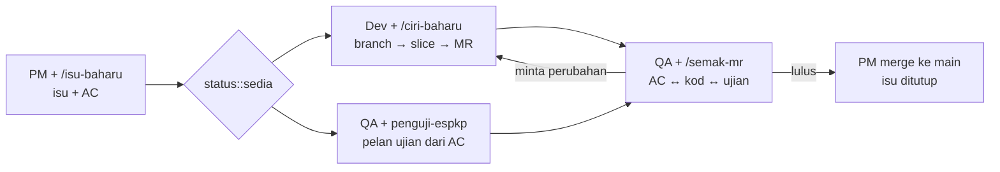
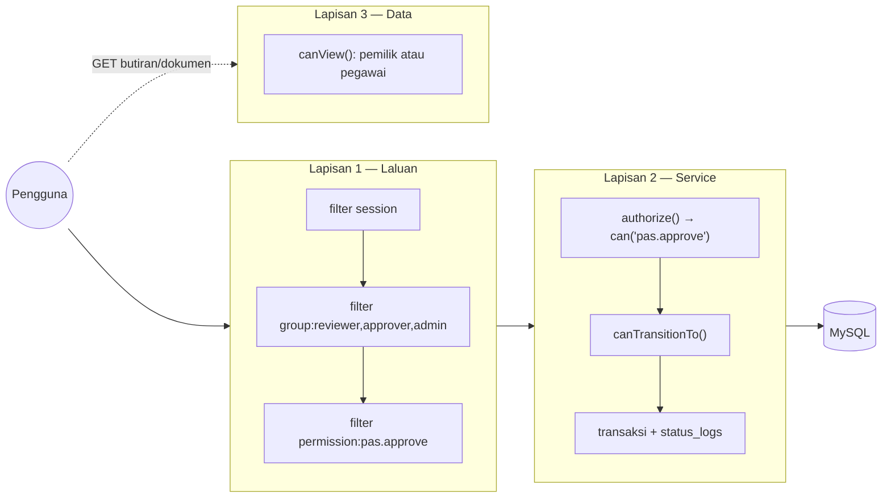
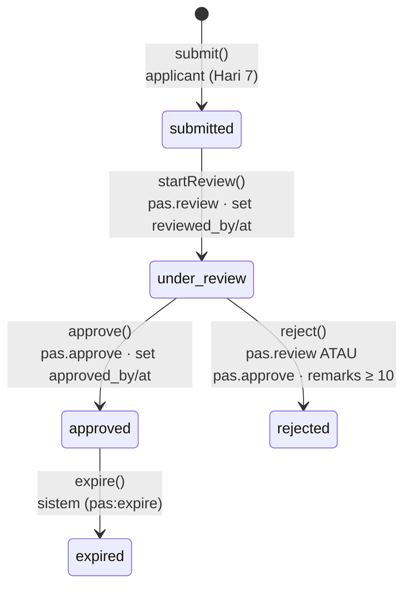
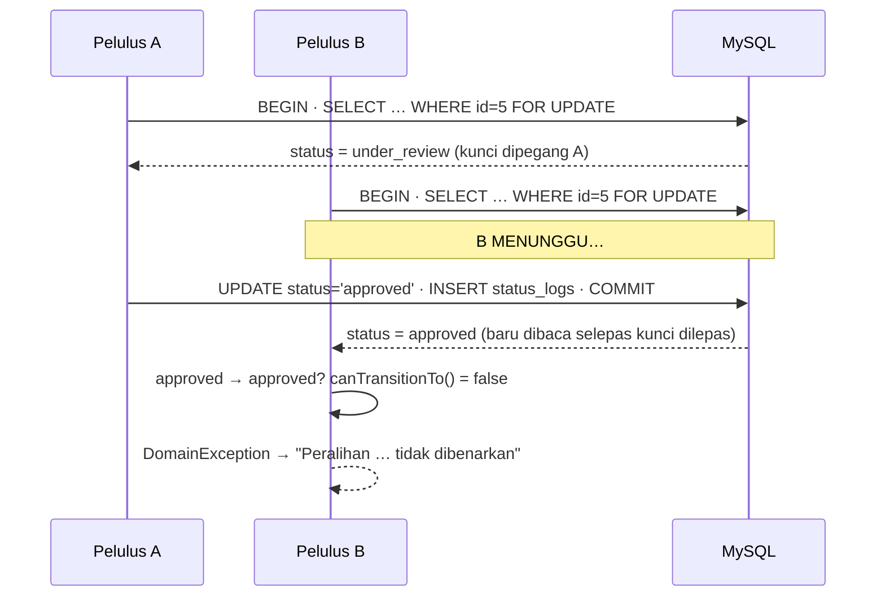

# Hari 8 — Kerja Pasukan dengan Claude Code: PM, QA & Dev dalam Satu Repo

[📅 Jadual](../JADUAL.md) · [👥 Peranan pasukan](../docs/peranan-pasukan.md) · [🤝 Kolaborasi](../docs/kolaborasi.md) · [🧪 Lab Hari 8](./lab.md)

> ⚠️ **Kemas kini 27/10: mulai S17 (14:30) kelas bertukar kepada 2 pasukan tetap hingga Hari 10.** **Projek** (4: PM, BA, 2 QA) memiliki keperluan, AC dan pengujian; **Dev** (9: 4 pasangan + floater) membangun. Agihan nama: isu #19. Backlog = isu sedia ada + jurang BRS (#20–#32). Peraturan: `docs/pasukan.md` dalam espkpv2 dan [`peranan-pasukan.md`](../docs/peranan-pasukan.md). Papan FigJam + Claude Code: [`tutorial-figma-mcp.md`](../docs/tutorial-figma-mcp.md).

> **Hari ini 12 orang bekerja dalam satu repo.** Mulai hari ini hingga Hari 10, kelas menjadi satu pasukan pembangunan dalam repo sebenar **eSPKP Contoh** (`aplikasi-baharu/espkpv2` di GitLab KKM): 3 skuad × 4 orang, setiap skuad ada **PM**, **QA** dan **2 Dev**, dan setiap peranan dibantu Claude Code. Isu GitLab → branch → MR → semakan QA → merge. Peranan bertukar selepas makan tengah hari.

---

## 🎯 Objektif Pembelajaran

Di akhir hari ini, peserta boleh:

| # | Objektif (boleh diukur) | Sesi | Bukti |
|---|------------------------|------|-------|
| O15 | **Menyediakan** espkpv2 pada Laragon (clone, `.env`, migrate + seed, `composer test`) dan **membuktikan** Claude Code memuatkan agent, skill dan MCP yang dikongsi | S15 | `/agents` menunjukkan `semak-espkp`; `/isu-baharu` dalam menu `/`; `claude mcp list` → `ci4-spark` ✔ |
| O16 | **Menulis** isu GitLab dengan cerita pengguna dan kriteria penerimaan Diberi/Apabila/Maka yang boleh diuji, dibantu skill `/isu-baharu` (peranan PM) | S16 | Isu skuad `status::sedia` dengan ≥ 3 AC termasuk AC akses 404 |
| O17 | **Melaksanakan** satu isu sebagai slice di branch `feat/<isu>-…` dengan mod *Plan* dan `/ciri-baharu`, dan **membuka** MR dengan `Closes #N` (peranan Dev) | S16–S17 | MR draf dengan commit `Rujuk #N`, `composer semak` hijau |
| O18 | **Menyemak** MR terhadap AC dengan `/semak-mr` dan `penguji-espkp`, dan **menulis** komen semakan berasaskan bukti `fail:baris` (peranan QA) | S17 | Komen semakan dalam MR: jadual AC + keputusan |
| O19 | **Menyelesaikan** konflik merge pada fail dikongsi tanpa membuang kerja skuad lain, dan **mendemokan** hasil sprint | S18 | MR di-merge ke `main`, isu ditutup, demo 2 minit |

> ℹ️ Objektif O1–O14 (Modul Pas individu) kekal sebagai rujukan dalam [Lampiran](#lampiran--kerja-individu-modul-pas-rujukan).

---

## 📅 Jadual Hari Ini

| Masa | Sesi | Aktiviti | Objektif sesi |
|------|------|----------|---------------|
| 08:30–09:00 | — | Recap Hari 7, pembentukan skuad & kad peranan | — |
| 09:00–10:30 | S15 | Persediaan pasukan: espkpv2 pada Laragon, Claude Code dikongsi, papan isu | O15 · [Lab 8.20](./lab.md#lab-820--persediaan-pasukan-espkpv2-claude-code--papan-isu-s15) |
| 10:30–10:45 | — | Rehat pagi | — |
| 10:45–12:30 | S16 | Sprint 1 (pagi): PM tulis isu, QA rancang ujian, Dev rancang & mula slice | O16, O17 · [Lab 8.21](./lab.md#lab-821--sprint-1-pagi-isu-pelan-ujian--slice-pertama-s16) |
| 12:30–14:30 | — | Makan tengah hari · **tukar peranan** | — |
| 14:30–16:00 | S17 | Sprint 1 (petang): Dev siapkan MR, QA semak MR, PM urus papan | O17, O18 · [Lab 8.22](./lab.md#lab-822--sprint-1-petang-mr-semakan-qa--papan-s17) |
| 16:00–17:00 | S18 | Merge, latihan konflik, demo skuad & retro | O19 · [Lab 8.23](./lab.md#lab-823--merge-konflik-demo--retro-s18) |

**Skuad dan isu Sprint 1** (milestone *Sprint 1 (Hari 8)*, papan *Papan pasukan*):

| Skuad | Kawasan & hotspot | Isu Sprint 1 |
|---|---|---|
| A — Aliran | `Config/Aliran.php`, `AliranKerja`, `DemoSeeder` | #1 Satu permohonan terbuka bagi setiap orang |
| B — Akaun & Keselamatan | `Config/Auth*`, `Security`, `Filters` | #10 CSRF `tokenRandomize`, #12 Bersihkan konfigurasi Auth |
| C — Laporan & Statistik | `Config/Laporan.php`, `Services/Laporan/*` | #16 RPT-10 Kadar keputusan ikut jenis & fasiliti |

> ℹ️ **Jurulatih = pemilik sistem.** Soalan terbuka dalam isu (cth "status 14 dikira Tidak Lulus?") dijawab jurulatih sebagai komen isu — bukan diteka oleh PM atau Claude.

---

## 🧭 Kenapa hari ini penting

Di KKM, sistem tidak dibina oleh seorang. Pasukan eSPKP sebenar ada pemilik produk, penguji dan beberapa pembangun yang menyentuh repo yang sama setiap hari. Masalahnya jarang pada sintaks; masalahnya pada **koordinasi**: keperluan kabur, dua orang mengubah fail yang sama, ujian ditulis selepas pepijat sampai ke pengguna, MR diluluskan tanpa dibaca.

Claude Code membantu setiap peranan — tetapi juga boleh mempercepat kekacauan: 12 orang × AI yang menulis kod pantas = 12 kali ganda diff untuk disemak. Hari ini anda belajar membahagikan kerja supaya AI mempercepat **peranan**, bukan memintasnya:



Tiga peraturan pasukan ([`peranan-pasukan.md`](../docs/peranan-pasukan.md)):

1. **Satu isu → satu branch → satu MR**, dan tiada siapa meluluskan MR sendiri.
2. **Hotspot ada pemilik.** Hanya skuad pemilik mengubah `Aliran.php`, `Auth*.php` atau `Laporan.php`; fail dikongsi (`Routes.php`, `Menu.php`) diubah dalam blok kawasan sendiri sahaja.
3. **AI mendraf, manusia memutuskan.** PM memutuskan skop, QA memutuskan lulus, Dev memutuskan setiap baris yang di-commit.

---

## S15 — Persediaan Pasukan: espkpv2, Claude Code Dikongsi & Papan Isu (09:00–10:30)

Repo pasukan ialah **espkpv2** — aplikasi eSPKP Contoh lengkap yang anda kaji pada Hari 7 (Lab 7.12). Ia sudah membawa konfigurasi Claude Code yang dikongsi, jadi setiap ahli pasukan mendapat agent, skill, hook dan MCP yang **sama** sebaik sahaja clone:

| Fail | Apa | Peranan utama |
|---|---|---|
| `CLAUDE.md` | Peraturan repo: seni bina, UUID, 404 bukan 403, CSP, kolaborasi | Semua |
| `.claude/skills/isu-baharu` | Idea / isu stub → isu dengan AC dan hotspot | PM |
| `.claude/skills/ciri-baharu` | Pelan slice ikut lapisan repo | Dev |
| `.claude/skills/aliran-kerja`, `migration-espkp` | Ubah `Aliran.php` / migration dengan selamat | Dev |
| `.claude/skills/semak-mr` | MR ↔ AC ↔ ujian, draf komen semakan | QA |
| `.claude/agents/semak-espkp` | Penyemak kod baca sahaja | Dev, QA |
| `.claude/agents/penguji-espkp` | Pencari jurang ujian | QA, Dev |
| `.claude/settings.json` + hooks | Sekat `.env`, `php -l` selepas edit, mod auto/bypass dimatikan | Semua |
| `.mcp.json` → `ci4-spark` | `routes`, `filter_check`, `db_table`, `migrate_status` (baca sahaja) | Dev, QA |

Konfigurasi dikongsi bermaksud **peraturan yang sama untuk semua**: jika skill `semak-mr` diperbaiki, ia diperbaiki melalui MR seperti kod lain.

### Kad peranan

| | PM | QA | Dev |
|---|---|---|---|
| Hasil | Isu `status::sedia` dengan AC | Pelan ujian + komen semakan MR | Branch, slice, ujian, MR |
| Claude Code | `/isu-baharu`, `glab issue view` | `/semak-mr`, `penguji-espkp` | Mod *Plan*, `/ciri-baharu`, `semak-espkp` |
| Tidak boleh | Tulis kod | Approve tanpa bukti | Push ke `main`, mod auto, satu prompt untuk seluruh ciri |

Dua Dev dalam satu isu bekerja **berpasangan**: seorang *pemandu* (memegang Claude Code dan papan kekunci), seorang *navigator* (membaca setiap diff, menjalankan ujian). Tukar selepas setiap slice. Satu branch, satu terminal Claude, tiada konflik.

### ✅ Checkpoint S15
- `composer test` hijau pada mesin anda (database ujian `espkp_contoh_test`).
- Log masuk demo tempatan sebagai `900101010006`; papan pemuka dipaparkan.
- Claude Code: `semak-espkp` dalam `/agents`, `/isu-baharu` dan `/semak-mr` dalam menu `/`, `ci4-spark` ✔.
- Anda tahu skuad, nombor tempat dan peranan pagi anda.

---

## S16 — Sprint 1 (Pagi): Isu, Pelan Ujian & Slice Pertama (10:45–12:30)

Tiga peranan bermula **serentak** pada isu yang sama:

| Minit | PM | QA | Dev (pasangan) |
|---|---|---|---|
| 0–20 | `/isu-baharu <no>` → semak AC → kemas kini isu → `status::sedia` | Baca isu; senaraikan kes ujian daripada setiap AC | Mod *Plan*: fahami kod yang disentuh isu (`fail:baris`), tanya soalan dalam komen isu |
| 20–60 | Jawab soalan Dev; bawa soalan pemilik sistem kepada jurulatih; label `status::disekat` jika perlu | `penguji-espkp`: ujian sedia ada vs AC; tulis **ujian gagal** dahulu untuk 1–2 AC | `/ciri-baharu <no>` → edit pelan → branch `feat/<no>-<ringkas>` → slice 1 |
| 60–105 | Pantau papan; selaras hotspot dengan PM skuad lain | Kongsi ujian kepada Dev (commit dalam branch yang sama, slice berasingan) | Slice 1 → `composer semak` → `semak-espkp` → commit `Rujuk #N` |

**Isu bersaiz L** (cth #1 mempunyai 6 AC): PM memecahkannya. Sprint 1 mesti menyiapkan sekurang-kurangnya AC teras (cth #1 AC-1 + AC-3) dengan ujian; selebihnya menjadi isu susulan untuk Sprint 2.

**Mengapa QA menulis ujian dahulu?** AC ialah kontrak. Jika QA menulis ujian daripada AC **sebelum** melihat kod Dev, ujian menguji keperluan — bukan menyalin apa yang kod kebetulan buat. Claude yang membantu Dev dan Claude yang membantu QA tidak berkongsi konteks: dua pandangan bebas.

### ✅ Checkpoint S16
- Isu skuad `status::sedia`, AC boleh diuji, hotspot dinyatakan.
- Branch `feat/<no>-…` wujud di GitLab KKM dengan sekurang-kurangnya 1 commit `Rujuk #N`.
- QA mempunyai senarai kes ujian dalam komen isu, dan sekurang-kurangnya 1 ujian yang gagal dengan sebab yang betul.

---

## S17 — Sprint 1 (Petang): MR, Semakan QA & Papan (14:30–16:00)

**Mulai sesi ini: 2 pasukan tetap** — nama dalam isu #19. **Projek** (4): PM, BA, 2 QA. **Dev** (9): pasangan 1 (#1), 2 (#10, #12), 3 (#16), 4 (#20 selepas AC) dan floater. Penyerahan berlaku **dalam isu**: pemilik isu pagi menulis komen "Serah tugas" (branch, apa siap, seterusnya) sebelum 14:30. Label `pasukan::projek|dev` menunjukkan siapa bertindak; `pasangan::N` menunjukkan pasangan Dev.

Aliran MR:

1. **Dev:** slice seterusnya → `composer semak` → `semak-espkp` → push → MR draf (`glab mr create --draft`, templat *Default*, `Closes #N`) → isi senarai semak dan "Tiga baris utama" → *Mark as ready* → `status::semakan`.
2. **QA:** `/semak-mr <no-MR>` → buka setiap `fail:baris` yang dirujuk → cuba 3 langkah ujian manual di pelayar → komen semakan → **approve** atau **minta perubahan** (`status::dalam-kerja`).
3. **BA:** isu BRS seterusnya (#20, kemudian #21–#26) → `/isu-baharu <no>` → AC → serah kepada QA untuk pelan ujian. Lakar perubahan skema di FigJam (lorong *Cadangan ERD*, subagent `papan-figjam`).
4. **PM:** pastikan setiap isu dalam lajur dan label `pasukan::` yang betul, selesaikan `status::disekat` (#33 soalan pemilik sistem), tetapkan susunan merge bersama floater.

Komen QA yang baik adalah khusus dan boleh disahkan:

| Lemah | Baik |
|---|---|
| "Nampak ok 👍" | "AC-3 dipenuhi: `PermohonanService.php:88` + `SatuPermohonanTest::testPindaanDikiraTerbuka`. AC-4 tiada ujian serentak — minta perubahan." |
| "Kod ini salah" | "`LaporanRpt10.php:41` `GROUP BY j.nama` tanpa `j.kod` — gagal `ONLY_FULL_GROUP_BY` di CI. Cadangan: tambah `j.kod` dalam `GROUP BY`." |

### ✅ Checkpoint S17
- Setiap pasangan Dev mempunyai MR `Ready` dengan `Closes #N` dan senarai semak diisi.
- Setiap MR mempunyai komen semakan QA dengan jadual AC.
- Papan: setiap isu Sprint 1 ada label `status::` dan `pasukan::`; BA telah menyiapkan AC #20.

---

## S18 — Merge, Latihan Konflik, Demo & Retro (16:00–17:00)

**Susunan merge** ditetapkan PM bersama floater: MR yang menyentuh lebih sedikit fail dikongsi di-merge dahulu. Selepas setiap merge, MR lain **rebase**:

```bash
git fetch origin
git rebase origin/main
composer semak
git push --force-with-lease
```

**Latihan konflik (10 minit):** dua pasangan menambah route dalam `app/Config/Routes.php` pada tempat yang berdekatan. Selepas pasangan pertama merge, pasangan kedua mendapat konflik semasa rebase. Selesaikan dengan:

1. `git status` → fail berkonflik.
2. Minta Claude: `Terangkan konflik dalam app/Config/Routes.php: apa yang ditambah setiap pihak? Jangan selesaikan.`
3. **Dev memilih**: simpan kedua-dua blok (modul masing-masing), buang penanda `<<<<<<<`/`=======`/`>>>>>>>`.
4. `php spark routes` (atau tool `ci4-spark` `routes`) → kedua-dua route wujud → `composer semak` → `git rebase --continue`.

**Demo (2 minit setiap pasangan):** BA menunjukkan isu dan AC, Dev menunjukkan ciri dalam pelayar, QA menunjukkan ujian yang membuktikan AC. **Retro (10 minit):** satu perkara yang berjalan baik, satu yang perlu diubah esok, satu peraturan prompt untuk esok — setiap orang satu sticky dalam seksyen *Retro* papan FigJam (tulis pasukan anda), PM salin ringkasan ke isu retro.

### ✅ Checkpoint S18
- Sekurang-kurangnya satu MR setiap pasangan di-merge ke `main`; isu berkaitan ditutup automatik oleh `Closes #N`.
- `main` boleh di-clone dan `composer test` hijau.
- Isu retro Sprint 1 dengan 3 perkara daripada setiap pasukan.

---
## 🤖 Prompting hari ini

Setiap peranan mempunyai prompt sendiri. Prompt penuh: [`pustaka-prompt.md`](../docs/pustaka-prompt.md) §H. Peraturan sama untuk semua: mod *Plan* dahulu, mod *Manual* untuk perubahan, baca setiap diff, data sintetik sahaja.

| Peranan | Prompt & ciri Claude Code | Sahkan sendiri | Lab |
|---|---|---|---|
| Semua · persediaan | `Terangkan .claude/settings.json, .mcp.json dan senarai skill repo ini: apa yang dibenarkan, apa yang disekat, dan kenapa.` (mod *Plan*) | Cuba `Read .env` → disekat oleh hook | 8.20 |
| PM · tulis isu | `/isu-baharu 16` → semak jadual kualiti → `Pecahkan isu ini kepada isu bersaiz ≤ M, setiap satu dengan AC sendiri.` (jika L) | Setiap AC boleh dicuba dengan akaun `9001010100NN`; soalan pemilik → jurulatih | 8.21 |
| QA · pelan ujian | `Guna subagent penguji-espkp: untuk setiap AC isu #N, ujian sedia ada yang meliputinya (fail:baris) dan kes yang tiada.` → `Tulis ujian PHPUnit gagal untuk AC-1 sahaja, ikut UjianCiri dan BinaPermohonan.` | Ujian gagal dengan mesej yang betul, bukan ralat sintaks | 8.21 |
| Dev · rancang | Mod *Plan*: `/ciri-baharu 1 satu permohonan terbuka` → `Laksana slice 1 pelan ini sahaja. Berhenti selepas slice 1.` | Baca setiap diff; `composer semak`; `Guna subagent semak-espkp pada diff slice ini` | 8.21–8.22 |
| QA · semak MR | `/semak-mr 3` → `Untuk dapatan 2, tunjukkan baris kod dan ujian yang membuktikannya.` | Buka setiap `fail:baris`; cuba langkah ujian manual di pelayar | 8.22 |
| PM · papan | `glab issue list --milestone "Sprint 1 (Hari 8)" --label pasukan::dev` → `Ringkaskan status isu ini dan apa yang menyekat, satu baris setiap isu.` | Bandingkan dengan papan di GitLab KKM | 8.22 |
| BA / Dev · papan FigJam | `Guna subagent papan-figjam. Isu #25: salin kad profil_pengguna ke lorong "Cadangan (Dev / BA)" dan tambah lajur telefon_bimbit berwarna kuning.` ([tutorial](../docs/tutorial-figma-mcp.md)) | Buka papan; perubahan hanya dalam lorong cadangan | 8.22 |
| Dev · konflik | `Terangkan konflik dalam app/Config/Routes.php: apa yang ditambah setiap pihak? Jangan selesaikan.` | Dev memilih baris; `php spark routes` | 8.23 |

---

## 📦 Hasil Hari Ini

**Kerja pasukan (hari ini):**

- [ ] espkpv2 berjalan pada Laragon; `composer test` hijau; Claude Code memuatkan `semak-espkp`, `/isu-baharu`, `/semak-mr` dan `ci4-spark`
- [ ] Isu Sprint 1 skuad `status::sedia` dengan AC Diberi/Apabila/Maka (termasuk AC akses 404)
- [ ] Branch `feat/<no>-…` dengan commit `Rujuk #N` dan MR `Closes #N` dengan senarai semak diisi
- [ ] Komen semakan QA (jadual AC ↔ kod ↔ ujian) pada setiap MR skuad
- [ ] Sekurang-kurangnya satu MR skuad di-merge ke `main` espkpv2; isu ditutup
- [ ] Isu retro skuad

**Kerja individu Modul Pas (rujukan, tidak wajib — [Lampiran](#lampiran--kerja-individu-modul-pas-rujukan)):**

- [ ] `PassWorkflowService`: `startReview`, `approve`, `reject`, `expire`, `history`, `transition`, `authorize`
- [ ] `app/Controllers/Pas/ReviewController.php` (`index`, `review`, `approve`, `reject`)
- [ ] `app/Config/AuthGroups.php` tepat SPEC §4
- [ ] Route `pas/semakan` + `permission:` per tindakan; `permission:pas.apply` untuk mohon
- [ ] `app/Views/pas/semakan/index.php`, `app/Views/errors/forbidden.php`, `app/Views/partials/status_timeline.php`; `pas/show.php` dengan panel tindakan + garis masa
- [ ] `tests/feature/Pas/PassAccessTest.php` — 13 ujian hijau
- [ ] Demo 3 peranan lulus; branch `feat/pas-kelulusan` digabung ke `main` — **M2 siap**
- [ ] ⭐ `app/Commands/ExpirePassesCommand.php`
- [ ] `ReviewController::reviewBatch()` + route `pas/semakan/pukal/review` dengan `permission:pas.review`; view baris gilir dengan checkbox (Lab 8.1b–8.2b)
- [ ] `docs/ujian-manual-pas.md` — UT-PAS-27..30 + jadual mutasi (Lab 8.2b–8.3b)
- [ ] `tests/feature/Pas/PassBatchReviewTest.php` — 5 ujian hijau (Lab 8.3b)
- [ ] `docs/demo-m2.md` — babak `admin` + dapatan pemisahan tugas, digabung ke `main` (Lab 8.4b)

Rujukan penuh jurulatih: `templates/kod/` (modul **Templat & Rujukan**) — `PassWorkflowService`, `ReviewController`, `AuthGroups`, `Routes-pas`, `status-timeline-view`, `PassAccessTest`, `ExpirePassesCommand`. Nota topikal: [06 Shield auth & RBAC](../docs/nota-06-shield-auth-dan-rbac.md) · [05 Service & transaksi](../docs/nota-05-service-layer-dan-transaksi.md) · [10 Ujian PHPUnit](../docs/nota-10-ujian-phpunit-ci4.md).

---

## 🧠 Semakan Kendiri

1. Route `/pas/semakan` sudah ada `group:reviewer,approver,admin`. Kenapa `/pas/semakan/{id}/approve` masih memerlukan `permission:pas.approve`, **dan** `authorize()` dalam Service?

<details><summary>Jawapan</summary>

Filter group membenarkan `reviewer` masuk — tanpa filter permission, penyemak boleh POST ke `/approve`. `permission:pas.approve` menutup lubang itu di Lapisan 1. `authorize()` dalam Service ialah Lapisan 2: jika suatu hari route baharu (API, Spark command, controller lain) memanggil `approve()` tanpa filter yang betul, Service tetap menolak. Pertahanan berlapis bermaksud satu kesilapan konfigurasi tidak terus menjadi pelanggaran.
</details>

2. Pelulus A dan B menekan **Lulus** serentak pada permohonan yang sama. Terangkan apa yang berlaku dalam `transition()` langkah demi langkah.

<details><summary>Jawapan</summary>

A memperoleh kunci baris melalui `SELECT … FOR UPDATE`; B menunggu. A membaca `under_review`, `canTransitionTo(Approved)` benar, kemas kini + `status_logs`, commit — kunci dilepas. B kini membaca `approved`; `Approved->canTransitionTo(Approved)` palsu → `DomainException` → `transRollback()` → B melihat "Peralihan status … tidak dibenarkan." Hanya **satu** entri kelulusan dalam `status_logs`.
</details>

3. Kenapa kod kita menyemak `$user->can('pas.approve')` dan bukan `$user->inGroup('approver')`? Bilakah `inGroup()` masih sesuai?

<details><summary>Jawapan</summary>

Permission memisahkan **keupayaan** daripada **peranan**. Admin (melalui `pas.*`) boleh meluluskan tanpa kod tambahan; jika pemilik sistem mengubah siapa boleh meluluskan, hanya `$matrix` berubah. `inGroup()` sesuai apabila peraturan itu sendiri ditakrifkan dalam bentuk group — cth BR-PAS-04 "`reviewer`/`approver`/`admin` lihat semua" dalam `canView()`, atau filter `group:` SPEC §6.
</details>

4. `testPenyemakTidakBolehLuluskan` hanya menyemak `assertRedirect()`. Apakah pepijat yang mungkin terlepas, dan bagaimana membaikinya?

<details><summary>Jawapan</summary>

Jika controller/Service telah **mengubah status** sebelum redirect (cth `update()` dipanggil dahulu, kebenaran disemak kemudian), respons tetap redirect dan ujian lulus — padahal data sudah rosak. Tambah `assertStatusIs($id, PassStatus::UnderReview)` (`seeInDatabase`) dan `dontSeeInDatabase('status_logs', [... 'to_status' => 'approved'])`.
</details>

5. Kenapa `pas:expire` memanggil `PassWorkflowService::expire()` dan bukan terus `UPDATE pass_applications SET status='expired' WHERE …`?

<details><summary>Jawapan</summary>

Satu `UPDATE` pukal akan memintas BR-PAS-01 (boleh menukar `rejected` kepada `expired` jika `WHERE` tersilap) dan BR-PAS-05 (tiada entri `status_logs`). Melalui Service, setiap pas melalui `transition()`: dikunci, disemak `canTransitionTo()`, dikemas kini, dan direkod dengan actor — konsisten dengan setiap peralihan lain.
</details>

6. Dev menggunakan Claude Code untuk menulis kod, QA juga menggunakan Claude Code untuk menyemak. Kenapa ini masih lebih baik daripada Dev meminta Claude menyemak kodnya sendiri?

<details><summary>Jawapan</summary>

Sesi QA tidak berkongsi konteks dengan sesi Dev: ia bermula daripada **AC isu**, bukan daripada niat Dev, jadi ia mencari jurang antara keperluan dan kod. Sesi yang menulis kod cenderung mengesahkan andaiannya sendiri. Lebih penting, keputusan lulus dibuat oleh **manusia QA** berdasarkan bukti `fail:baris` dan ujian — Claude hanya mengumpul bukti.
</details>

7. Skuad B perlu menambah satu kebenaran baharu dalam `app/Config/AuthGroups.php`, tetapi isu mereka juga memerlukan satu baris dalam `app/Config/Aliran.php` (hotspot skuad A). Apa yang patut mereka lakukan?

<details><summary>Jawapan</summary>

Jangan ubah `Aliran.php` sendiri. PM skuad B membuka isu (atau komen pada isu berkaitan) kepada PM skuad A dengan perubahan yang diperlukan dan sebabnya; skuad A melaksanakannya dalam MR mereka, atau kedua-dua PM bersetuju satu MR dengan penyemak daripada skuad A. Ini mengelakkan dua MR mengubah baris yang sama dan memastikan pemilik `Aliran.php` memahami setiap peralihan.
</details>

8. Selepas rebase, `composer semak` hijau di mesin anda tetapi pipeline MR merah pada `ujian`. Sebutkan dua punca yang mungkin dalam repo ini.

<details><summary>Jawapan</summary>

(1) CI menggunakan MySQL 8.4 dengan `sql_mode` ketat (`ONLY_FULL_GROUP_BY`) — query laporan yang lulus di MySQL/MariaDB tempatan yang longgar boleh gagal di CI. (2) Migration atau seeder bergantung pada data dalam database tempatan anda (cth anda pernah menjalankan `db:seed`), sedangkan `UjianPangkalanData` membina skema baharu untuk setiap ujian. Punca lain: versi migration bertembung dengan migration skuad lain selepas rebase.
</details>

---

## ➡️ Persediaan untuk esok

Hari 9 — **Sprint 2**: isu skuad seterusnya (milestone *Sprint 2 (Hari 9)*), dengan peranan bertukar sekali lagi (tempat 3 menjadi PM pagi).

- Tarik `main` terkini: `git switch main && git pull`, kemudian `composer install` dan `php spark migrate --all` jika ada migration baharu.
- PM esok: baca isu Sprint 2 skuad anda (`glab issue list --milestone "Sprint 2 (Hari 9)" --label skuad::<x>`) dan senaraikan soalan untuk pemilik sistem.
- Isu susulan daripada Sprint 1 (AC yang belum siap) mesti ada dalam backlog dengan label `skuad::` dan milestone Sprint 2.
- Soalan untuk difikirkan: *Isu Sprint 2 skuad anda menyentuh fail dikongsi yang mana — dan dengan skuad mana anda perlu berbincang sebelum bermula?*

---

## Lampiran — Kerja individu Modul Pas (rujukan)

> ℹ️ Bahagian di bawah ialah bahan Hari 8 sebelum mod pasukan: Modul Pas dibina secara individu dalam `kelas-ci-<nama>` (sesi Claude Code S9–S12 dan sesi manual S1–S8). Ia kekal sebagai **rujukan, tidak wajib** — corak `transition()`, RBAC berlapis dan ujian akses yang sama digunakan dalam espkpv2.

### Objektif rujukan (O1–O14)

Di akhir hari ini, peserta boleh:

| # | Objektif (boleh diukur) | Sesi | Bukti |
|---|------------------------|------|-------|
| O1 | **Melaksanakan** `PassWorkflowService` (`startReview`, `approve`, `reject`) yang menguatkuasa BR-PAS-01 melalui `PassStatus::canTransitionTo()` dalam transaksi berkunci `FOR UPDATE`, menetapkan `reviewed_by/at` & `approved_by/at`, dan merekod `status_logs` | S1 | Permohonan bergerak `submitted → under_review → approved`; 3 baris `status_logs` |
| O2 | **Menguatkuasa** BR-PAS-03: penolakan tanpa catatan ≥ 10 aksara ditolak di borang **dan** di Service | S1 | Tolak dengan "tak ok" → status tidak berubah |
| O3 | **Mengkonfigur** `Config\AuthGroups` (groups, permissions, `$matrix`) tepat SPEC §4 dan filter route `group:` / `permission:` | S2 | `php spark routes` menunjukkan filter gabungan pada `/pas/semakan/(:num)/approve` |
| O4 | **Menerangkan** perbezaan pengesahan (authentication) vs kebenaran (authorization) dan **membina** tiga lapisan pertahanan: filter route → `authorize()` dalam Service → semakan pemilikan | S2 | Penyemak POST ke `/approve` → ditolak; memanggil Service terus → `PermissionException` |
| O5 | **Memaparkan** garis masa sejarah status dari `status_logs` (siapa, bila, dari→ke, catatan) | S3 | Halaman butiran menunjukkan 3 entri berbadge |
| O6 | **Menulis** ujian feature positif & negatif bagi setiap peranan (pemohon tidak boleh lulus, penyemak tidak boleh lulus, pelulus boleh) dan **mendemokan** aliran penuh 3 peranan | S3–S4 | `PassAccessTest` ≥ 13 ujian hijau; demo 5 minit lulus DoD |
| O7 | **Membina** tindakan pukal *Mula Semakan* yang memanggil `startReview()` bagi setiap permohonan, dengan kegagalan BR-PAS-01 dilaporkan tanpa menghentikan yang lain | S5 | [Lab 8.1b](./lab.md#lab-81b--mula-semakan-pukal-dari-baris-gilir-s5); flash hijau + merah, satu baris `status_logs` bagi setiap permohonan |
| O8 | **Menguatkuasa** `permission:pas.review` pada route pukal dan **membuktikan** dua lapisan dengan serangan `fetch()` dari Console untuk 4 peranan | S6 | [Lab 8.2b](./lab.md#lab-82b--lindungi-route-pukal-filter-permission--matriks-peranan-s6); UT-PAS-27..30 dalam `docs/ujian-manual-pas.md` |
| O9 | **Menulis** `PassBatchReviewTest` (5 ujian: flash, kegagalan separa, negatif respons + DB) dan **membuktikannya** dengan 2 mutasi | S7 | [Lab 8.3b](./lab.md#lab-83b--ujian-fungsian-tindakan-pukal-s7); `OK (5 tests, …)` + jadual mutasi |
| O10 | **Mendemokan** peranan `admin` (mohon → semak pukal → lulus sendiri) dan **merekod** dapatan pemisahan tugas untuk pemilik sistem | S8 | [Lab 8.4b](./lab.md#lab-84b--demo-peranan-keempat-admin--dapatan-pemisahan-tugas-s8); `docs/demo-m2.md` di `main` |
| O11 | **Membina** aliran kelulusan (`startReview`/`approve`/`reject` melalui `transition()` dan `canTransitionTo()`) dengan Claude Code, dan **menolak** diff yang melanggar BR-PAS-01/03/05 | S9 | [Lab 8.10](./lab.md#lab-810--claude-code-aliran-kelulusan-pas-s9); pelan disunting + 3 baris diterangkan dalam `docs/nota-claude.md` |
| O12 | **Membuktikan** tiga lapisan akses (filter `permission:`, `authorize()`, `canView()`) dalam kod yang dijana Claude dengan `filter_check` MCP, `php spark filter:check` dan serangan DevTools | S10 | [Lab 8.11](./lab.md#lab-811--claude-code-rbac-shield--skop-akses-s10); redirect, 403 dan 404 pada peranan yang betul |
| O13 | **Menulis** matriks peranan × tindakan sendiri dan **menguji** `PassAccessTest` yang dijana Claude dengan 2 mutasi | S11 | [Lab 8.12](./lab.md#lab-812--claude-code-ujian-akses--sejarah-status-s11); setiap mutasi menggagalkan ujian |
| O14 | **Mendemokan** M2 dan **menerangkan** 3 baris rawak dari diff tanpa Claude sebelum merge | S12 | [Lab 8.13](./lab.md#lab-813--claude-code-demo-m2--semakan-akhir-s12); MR `feat/pas-claude` di-merge |

### Kenapa Modul Pas penting (rujukan)

Sistem kelulusan kerajaan hidup atau mati pada tiga soalan audit:

1. **Siapa yang meluluskan ini?** → `approved_by`, `status_logs.actor_id`
2. **Adakah dia berhak?** → Shield groups/permissions + semakan di server
3. **Bolehkah ia berlaku dua kali, atau langkau peringkat?** → `canTransitionTo()` + transaksi berkunci

Jika mana-mana satu gagal, laporan audit akan menandakan sistem sebagai **tidak boleh dipercayai** — walaupun antara mukanya cantik. Hari ini kita menutup ketiga-tiga lubang, dan membina **ujian automatik** yang akan menjerit jika seseorang membukanya semula enam bulan akan datang.



### Prompting rujukan (kerja individu)

Setiap slice: rancang dalam mod *Plan* (`Shift+Tab` / `Alt+M`), kemudian Claude Code melaksana dalam mod *Manual* — anda membaca dan meluluskan setiap diff, menjalankan ujian, `semak-ci4`, dan mesti boleh menerangkan setiap baris yang di-commit (7 pintu semakan, [`kolaborasi.md`](../docs/kolaborasi.md) §3). Prompt penuh: [`pustaka-prompt.md`](../docs/pustaka-prompt.md). Rekod jawapan yang anda sahkan dalam `docs/nota-claude.md`.

| Sesi | Prompt & ciri Claude Code | Sahkan sendiri | Lab |
|---|---|---|---|
| S9 · Slice 3: aliran kelulusan | Pelan slice (mod *Plan*, tiada kod) → AI-19 (laksana langkah 1 pelan sahaja, mod Manual) → AI-20 untuk diff `transition()` → subagent `semak-ci4` pada `PassWorkflowService` | Permohonan A `approved` dengan 3 baris `status_logs`; `!composer test` | 8.10 |
| S10 · Slice 4: RBAC & skop | Tool MCP `ci4-spark` `filter_check` sebelum pelan → pelan RBAC (SPEC §4) → AI-19 → AI-20 → `semak-ci4` pada `AuthGroups.php` dan `Routes.php` | `php spark filter:check POST /pas/semakan/1/approve`; `pemohon2` → 404 | 8.11 |
| S11 · Slice 5: ujian akses | Pelan daripada matriks anda → AI-19 untuk ujian; AI-09 untuk sel matriks; AI-10 untuk pepijat yang tidak ditangkap; `semak-ci4` pada garis masa | `!composer test -- tests/feature/Pas/PassAccessTest.php`; 2 mutasi menggagalkan ujian | 8.12 |
| S12 · Demo M2 | `semak-ci4` pada modul penuh → AI-08 (DoD, BR-PAS-01..06); AI-02 jika satu baris tidak dapat diterangkan | `git diff main...feat/pas-claude`: 3 baris rawak diterangkan tanpa Claude | 8.13 |
| S1 · Aliran kelulusan (kod rujukan) | AI-05 (BR-PAS-01/03/05) dengan `@app/Services/PassWorkflowService.php`; tanya di mana `FOR UPDATE` dan `status_logs` | Buka fail:baris; ulang ujian sesi kedua `pelulus` | 8.1 langkah 10 |
| S2 · RBAC Shield (kod rujukan) | AI-07 + tool MCP `ci4-spark` `routes` dan `filter_check` pada 3 route POST semakan | `php spark filter:check POST /pas/semakan/1/approve` | 8.2 langkah 10 |
| S3 · Ujian akses (kod rujukan) | AI-09: matriks peranan × tindakan dari `@tests/feature/Pas/PassAccessTest.php`; AI-10 untuk pepijat | `!composer test -- tests/feature/Pas` | 8.3 langkah 8 |
| S4 · Demo & M2 (kod rujukan) | Subagent `semak-ci4` pada modul Pas (`esc()`, CSRF, filter, pemilikan) | Buka setiap fail:baris; dapatan sahih → `FIX:` | 8.4 langkah 5 |
| S5–S8 · Lanjutan (kod rujukan) | AI-07 + `filter_check POST /pas/semakan/pukal/review`; AI-09 untuk `PassBatchReviewTest` | `!composer test -- tests/feature/Pas` | — |

---

## S9 — Claude Code: Aliran Kelulusan Pas (09:00–10:30)

Mulai hari ini, modul dibina **bersama Claude Code**: Claude menulis kod pelaksanaan, anda memandu dan meluluskan. Setiap slice melalui tujuh gerbang yang sama:

| # | Gerbang | Siapa | Bukti |
|---|---------|-------|-------|
| 1 | SPEC & BR | Anda | ID BR dan bahagian SPEC dalam `docs/nota-claude.md` |
| 2 | Pelan slice (mod Plan, tiada kod) | Claude mencadang, anda menyunting | Pelan akhir dalam `docs/nota-claude.md` |
| 3 | Laksana (mod Manual) | Claude menulis, anda membaca **setiap** diff | Yes/No pada setiap `Edit`; *accept edits*/*auto*/*bypass* dilarang |
| 4 | Sahkan | Anda | `composer test`, pelayar, tool MCP `ci4-spark` `routes`/`filter_check`/`db_table` |
| 5 | Semakan `semak-ci4` | Subagent, kemudian anda | Dapatan sahih dibaiki melalui gerbang 3 |
| 6 | Gerbang terang | Anda | 3 baris utama dengan ayat sendiri dalam `docs/nota-claude.md` |
| 7 | Commit kecil | Anda | Satu commit di `feat/pas-claude` |

Slice 3 ialah aliran kelulusan. Kandungan teknikal sama seperti S1 di bawah (§1.1–§1.4): satu `transition()` berkunci `FOR UPDATE`, `PassStatus::canTransitionTo()` (BR-PAS-01), catatan wajib ≥ 10 aksara (BR-PAS-03), dan `status_logs` dalam transaksi yang sama (BR-PAS-05). Bezanya, tugas anda kini ialah **menilai** kod, bukan menaipnya:

| Dalam diff Claude, cari | Tolak jika anda nampak |
|-------------------------|------------------------|
| `SELECT … FOR UPDATE` selepas `transBegin()` | `canTransitionTo()` disemak sebelum transaksi |
| `canTransitionTo()` membaling `DomainException` | `status` diambil dari `getPost()` |
| `record()` dalam `try` yang sama, sebelum `transCommit()` | `record()` selepas commit atau dalam controller |
| `approved_by/at` dalam `approve()` sahaja | `approved_at` ditetapkan semasa `reject()` |

Lab: [Lab 8.10](./lab.md#lab-810--claude-code-aliran-kelulusan-pas-s9)

### 🎯 Kuiz S9

> Jawab selepas Lab 8.10 — jawapan datang daripada diff dan pelan sebenar anda. Lulus kuiz ini menanda checkpoint Lab 8.10.

1. Claude mencadangkan diff ini dalam `ReviewController::approve()`: `$model->update($id, ['status' => $this->request->getPost('status')]);`. Apakah tindakan anda di gerbang diff?
   - [ ] Terima, kerana route sudah dilindungi filter `group:reviewer,approver,admin`
   - [x] Tolak: status datang dari input pengguna dan memintas `transition()`, jadi `canTransitionTo()` dan `status_logs` tidak berjalan
   - [ ] Terima, kemudian tambah ujian untuk menyemak status selepas itu
   - [ ] Tolak hanya kerana kod itu menggunakan sintaks CI3
   > Filter route menyemak **siapa**, bukan **apa**. Status mesti datang dari enum dalam service melalui satu pintu `transition()`. Ini bukan sintaks CI3 — ia CI4 yang sah tetapi tidak selamat.

2. Apakah susunan yang betul dalam `transition()` yang dijana Claude?
   - [ ] `canTransitionTo()` → `transBegin()` → `update()` → `transCommit()` → `record()`
   - [ ] `update()` → `record()` → `canTransitionTo()` → `transCommit()`
   - [x] `transBegin()` → `SELECT … FOR UPDATE` → `canTransitionTo()` → `update()` → `record()` → `transCommit()`
   - [ ] `transBegin()` → `update()` → `transCommit()` → `SELECT … FOR UPDATE` → `record()`
   > Status mesti dibaca **selepas** kunci diperoleh (jika tidak, dua pelulus serentak sama-sama lulus), dan log mesti ditulis sebelum commit supaya tiada perubahan status tanpa log (BR-PAS-05).

---

## S10 — Claude Code: RBAC Shield & Skop Akses (10:45–12:30)

Slice 4 menutup tiga lapisan pertahanan dari S2 (§2.1–§2.5): **filter route** (`permission:` per tindakan), **`authorize()`** dalam service, dan **semakan pemilikan** `canView()` (BR-PAS-04). Claude menulis kod; anda membuktikan setiap lapisan dengan alat yang bukan Claude:

| Lapisan | Kod yang Claude tulis | Cara anda membuktikan |
|---------|-----------------------|-----------------------|
| 1 — filter route | `'filter' => 'permission:pas.approve'` pada `/approve` | Tool MCP `filter_check` **dan** `php spark filter:check` sendiri |
| 2 — service | `authorize()` → `$actor->can(...)` → `PermissionException` | Buang filter sementara → 403, kemudian pulihkan |
| 3 — pemilikan | `canView()` dalam `show()` dan muat turun dokumen | `pemohon2` buka URL `pemohon1` → 404 |

Dua perkara yang sering salah dalam kod AI: `inGroup('approver')` menggantikan `can('pas.approve')` (admin dengan `pas.*` disekat), dan 403 untuk bukan pemilik (membocorkan bahawa ID itu wujud). SPEC §4 ialah satu-satunya sumber `$matrix` — jika Claude mencadangkan permission yang tiada dalam SPEC, tolak.

Lab: [Lab 8.11](./lab.md#lab-811--claude-code-rbac-shield--skop-akses-s10)

### 🎯 Kuiz S10

> Jawab selepas Lab 8.11 — jawapan datang daripada output `filter_check` dan serangan anda. Lulus kuiz ini menanda checkpoint Lab 8.11.

1. Selepas Claude selesai, tool MCP `filter_check` untuk `POST /pas/semakan/1/approve` menunjukkan *Before Filters* `csrf` dan `group:reviewer,approver,admin` sahaja. Apakah maksudnya?
   - [ ] Betul — `group:` sudah cukup kerana `authorize()` ada dalam service
   - [ ] Tool MCP rosak; percaya diff Claude
   - [ ] `csrf` menggantikan keperluan `permission:`
   - [x] Lapisan 1 tiada: penyemak lepas filter ke controller, dan hanya `authorize()` menghalangnya — slice belum siap
   > Pertahanan berlapis bermaksud kedua-dua lapisan mesti wujud. Sahkan dengan `php spark filter:check` sendiri; kemudian minta Claude menambah `permission:pas.approve` melalui gerbang diff.

2. `pemohon2` membuka `/pas/permohonan/<id>` milik `pemohon1`. Apakah respons yang betul mengikut BR-PAS-04 dan pelan slice 4?
   - [x] 404, daripada semakan `canView()` di server
   - [ ] 200, tetapi butang tindakan disembunyikan
   - [ ] 403 — Akses Ditolak, supaya pemohon tahu dia tiada hak
   - [ ] Redirect ke `/` oleh filter Shield
   > Menyembunyikan butang ialah UX sahaja. 404 tidak mendedahkan bahawa ID itu wujud. Filter Shield tidak tahu pemilik rekod, jadi semakan ini mesti dalam controller/service.

---

## S11 — Claude Code: Ujian Akses & Sejarah Status (14:30–16:00)

Slice 5 menambah garis masa `status_logs` (§3.1) dan `PassAccessTest` (§3.2–§3.3). Claude boleh menulis ujian dengan cepat — dan itulah risikonya: ujian yang hijau tidak semestinya menguji apa-apa. Tiga peraturan untuk ujian yang dijana AI:

1. **Matriks dahulu, oleh anda.** Anda menulis jadual peranan × tindakan (hasil + keadaan DB) sebelum Claude menulis satu ujian pun. Ujian mesti sepadan dengan sel, bukan sebaliknya.
2. **Ujian negatif = respons + DB.** `assertRedirect()` sahaja terlepas pepijat "status sudah berubah sebelum redirect". Setiap ujian negatif juga menyemak `seeInDatabase` (status kekal) dan `dontSeeInDatabase('status_logs', …)`.
3. **Mutasi membuktikan.** Anda sendiri merosakkan kod (buang filter, `canView()` pulang `true`). Jika tiada ujian gagal, ujian itu belum menguji.

Garis masa juga diperiksa dari sudut keselamatan: `remarks` ialah input penyemak/pelulus yang dibaca pemohon, jadi setiap nilai dalam partial mesti melalui `esc()`.

Lab: [Lab 8.12](./lab.md#lab-812--claude-code-ujian-akses--sejarah-status-s11)

### 🎯 Kuiz S11

> Jawab selepas Lab 8.12 — jawapan datang daripada ujian dan mutasi sebenar anda. Lulus kuiz ini menanda checkpoint Lab 8.12.

1. Claude menjana `testPenyemakTidakBolehLuluskan` yang hanya memanggil `assertRedirect()`. Apakah yang anda minta ditambah?
   - [ ] `assertTrue(true)` supaya ujian tidak kosong
   - [x] `seeInDatabase` untuk status kekal `under_review` dan `dontSeeInDatabase` untuk tiada log `to_status = approved`
   - [ ] `markTestSkipped()` sehingga Lab 8.13
   - [ ] Tiada — redirect sudah membuktikan penyemak disekat
   > Jika service mengubah status sebelum semakan kebenaran, respons tetap redirect dan ujian lulus walaupun data rosak. Assertion DB menangkapnya.

2. `semak-ci4` melaporkan `<?= $log['remarks'] ?>` dalam `status_timeline.php` sebagai dapatan kategori 1. Kenapa ia sahih?
   - [ ] `remarks` sentiasa kosong untuk `approve()`, jadi ia mencetak ralat PHP
   - [ ] Partial tidak boleh mencetak data dari `status_logs`
   - [x] `remarks` ialah input pegawai yang dipaparkan kepada pemohon; tanpa `esc()`, catatan berisi `<script>` berjalan dalam pelayar pemohon (XSS)
   - [ ] CI4 melepaskan output secara automatik, jadi dapatan itu palsu
   > CI4 **tidak** melepaskan `<?= ?>` secara automatik. Baiki melalui gerbang diff: `<?= esc($log['remarks']) ?>`.

---

## S12 — Claude Code: Demo M2 & Semakan Akhir (16:00–17:00)

Sebelum merge, modul Pas melalui tiga semakan: `semak-ci4` pada seluruh modul, semakan DoD AI-08 terhadap [`kolaborasi.md`](../docs/kolaborasi.md) §2 dan BR-PAS-01..06, dan **gerbang terang rakan** — rakan memilih 3 baris rawak dari `git diff main...feat/pas-claude` dan anda menerangkannya tanpa Claude. DoD tidak berubah kerana Claude menulis kod: *peserta boleh menerangkan setiap baris*. Demo 5 minit ikut skrip §4.1 dan senarai DoD §4.2.

Lab: [Lab 8.13](./lab.md#lab-813--claude-code-demo-m2--semakan-akhir-s12)

### 🎯 Kuiz S12

> Jawab selepas Lab 8.13 — jawapan datang daripada demo dan semakan sebenar anda. Lulus kuiz ini menanda checkpoint Lab 8.13.

1. Dalam demo, permohonan D dihantar, disemak dan diluluskan. Berapa baris `status_logs` untuk D?
   - [x] 3: `NULL → submitted`, `submitted → under_review`, `under_review → approved`
   - [ ] 2: penciptaan tidak direkod
   - [ ] 4: cubaan **Lulus** penyemak melalui DevTools juga direkod
   - [ ] 1: hanya status akhir disimpan
   > Cubaan penyemak ditolak oleh filter sebelum controller, jadi tiada log. Setiap peralihan yang berjaya direkod tepat sekali (BR-PAS-05).

2. Rakan menunjuk `$this->db->transRollback();` dalam `catch` dan anda tidak dapat menerangkannya. Apakah status ciri itu mengikut DoD?
   - [ ] Siap — `composer test` hijau sudah memadai
   - [ ] Siap — Claude yang menulisnya, jadi ia betul
   - [x] Belum siap: guna AI-02 dalam mod Plan, tulis penerangan dengan ayat sendiri dalam `docs/nota-claude.md`, dan terangkan semula sebelum merge
   - [ ] Belum siap: padam baris itu kerana tidak difahami
   > DoD: *peserta boleh menerangkan setiap baris*. Memadam baris yang tidak difahami lebih berbahaya — tanpa rollback, transaksi kekal terbuka selepas exception.

---

## S1 — Aliran Kelulusan: Mohon → Semak → Lulus/Tolak (09:00–10:30)

### 1.1 Mesin keadaan menjadi kod

Rajah SPEC §2.2, dengan **siapa** dan **medan** yang berubah pada setiap anak panah:



Setiap kaedah awam `PassWorkflowService` adalah **nipis** — ia menyemak kebenaran, kemudian menyerahkan kepada **satu** kaedah peribadi `transition()`:

```php
public function startReview(int $applicationId, User $actor): PassApplication
{
    $this->authorize($actor, 'pas.review');                       // Lapisan 2

    return $this->transition($applicationId, PassStatus::UnderReview, (int) $actor->id, null, [
        'reviewed_by' => (int) $actor->id,
        'reviewed_at' => Time::now()->toDateTimeString(),
    ]);
}

public function reject(int $applicationId, User $actor, string $remarks): PassApplication
{
    $this->authorize($actor, 'pas.review', 'pas.approve');        // can() = mana-mana satu (OR)

    $remarks = trim($remarks);
    if (mb_strlen($remarks) < self::REMARKS_MIN) {                // BR-PAS-03
        throw new InvalidArgumentException('Catatan penolakan wajib diisi (sekurang-kurangnya 10 aksara).');
    }

    return $this->transition($applicationId, PassStatus::Rejected, (int) $actor->id, $remarks);
}
```

### 1.2 `transition()` — satu-satunya pintu perubahan status

```php
private function transition(int $applicationId, PassStatus $to, int $actorId, ?string $remarks = null, array $extra = []): PassApplication
{
    $this->db->transException(true)->transBegin();   // ralat query → exception, bukan `false` senyap
    try {
        // 1. Kunci baris (binding ?, bukan cantuman string; prefixTable() untuk DBPrefix)
        $query = $this->db->query(
            sprintf('SELECT id, status FROM %s WHERE id = ? FOR UPDATE', $this->db->prefixTable('pass_applications')),
            [$applicationId],
        );
        if ($query === false) {
            throw new RuntimeException('Gagal mengunci permohonan.');
        }
        $row = $query->getRowArray();
        if ($row === null) {
            throw PageNotFoundException::forPageNotFound('Permohonan tidak dijumpai.');
        }

        // 2. BR-PAS-01 — baca status SELEPAS kunci diperoleh
        $from = PassStatus::from((string) $row['status']);
        if (! $from->canTransitionTo($to)) {
            throw new DomainException(sprintf('Peralihan status "%s" → "%s" tidak dibenarkan.', $from->label(), $to->label()));
        }

        // 3. Kemas kini + 4. BR-PAS-05 log — dalam transaksi YANG SAMA
        if (! $this->applications->update($applicationId, ['status' => $to->value] + $extra)) {
            throw new RuntimeException('Gagal mengemas kini permohonan: ' . implode(' ', $this->applications->errors()));
        }
        if (! $this->statusLogs->record('PAS', $applicationId, $from->value, $to->value, $actorId, $remarks)) {
            throw new RuntimeException('Gagal merekod log status.');
        }

        $this->db->transCommit();
    } catch (Throwable $e) {
        $this->db->transRollback();
        throw $e;
    }
    return $this->applications->find($applicationId);
}
```

Kenapa **satu** kaedah? Kerana empat peraturan (kunci, BR-PAS-01, kemas kini, BR-PAS-05) mesti berlaku **bersama setiap kali**. Jika setiap kaedah awam menulis semula langkah-langkah ini, lambat-laun seseorang terlupa `record()` dalam satu cabang.

### 1.3 Kenapa `FOR UPDATE` untuk kelulusan?

Dua pelulus (atau seorang pelulus yang klik dua kali) menekan **Lulus** pada saat yang sama:



Tanpa kunci, kedua-duanya membaca `under_review`, kedua-duanya lulus semakan, dan `status_logs` mempunyai **dua** entri "diluluskan" oleh dua orang berbeza. Juruaudit akan bertanya siapa yang sebenarnya meluluskan. Ini corak yang sama seperti BR-TLK-05 (Hari 6).

### 1.4 Controller nipis: terjemah exception kepada HTTP

`ReviewController` tidak tahu apa-apa tentang status atau transaksi. Ia hanya memetakan hasil Service kepada respons:

| Exception dari Service | Makna | Respons |
|------------------------|-------|---------|
| *(tiada)* | Berjaya | Redirect ke butiran + flash `message` |
| `DomainException` | BR-PAS-01 — peralihan tidak sah (cth sudah diluluskan) | Redirect ke butiran + flash `error` |
| `InvalidArgumentException` | BR-PAS-03 — catatan terlalu pendek | Redirect ke butiran + flash `error` |
| `PermissionException` (Shield) | Log masuk tetapi tiada hak | **403** + view `errors/forbidden` |
| `PageNotFoundException` | ID tiada | **404** |

```php
private function act(int $id, string $successMessage, callable $action): ResponseInterface
{
    try {
        $action(service('passWorkflowService'), auth()->user());
    } catch (PermissionException $e) {
        return $this->response->setStatusCode(403)->setBody(view('errors/forbidden', ['message' => $e->getMessage()]));
    } catch (DomainException|InvalidArgumentException $e) {
        return redirect()->to(url_to('pas.show', $id))->with('error', $e->getMessage());
    }
    return redirect()->to(url_to('pas.show', $id))->with('message', $successMessage);
}
```

Borang tindakan diletakkan pada halaman **butiran sedia ada** (`/pas/permohonan/{id}`) — pegawai sudah dibenarkan melihatnya (BR-PAS-04). Tiada halaman "semakan butiran" pendua.

> ⚠️ **Kesilapan lazim**
> - Menyemak status **sebelum** `transBegin()`/`FOR UPDATE` → keadaan perlumbaan kembali.
> - `$model->update($id, ['status' => $request->getPost('status')])` — status dari input pengguna! Status hanya dari enum dalam Service.
> - Lupa `transRollback()` dalam `catch` → connection kekal dalam transaksi terbuka; permintaan seterusnya dalam proses yang sama bertindih.
> - Menetapkan `approved_at` semasa **menolak** → statistik "purata hari untuk lulus" (Hari 10) tercemar. Penolakan direkod dalam `status_logs` sahaja.

### 🎯 Kuiz S1

1. Penyemak memanggil `reject()` dengan catatan berikut. Apakah hasilnya?
   ```php
   $workflow->reject($id, $penyemak, '  Tak ok  ');
   ```
   - [x] `InvalidArgumentException` — selepas `trim()`, `mb_strlen('Tak ok')` = 6 < 10 (BR-PAS-03); status tidak berubah
   - [ ] Status menjadi `rejected` kerana catatan tidak kosong
   - [ ] `DomainException` kerana `under_review` tidak boleh terus ke `rejected`; penyemak mesti mengembalikannya ke `submitted` dahulu
   - [ ] `PermissionException` kerana penyemak tiada `pas.approve`
   > `reject()` membenarkan `pas.review` **atau** `pas.approve`, jadi penyemak dibenarkan. Tetapi catatan di-`trim()` dahulu dan mesti sekurang-kurangnya 10 aksara sebelum `transition()` dipanggil.

2. Dua pelulus menekan **Lulus** serentak pada permohonan `under_review` yang sama. Dengan `SELECT … FOR UPDATE` dalam `transition()`, apakah yang berlaku?
   - [x] Pelulus A berjaya; B menunggu kunci, kemudian membaca `approved` dan `canTransitionTo()` menolak dengan `DomainException`
   - [ ] Kedua-dua berjaya kerana `FOR UPDATE` hanya mengunci semasa SELECT; `status_logs` ada dua entri "diluluskan" daripada dua pelulus
   - [ ] Kedua-dua gagal kerana deadlock
   - [ ] B berjaya kerana permintaan terakhir menang
   > Kunci baris memastikan status dibaca **selepas** kunci diperoleh. Tanpa kunci, kedua-duanya membaca `under_review` dan juruaudit melihat dua kelulusan oleh dua orang berbeza.

---

## S2 — Kawalan Akses Ikut Peranan (10:45–12:30)

### 2.1 Pengesahan vs kebenaran

| | Pengesahan (authentication) | Kebenaran (authorization) |
|--|------------------------------|-----------------------------|
| Soalan | **Siapa** anda? | **Apa** yang anda boleh buat? |
| Bukti | E-mel + kata laluan → sesi | Group, permission, pemilikan rekod |
| Shield | `auth()->loggedIn()`, filter `session` | `$user->inGroup()`, `$user->can()`, filter `group:` / `permission:` |
| Gagal | Redirect ke `/login` | Redirect dengan mesej / 403 / 404 |
| OWASP | A07 Identification & Authentication Failures | **A01 Broken Access Control** (#1) |

### 2.2 Model Shield: group → permission

```php
// app/Config/AuthGroups.php — tepat SPEC §4
public array $matrix = [
    'applicant' => ['tlk.apply', 'pas.apply'],
    'reviewer'  => ['pas.review', 'laporan.view'],
    'approver'  => ['tlk.decide', 'pas.approve', 'laporan.view', 'statistik.view'],
    'admin'     => ['admin.*', 'tlk.*', 'pas.*', 'laporan.*', 'statistik.*'],
];
```

- **Group** = peranan manusia (`reviewer`). Disimpan per pengguna dalam jadual `auth_groups_users` (oleh `UserSeeder`).
- **Permission** = keupayaan (`pas.approve`). Diisytihar dalam `$permissions`, dipetakan dalam `$matrix` — **konfigurasi**, bukan DB. Tiada migration diperlukan bila matriks berubah.
- **Kod menyemak permission, bukan group.** `can('pas.approve')` dan bukan `inGroup('approver')`. Jika esok pemilik sistem mahu Timbalan Pengarah (group `admin`) turut meluluskan — ia sudah berfungsi melalui `pas.*` tanpa mengubah satu baris kod.
- **Pengecualian yang disengajakan:** BR-PAS-04 ("`reviewer`/`approver`/`admin` lihat semua") dinyatakan oleh SPEC dalam bentuk **group**, jadi `canView()` guna `inGroup()`.

| Peranan | `/pas/permohonan` (milik sendiri) | Mohon | Lihat semua | `/pas/semakan` | Mula semak | Lulus | Tolak |
|---------|:---:|:---:|:---:|:---:|:---:|:---:|:---:|
| `applicant` | ✅ | ✅ | ❌ | ❌ | ❌ | ❌ | ❌ |
| `reviewer` | ✅ | ❌ | ✅ | ✅ | ✅ | ❌ | ✅ |
| `approver` | ✅ | ❌ | ✅ | ✅ | ❌ | ✅ | ✅ |
| `admin` | ✅ | ✅ | ✅ | ✅ | ✅ | ✅ | ✅ |

### 2.3 Filter laluan — Lapisan 1

```php
$routes->group('pas/semakan', ['namespace' => 'App\Controllers\Pas', 'filter' => 'group:reviewer,approver,admin'], static function ($routes): void {
    $routes->get('/', 'ReviewController::index', ['as' => 'pas.semakan']);
    $routes->post('(:num)/review',  'ReviewController::review/$1',  ['as' => 'pas.review',  'filter' => 'permission:pas.review']);
    $routes->post('(:num)/approve', 'ReviewController::approve/$1', ['as' => 'pas.approve', 'filter' => 'permission:pas.approve']);
    $routes->post('(:num)/reject',  'ReviewController::reject/$1',  ['as' => 'pas.reject',  'filter' => 'permission:pas.review,pas.approve']);
});
```

- `group:reviewer,approver,admin` — **mana-mana** satu group (OR). `permission:pas.review,pas.approve` — mana-mana satu permission (OR).
- **CI 4.5.4+ menggabungkan** filter kumpulan dengan filter route: `/approve` mesti lulus `group:…` **dan** `permission:pas.approve`. Sahkan dengan `php spark routes` (lajur *Before Filters*).
- Kenapa filter group sahaja tidak cukup? Ia membenarkan `reviewer` mencapai `/approve`. Nota 06 menyebutnya secara jelas: *lapisan kedua mesti menolaknya*.
- `/pas/permohonan/new` dan `POST /pas/permohonan` turut diberi `permission:pas.apply` — SPEC §4 memberi `pas.apply` kepada `applicant` (dan `admin` melalui `pas.*`) sahaja.

### 2.4 Apa yang pengguna lihat bila ditolak?

| Lapisan yang menolak | Kelakuan | Kenapa |
|----------------------|----------|--------|
| Filter `session` (belum log masuk) | Redirect ke `/login` | Pengesahan |
| Filter `group:` / `permission:` (Shield) | Redirect ke `Config\Auth::$redirects['group_denied' / 'permission_denied']` (lalai `/`) dengan flash `error` (teks lalai Shield dalam Bahasa Inggeris: *"You do not have the necessary permission…"* — terjemahan ⭐ Lab 8.2) | Tingkah laku lalai Shield — mesra pengguna |
| `authorize()` dalam Service | **403** + `errors/forbidden` | Tidak sepatutnya berlaku jika filter betul — jika berlaku, ia petanda route tersalah konfigur; 403 jelas dalam log |
| `canView()` (rekod orang lain) | **404** | Jangan dedahkan kewujudan ID (Hari 7) |

Untuk halaman tolak yang lebih jelas, tukar `permission_denied` dan `group_denied` dalam `app/Config/Auth.php` kepada route yang memaparkan mesej (cth `'/akses-ditolak'`); jangan ubah fail dalam `vendor/`.

### 2.5 Butang: UX, bukan keselamatan

`ApplicationController::show()` mengira `$actions` supaya view hanya memaparkan butang yang **akan berjaya**:

```php
'actions' => [
    'review'  => $user->can('pas.review')  && $status->canTransitionTo(PassStatus::UnderReview),
    'approve' => $user->can('pas.approve') && $status->canTransitionTo(PassStatus::Approved),
    'reject'  => $user->can('pas.review', 'pas.approve') && $status->canTransitionTo(PassStatus::Rejected),
],
```

Menyembunyikan butang mengelakkan kekeliruan — tetapi **tidak** menghalang penyerang yang menghantar POST dengan `curl`. Itulah kerja Lapisan 1 & 2.

> ⚠️ **Kesilapan lazim**
> - Permission digunakan dalam `$matrix`/kod tetapi tidak diisytihar dalam `$permissions` → senarai kebenaran tidak lengkap, `$user->addPermission()` membaling ralat, dan salah ejaan (`pas.aprove`) tidak dikesan. Isytihar **semua** permission.
> - Menulis `filter => 'permission:pas.review|pas.approve'` → hujah filter dipisahkan dengan **koma**, bukan `|`.
> - `inGroup('reviewer')` dalam controller untuk meluluskan → admin tidak boleh meluluskan; logik peranan bertaburan. Guna `can()`.
> - Mengubah `AuthGroups` tetapi pengguna ujian tiada dalam group (seeder tidak dijalankan semula) → semua ditolak. Semak `SELECT * FROM auth_groups_users;`.

### 🎯 Kuiz S2

1. `penyemak` menghantar `POST /pas/semakan/5/approve` menggunakan curl. Route itu dalam kumpulan `group:reviewer,approver,admin` dan mempunyai filter `permission:pas.approve`. Apakah yang berlaku?
   - [ ] Berjaya — penyemak lulus filter `group:reviewer,approver,admin`, dan filter kumpulan mengatasi filter pada route individu
   - [ ] 404 kerana penyemak tidak boleh melihat permohonan
   - [ ] Status berubah tetapi tiada log
   - [x] Ditolak — kedua-dua filter dijalankan; penyemak lulus `group:` tetapi gagal `permission:pas.approve`
   > Filter group sahaja tidak cukup kerana ia membenarkan `reviewer` mencapai `/approve`. Filter kumpulan tidak mengatasi filter route: kedua-duanya digabung dan dijalankan, jadi `permission:pas.approve` tetap menolak penyemak. Lapisan kedua, `authorize()` dalam Service, juga akan menolak jika filter terlepas.

2. Kenapa kod meluluskan pas menyemak `$user->can('pas.approve')` dan bukan `$user->inGroup('approver')`?
   - [ ] `inGroup()` tidak wujud dalam Shield
   - [x] Permission ialah keupayaan; `admin` turut mendapat `pas.approve` melalui `pas.*` tanpa mengubah kod, dan perubahan peranan hanya menyentuh `$matrix`
   - [ ] `can()` turut menyemak pemilikan rekod dan peralihan status secara automatik, jadi `canTransitionTo()` tidak lagi diperlukan dalam Service
   - [ ] `inGroup()` memerlukan migration baharu
   > Kod menyemak permission, bukan group. Pengecualian disengajakan ialah `canView()` (BR-PAS-04), kerana SPEC menyatakannya dalam bentuk group.

---

## S3 — Sejarah Status & Ujian Fungsian (14:30–16:00)

### 3.1 Garis masa dari `status_logs`

`status_logs` ialah **satu** jadual audit untuk TLK & Pas (SPEC §3). `StatusLogModel::history('PAS', $id)` (Hari 4) memulangkan baris dengan `actor_name`, `from_status`, `to_status`, `remarks`, `created_at`. Kita paparkan dengan partial generik:

```php
<?= view('partials/status_timeline', ['history' => $history, 'enum' => \App\Enums\PassStatus::class]) ?>
```

```php
// app/Views/partials/status_timeline.php (petikan)
$caseOf = static fn (?string $value) => $value === null ? null : $enum::tryFrom($value);
…
<span class="badge <?= esc($to?->badge() ?? 'text-bg-light', 'attr') ?>"><?= esc($to?->label() ?? $log['to_status']) ?></span>
<small>oleh <?= esc($log['actor_name'] ?? 'Sistem') ?></small>
<?php if (! empty($log['remarks'])): ?>“<?= esc($log['remarks']) ?>”<?php endif ?>
```

- **Kenapa `$enum` sebagai parameter?** Partial yang sama boleh digunakan untuk TLK dengan `BookingStatus::class` — kedua-dua enum mempunyai `label()` dan `badge()`.
- **`tryFrom()`, bukan `from()`**: data audit lama mungkin mengandungi nilai yang sudah tidak wujud dalam enum. Garis masa mesti tetap dipaparkan.
- **`esc($log['remarks'])`**: catatan ditaip oleh pegawai — tetap input pengguna.
- Contoh hasil untuk satu permohonan yang diluluskan:

```text
1. [Dihantar]                         oleh Pemohon Satu    24/09/2026 09:12
2. [Dihantar] → [Dalam Semakan]       oleh Penyemak Satu   24/09/2026 10:05
3. [Dalam Semakan] → [Diluluskan]     oleh Pelulus Satu    24/09/2026 11:40   "Dokumen lengkap."
```

### 3.2 Strategi ujian: matriks peranan × tindakan

Setiap sel "❌" dalam jadual §2.2 ialah **ujian negatif**; setiap "✅" yang penting ialah **ujian positif**. Ujian negatif menyemak **dua** perkara: respons ditolak **dan** DB tidak berubah (`assertStatusIs()`), kerana redirect semata-mata tidak membuktikan tiada kesan sampingan.

| Ujian | Peranan | Tindakan | Dijangka |
|-------|---------|----------|----------|
| `testPemohonHanyaNampakPermohonanSendiriDalamSenarai` | applicant | GET senarai | nampak milik sendiri sahaja |
| `testPemohonLainMendapat404BagiPermohonanOrangLain` | applicant | GET butiran orang lain | `PageNotFoundException` |
| `testPenyemakBolehLihatPermohonanSesiapa` | reviewer | GET butiran | 200 |
| `testPemohonTidakBolehBukaSenaraiSemakan` | applicant | GET `/pas/semakan` | redirect |
| `testPemohonTidakBolehLuluskan` | applicant | POST approve | redirect + status kekal |
| `testPenyemakTidakBolehLuluskan` | reviewer | POST approve | redirect + status kekal |
| `testPelulusTidakBolehMulakanSemakan` | approver | POST review | redirect + status kekal |
| `testPenyemakBolehMulakanSemakan` | reviewer | POST review | `under_review`, `reviewed_by`, log |
| `testPelulusBolehLuluskan` | approver | POST approve | `approved`, `approved_by`, log |
| `testTolakTanpaCatatanYangCukupTidakMengubahStatus` | reviewer | POST reject "tak ok" | status kekal |
| `testPenyemakBolehTolakDenganCatatan` | reviewer | POST reject | `rejected` + remarks dalam log |
| `testServiceMenolakPeralihanTidakSah` | approver | Service `approve()` pada `submitted` | `DomainException` |
| `testServiceMenyekatPenyemakWalaupunFilterTerlepas` | reviewer | Service `approve()` | `PermissionException` |

```php
public function testPenyemakTidakBolehLuluskan(): void
{
    $id = $this->makeApplication($this->pemohon1, PassStatus::UnderReview);

    // Lulus filter group:reviewer,… TETAPI gagal permission:pas.approve
    $this->actingAs($this->penyemak)->post("pas/semakan/{$id}/approve")->assertRedirect();

    $this->assertStatusIs($id, PassStatus::UnderReview);   // DB TIDAK berubah
}
```

### 3.3 Perkara teknikal ujian (sama seperti Hari 6 — nota 10)

- **DB ujian MySQL berasingan** (`kkm_latihan_test`, `DBPrefix` kosong). SQLite `:memory:` tidak menyokong `FOR UPDATE`.
- `protected $namespace = null;` — jalankan migration **semua** namespace (App + Shield + Settings); tanpanya jadual `users` tiada.
- **CSRF**: `FeatureTestTrait` tidak memintas CSRF. `PassAccessTest` menyahaktif `csrf` dalam `setUp()` dan memulihkannya dalam `tearDown()` — ujian ini tentang akses, bukan CSRF. (Ujian khusus CSRF sudah ada sejak Hari 6.)
- `actingAs($user)` dari `CodeIgniter\Shield\Test\AuthenticationTesting`.
- 404 dalam ujian: CI4 membaling semula `PageNotFoundException` → guna `expectException()`.

> ⚠️ **Kesilapan lazim**
> - Menguji hanya happy path. Pepijat kawalan akses hampir **selalu** dalam ujian negatif yang tidak ditulis.
> - Berkongsi pengguna antara ujian dengan `$migrateOnce`/`$refresh = false` → ujian bergantung pada susunan.

### 🎯 Kuiz S3

1. Ujian negatif berikut boleh lulus walaupun status telah berubah. Apakah kelemahannya?
   ```php
   public function testPenyemakTidakBolehLuluskan(): void
   {
       $id = $this->makeApplication($this->pemohon1, PassStatus::UnderReview);

       $this->actingAs($this->penyemak)->post("pas/semakan/{$id}/approve")->assertRedirect();
   }
   ```
   - [ ] Tiada kelemahan; redirect membuktikan permintaan ditolak
   - [ ] `actingAs()` patut dipanggil selepas `post()` supaya sesi penyemak tidak menjejaskan ujian lain dalam kelas yang sama
   - [x] Redirect sahaja tidak membuktikan tiada kesan sampingan — tambah semakan DB seperti `$this->assertStatusIs($id, PassStatus::UnderReview)`
   - [ ] Ujian negatif tidak perlu untuk kawalan akses
   > Happy path pun memulangkan redirect. Ujian negatif mesti menyemak respons ditolak **dan** DB tidak berubah.

2. Kenapa partial `status_timeline` menggunakan `$enum::tryFrom($value)` dan bukan `$enum::from($value)`?
   - [ ] `from()` tidak wujud untuk backed enum
   - [ ] `tryFrom()` menukar nilai DB terus kepada label BM (cth `under_review` → "Dalam Semakan"), jadi `label()` tidak perlu dipanggil
   - [ ] `tryFrom()` lebih pantas
   - [x] Data audit lama mungkin mengandungi nilai yang tidak lagi wujud dalam enum; `tryFrom()` memulangkan `null` supaya garis masa tetap dipaparkan
   > `from()` akan melontar `ValueError` dan memecahkan halaman. Partial menggunakan `$to?->label() ?? $log['to_status']` sebagai sandaran.

---

## S4 — Wrap-up Modul Pas: Demo 3 Peranan (16:00–17:00)

### 4.1 Skrip demo (5 minit setiap peserta)

Tiga tetingkap pelayar (biasa, inkognito, pelayar kedua) — satu untuk setiap peranan:

| # | Peranan | Tindakan | Apa yang ditunjukkan kepada "pemilik sistem" |
|---|---------|----------|---------------------------------------------|
| 1 | `pemohon1` | Mohon pas kakitangan + 2 dokumen | `PAS-2026-000N`, badge **Dihantar**, garis masa 1 entri |
| 2 | `pemohon1` | Cuba buka `/pas/semakan` | Ditolak dengan mesej |
| 3 | `penyemak` | `/pas/semakan` → buka permohonan → muat turun dokumen → **Mula Semakan** | Badge **Dalam Semakan**; tiada butang *Lulus* |
| 4 | `penyemak` | (curl/DevTools) POST ke `/approve` | Ditolak — "butang tiada ≠ keselamatan; server menolak" |
| 5 | `pelulus` | Buka permohonan → **Lulus** dengan catatan | Badge **Diluluskan**; garis masa 3 entri dengan nama & masa |
| 6 | `pelulus` | Klik **Lulus** sekali lagi (pelayar kedua — halaman dibuka sebelum lulus) | "Peralihan status … tidak dibenarkan" (BR-PAS-01) |
| 7 | `penyemak` | Permohonan kedua → Mula Semakan → **Tolak** "tak ok" → kemudian catatan penuh | Ralat catatan, kemudian **Ditolak** (BR-PAS-03) |
| 8 | Terminal | `composer test -- tests/feature/Pas --testdox` | Semua hijau |

### 4.2 Definition of Done — M2

Semak terhadap [KOLABORASI §2](../docs/kolaborasi.md):

- [ ] Peraturan BR-PAS ([SPEC](../docs/spesifikasi-sistem.md) §2) lulus diuji manual (`docs/ujian-manual-pas.md` + demo).
- [ ] Validasi di server: borang (Hari 7), catatan penolakan (hari ini), fail (BR-PAS-02).
- [ ] Akses dikawal di server: filter route + `authorize()` + `canView()`.
- [ ] Setiap peralihan direkod dalam `status_logs` (BR-PAS-05) — termasuk penciptaan.
- [ ] `composer test` lulus.
- [ ] Tiada `.env`/rahsia; data sintetik sahaja.
- [ ] Anda boleh menerangkan `transition()` dan tiga lapisan akses.

### 4.3 ⭐ Tamat tempoh automatik: `php spark pas:expire`

SPEC §2.2: `expired` ditetapkan oleh **sistem**. Semalam kita buat versi "semasa papar" (`displayStatus()`). Hari ini (pilihan) kita buat versi kekal — Spark command yang **memanggil Service yang sama**, jadi `canTransitionTo()` dan `status_logs` tetap terpakai:

```bash
php spark pas:expire --dry-run     # 2 pas melepasi valid_until sebelum 2026-09-25: ID 4, 7
php spark pas:expire               # ✔ PAS-2026-0004 → Tamat Tempoh …
```

```php
foreach ($ids as $id) {
    try {
        $application = $workflow->expire($id, $actorId);   // melalui transition() — log direkod
        CLI::write("  ✔ {$application->ref_no} → Tamat Tempoh", 'green');
    } catch (Throwable $e) {
        CLI::error("  ✘ ID {$id}: " . $e->getMessage());   // satu gagal tidak hentikan yang lain
    }
}
```

`status_logs.actor_id` wajib (FK), jadi command menggunakan `--actor <id>` atau admin pertama. Pada server sebenar ia dijadualkan dengan cron (`10 0 * * * cd /var/www/app && php spark pas:expire`). Server Windows: Task Scheduler, dalam Command Prompt sebagai pentadbir — bukan Git Bash (`schtasks /create /tn KKM-PasExpire /sc daily /st 00:10 /tr "cmd /c cd /d C:\laragon\www\app && php spark pas:expire"`). Rujukan: `ExpirePassesCommand.php.txt` (modul **Templat & Rujukan**).

**Trek sampingan (pilihan):** [Pengesahan dua langkah (2FA) dengan Shield](../docs/trek-2fa.md) — tambah kod Google Authenticator pada log masuk projek anda.

### 🎯 Kuiz S4

1. Dalam demo, pelulus menekan **Lulus** sekali lagi dalam pelayar kedua (halaman dibuka sebelum kelulusan) selepas permohonan sudah `approved`. Apakah yang patut dilihat oleh pemilik sistem?
   - [ ] Satu lagi entri "Diluluskan" dalam garis masa
   - [ ] Halaman 403 kerana pelulus tiada kebenaran `pas.approve` ke atas permohonan yang sudah diluluskan
   - [x] Mesej "Peralihan status … tidak dibenarkan" — `approved → approved` ditolak oleh `canTransitionTo()` (BR-PAS-01)
   - [ ] Status bertukar kepada `expired`
   > Peralihan sah dari `approved` hanya ke `expired`. `transition()` membaca status selepas kunci, jadi klik berulang tidak menghasilkan log pendua.

2. Kenapa Spark command `pas:expire` memanggil `$workflow->expire($id, $actorId)` dan bukan terus `UPDATE pass_applications SET status = 'expired'`?
   - [x] Supaya peralihan melalui `transition()` — `canTransitionTo()` dikuatkuasa dan `status_logs` direkod (BR-PAS-05)
   - [ ] Kerana Spark command tidak boleh menggunakan Query Builder
   - [ ] Supaya command boleh dijalankan tanpa database
   - [ ] Kerana `expired` hanya boleh ditetapkan oleh `approver`, jadi command mesti bertindak sebagai pelulus melalui Service
   > Satu pintu perubahan status untuk semua pemanggil (controller, command, ujian). `status_logs.actor_id` wajib, jadi command menggunakan `--actor <id>` atau admin pertama.

---

## S5 — Lanjutan S1: Mula Semakan Pukal (selepas Lab 8.1)

Penyemak membuka baris gilir setiap pagi dan memulakan semakan satu per satu. Ciri pukal **tidak** menulis peraturan baharu — ia memanggil `startReview()` dalam gelung, jadi setiap permohonan tetap melalui `transition()`:

| Soalan reka bentuk | Pilihan kita | Kenapa |
|--------------------|--------------|--------|
| Satu transaksi untuk semua, atau satu bagi setiap permohonan? | Satu bagi setiap permohonan (dalam `transition()`) | Satu permohonan yang sudah dimulakan orang lain tidak membatalkan yang lain |
| Apa jadi bila satu gagal BR-PAS-01? | `DomainException` ditangkap dalam gelung; mesej dikumpul | Flash hijau (berjaya) + flash merah (gagal) dalam satu redirect |
| Di mana status ditukar? | Hanya dalam `transition()` | Kunci `FOR UPDATE`, BR-PAS-01 dan BR-PAS-05 terpakai tanpa kod baharu |
| Siapa nampak checkbox? | `canReview` = `can('pas.review')`, hanya pada **Dihantar** | UX sahaja — S6 menutup lubang di server |

Route pukal berada dalam kumpulan `pas/semakan` **kedua** supaya Lab 8.2 langkah 3 (gantikan kumpulan pertama) tidak memadamnya. Untuk menguji dua pegawai serentak, guna **dua sesi** (pelayar berbeza): token CSRF ditukar selepas setiap POST, jadi tab lama dalam sesi yang sama ditolak sebelum controller.

Lab: [Lab 8.1b](./lab.md#lab-81b--mula-semakan-pukal-dari-baris-gilir-s5)

### 🎯 Kuiz S5

> Jawab selepas Lab 8.1b di laptop anda — jawapan datang daripada flash dan DB sebenar. Lulus kuiz ini menanda checkpoint Lab 8.1b.

1. Lab 8.1b langkah 6: `admin` memulakan semakan E dahulu, kemudian penyemak menghantar C, D dan E. Apakah mesej **merah** yang dipaparkan?
   - [ ] *The action you requested is not allowed.* — token CSRF penyemak tamat kerana admin menghantar POST
   - [x] *1 gagal — ID (id E): Peralihan status "Dalam Semakan" → "Dalam Semakan" tidak dibenarkan.*
   - [ ] *Pilih sekurang-kurangnya satu permohonan.*
   - [ ] Tiada mesej merah — ketiga-tiga berjaya kerana E masih ditanda dalam borang
   > Sesi admin berasingan, jadi token penyemak masih sah. `startReview()` bagi E membaca `under_review` selepas kunci; `canTransitionTo()` menolak dan `DomainException` ditangkap dalam gelung — C dan D tetap berjaya.

2. Lab 8.1b langkah 8: berapa baris `status_logs` `submitted → under_review` untuk E, dan apakah `reviewed_by` E?
   - [ ] Dua baris (admin dan penyemak); `reviewed_by` = id penyemak kerana tulisan terakhir menang
   - [ ] Tiada baris; `reviewed_by` `NULL` kerana kegagalan E membatalkan seluruh tindakan pukal
   - [ ] Satu baris oleh penyemak; `reviewed_by` = id penyemak
   - [x] Satu baris oleh admin; `reviewed_by` = id admin
   > Cubaan penyemak gagal **sebelum** `update()` dan `record()`, lalu `transRollback()`. Hanya peralihan admin yang direkod — inilah yang dijamin oleh satu pintu `transition()`.

---

## S6 — Lanjutan S2: Lindungi Route Pukal (selepas Lab 8.2)

Lab 8.1b menambah route POST baharu dengan filter `group:` sahaja. Itulah kesilapan yang sama seperti Lab 8.1 sebelum Lab 8.2 — setiap route tindakan baharu memerlukan semakan tiga lapisan:

| Lapisan | Route `(:num)/review` (Lab 8.2) | Route `pukal/review` (Lab 8.1b) | Selepas Lab 8.2b |
|---------|-------------------------------|------------------------------|------------------|
| 1 — filter route | `group:` + `permission:pas.review` | `group:` sahaja | `group:` + `permission:pas.review` |
| 2 — `authorize()` dalam Service | ✅ | ✅ (melalui `startReview()`) | ✅ |
| Apa `pelulus` dapat | Redirect ke `/` | **403** dari Service | Redirect ke `/` |

403 dari Service bermaksud Lapisan 1 terlepas (§2.4). Kita membuktikannya dengan `fetch()` dalam Console: ia menghantar POST dengan token CSRF halaman, dan `r.url` menunjukkan ke mana redirect berakhir.

Lab: [Lab 8.2b](./lab.md#lab-82b--lindungi-route-pukal-filter-permission--matriks-peranan-s6)

### 🎯 Kuiz S6

> Jawab selepas Lab 8.2b di laptop anda — jawapan datang daripada Console pelayar dan DB sebenar. Lulus kuiz ini menanda checkpoint Lab 8.2b.

1. Lab 8.2b langkah 2 (sebelum filter): apakah yang dicetak Console `pelulus`, dan apakah status permohonan itu?
   - [x] `403 http://localhost:8080/pas/semakan/pukal/review`; status kekal `submitted`
   - [ ] `200 http://localhost:8080/pas/semakan`; status `under_review` dengan `reviewed_by` = id pelulus
   - [ ] `200 http://localhost:8080/`; status kekal `submitted`
   - [ ] `404 http://localhost:8080/pas/semakan/pukal/review`
   > Filter `group:` membenarkan `approver`, jadi controller dipanggil; `authorize()` dalam `startReview()` membaling `PermissionException` sebelum `transition()`, dan `reviewBatch()` memulangkan 403. Pilihan kedua ialah apa yang berlaku pada S5, sebelum Lab 8.2 mengaktifkan `authorize()`.

2. Lab 8.2b langkah 5 (selepas filter): apakah yang dicetak Console `pelulus`?
   - [ ] `403 http://localhost:8080/pas/semakan/pukal/review` — filter Shield memulangkan 403
   - [ ] `401 http://localhost:8080/login`
   - [x] `200 http://localhost:8080/`
   - [ ] `200 http://localhost:8080/pas/semakan` dengan mesej *Pilih sekurang-kurangnya satu permohonan.*
   > `PermissionFilter` Shield mengalih ke `permission_denied` (lalai `/`) dengan flash `error`. `fetch()` mengikut redirect itu dan mencetak status halaman akhir (`200`) dan URL-nya. Controller tidak dipanggil langsung.

---

## S7 — Lanjutan S3: Ujian Fungsian Tindakan Pukal (selepas Lab 8.3)

`PassAccessTest` menguji route satu permohonan. Route pukal ada tiga kelakuan baharu yang mesti diuji: **flash** (`message` dan `error`), **kegagalan separa**, dan **kiraan log**:

| Ujian | Peranan | Dijangka | Semakan |
|-------|---------|----------|---------|
| `testPenyemakMulakanSemakanPukal` | reviewer | 2 `under_review` | flash `message`, `reviewed_by`, 2 log |
| `testSatuGagalTidakMenghentikanYangLain` | reviewer | 1 berjaya, 1 gagal | flash `message` **dan** `error`, 1 log |
| `testTanpaPilihanMemaparkanRalat` | reviewer | redirect ke `pas/semakan` | flash `error` |
| `testPelulusDitolakFilterDanStatusKekal` | approver | redirect Shield | flash `error`, status kekal, 0 log |
| `testPemohonDitolakDanStatusKekal` | applicant | redirect Shield | flash `error`, status kekal |

`assertSessionHas('message', '…')` membandingkan teks flash aksara demi aksara — ia juga menguji mesej yang pengguna baca. Ujian negatif menggunakan `assertRedirect()` + `assertSessionHas('error')`: redirect Shield berakhir di URL penuh tanpa `/` akhir, jadi `assertRedirectTo('/')` tidak sepadan.

Lab: [Lab 8.3b](./lab.md#lab-83b--ujian-fungsian-tindakan-pukal-s7)

### 🎯 Kuiz S7

> Jawab selepas Lab 8.3b di laptop anda — jawapan datang daripada output `composer test` sebenar. Lulus kuiz ini menanda checkpoint Lab 8.3b.

1. Lab 8.3b langkah 2: apakah baris akhir output `composer test -- tests/feature/Pas/PassBatchReviewTest.php --testdox`?
   - [ ] `OK (5 tests, 5 assertions)`
   - [ ] `OK (13 tests, 30 assertions)`
   - [x] `OK (5 tests, 24 assertions)`
   - [ ] `OK (6 tests, 24 assertions)`
   > Setiap `seeInDatabase()`, `assertSessionHas()`, `assertRedirect*()` dan `assertSame()` dikira — 5 ujian, 24 assertion. `13 tests, 30 assertions` ialah `PassAccessTest` (Lab 8.3).

2. Lab 8.3b langkah 3 (mutasi 1 — buang `permission:pas.review` dari route pukal): ujian manakah gagal, dan apakah mesejnya?
   - [ ] `Pemohon ditolak dan status kekal` — *Failed asserting that a row in the table [pass_applications] matches the attributes*
   - [x] `Pelulus ditolak filter dan status kekal` — *Response is not a redirect or instance of RedirectResponse.*
   - [ ] `Pelulus ditolak filter dan status kekal` — *Failed asserting that a row in the table [pass_applications] matches the attributes* (status menjadi `under_review`)
   - [ ] Tiada — kelima-lima masih lulus kerana `authorize()` menolak
   > Tanpa Lapisan 1, `pelulus` sampai ke controller dan `authorize()` memulangkan **403**, bukan redirect. Status tetap kekal (Lapisan 2 berfungsi), tetapi ujian menangkap konfigurasi route yang salah. `pemohon1` masih ditolak oleh filter `group:`.

---

## S8 — Lanjutan S4: Demo Peranan Keempat (selepas Lab 8.4)

Demo S4 menunjukkan tiga peranan. `admin` ialah peranan keempat — dan SPEC §4 memberinya `pas.*`, iaitu **semua** keupayaan Pas sekali gus:

| Keupayaan | `applicant` | `reviewer` | `approver` | `admin` |
|-----------|:-:|:-:|:-:|:-:|
| `pas.apply` | ✅ | ❌ | ❌ | ✅ |
| `pas.review` | ❌ | ✅ | ❌ | ✅ |
| `pas.approve` | ❌ | ❌ | ✅ | ✅ |

Akibatnya: admin boleh memohon, menyemak dan meluluskan permohonan **sendiri**. Kod kita mematuhi SPEC — ini bukan pepijat, tetapi **dapatan** untuk pemilik sistem (pemisahan tugas). Tugas pembangun ialah membuktikannya dengan data (`user_id` = `reviewed_by` = `approved_by`) dan menyerahkan keputusan kepada pemilik, bukan menukar peraturan sendiri.

Babak yang sama juga membuktikan BR-PAS-01 dengan dua pelulus sebenar dalam dua sesi: `admin` meluluskan, `pelulus` menekan **Lulus** pada halaman yang dibuka sebelum itu.

Lab: [Lab 8.4b](./lab.md#lab-84b--demo-peranan-keempat-admin--dapatan-pemisahan-tugas-s8)

### 🎯 Kuiz S8

> Jawab selepas Lab 8.4b di laptop anda — jawapan datang daripada demo sebenar. Lulus kuiz ini menanda checkpoint Lab 8.4b.

1. Lab 8.4b langkah 7: `pelulus` menekan **Lulus** pada halaman F yang dibuka sebelum admin meluluskannya. Apakah yang dipaparkan?
   - [ ] *The action you requested is not allowed.*
   - [ ] Halaman *403 — Akses Ditolak*
   - [ ] Status kekal tanpa sebarang mesej
   - [x] *Peralihan status "Diluluskan" → "Diluluskan" tidak dibenarkan.*
   > Dua sesi berbeza, jadi token CSRF `pelulus` masih sah dan `pelulus` ada `pas.approve`. `transition()` membaca `approved` selepas kunci dan `canTransitionTo()` menolak — tiada baris log kedua.

2. Lab 8.4b langkah 8: apakah garis masa F selepas admin memuat semula halaman?
   - [x] 3 entri, ketiga-tiganya oleh nama admin (Encik Admin Sistem)
   - [ ] 3 entri: oleh admin, penyemak dan pelulus
   - [ ] 4 entri — termasuk cubaan Lulus `pelulus` yang ditolak
   - [ ] 2 entri — permohonan oleh admin tidak merekod penciptaan
   > Admin melakukan ketiga-tiga peralihan (`NULL → submitted`, `submitted → under_review`, `under_review → approved`). Cubaan `pelulus` di-rollback, jadi tiada entri. Inilah bukti dapatan pemisahan tugas.

---
