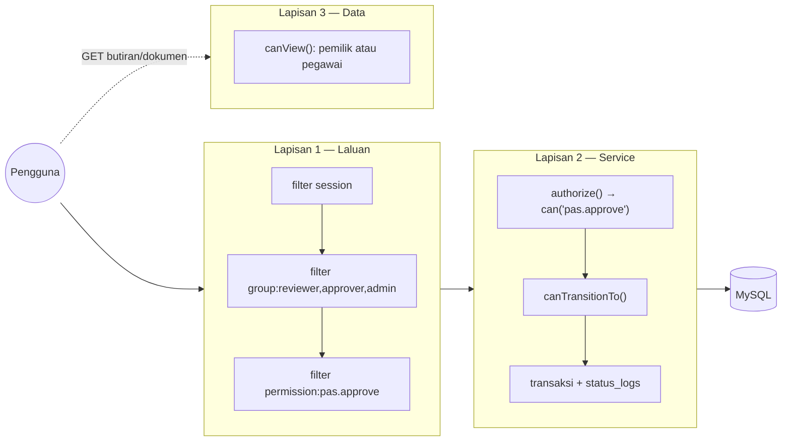
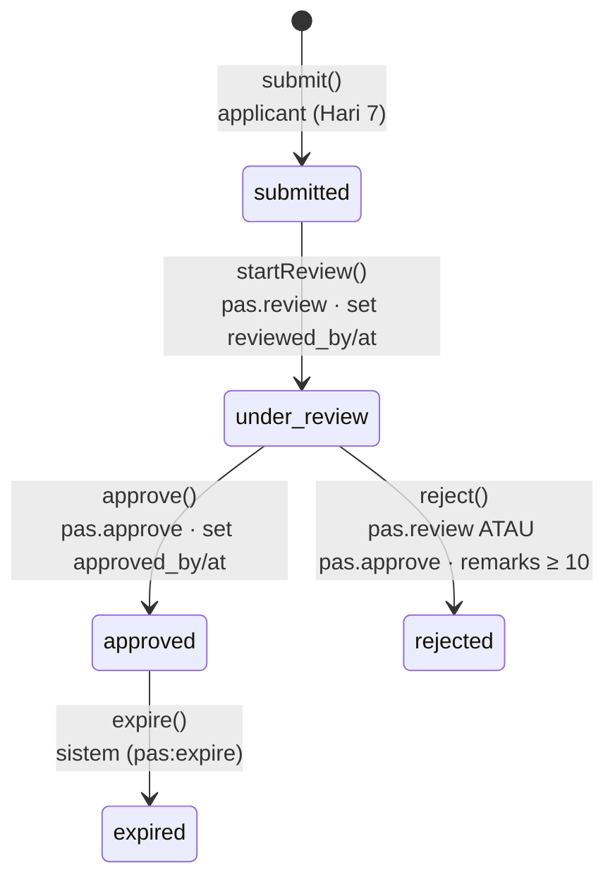
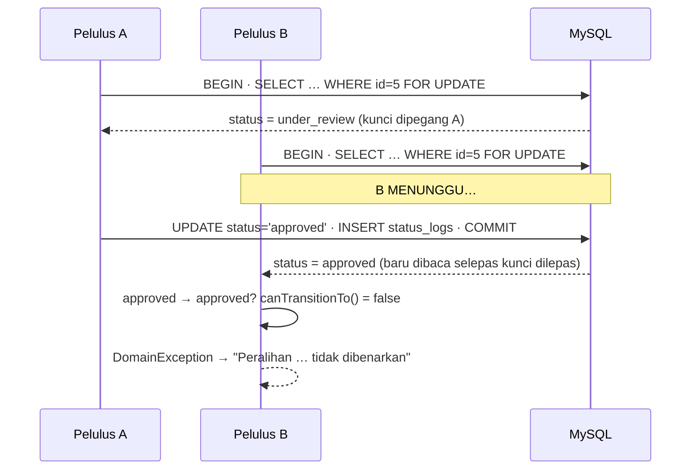

# Hari 8 — Modul Pas (Bahagian 2): Aliran Kelulusan, RBAC Shield & Ujian Akses

[📅 Jadual](../JADUAL.md) · [📘 Kanun SPEC](../docs/spesifikasi-sistem.md) · [🧪 Lab Hari 8](./lab.md)

> **Hari ini Modul Pas menjadi lengkap (M2 siap).** Semalam pemohon boleh menghantar permohonan. Hari ini **dua pegawai** mengambil alih: penyemak memulakan semakan, pelulus membuat keputusan — dan sistem **memastikan** setiap orang hanya boleh menekan butang yang menjadi haknya, setiap perubahan direkod, dan semua ini dibuktikan dengan ujian automatik.

---

## 🎯 Objektif Pembelajaran

Di akhir hari ini, peserta boleh:

| # | Objektif (boleh diukur) | Sesi | Bukti |
|---|------------------------|------|-------|
| O1 | **Melaksanakan** `PassWorkflowService` (`startReview`, `approve`, `reject`) yang menguatkuasa BR-PAS-01 melalui `PassStatus::canTransitionTo()` dalam transaksi berkunci `FOR UPDATE`, menetapkan `reviewed_by/at` & `approved_by/at`, dan merekod `status_logs` | S1 | Permohonan bergerak `submitted → under_review → approved`; 3 baris `status_logs` |
| O2 | **Menguatkuasa** BR-PAS-03: penolakan tanpa catatan ≥ 10 aksara ditolak di borang **dan** di Service | S1 | Tolak dengan "tak ok" → status tidak berubah |
| O3 | **Mengkonfigur** `Config\AuthGroups` (groups, permissions, `$matrix`) tepat SPEC §4 dan filter route `group:` / `permission:` | S2 | `php spark routes` menunjukkan filter gabungan pada `/pas/semakan/(:num)/approve` |
| O4 | **Menerangkan** perbezaan pengesahan (authentication) vs kebenaran (authorization) dan **membina** tiga lapisan pertahanan: filter route → `authorize()` dalam Service → semakan pemilikan | S2 | Penyemak POST ke `/approve` → ditolak; memanggil Service terus → `PermissionException` |
| O5 | **Memaparkan** garis masa sejarah status dari `status_logs` (siapa, bila, dari→ke, catatan) | S3 | Halaman butiran menunjukkan 3 entri berbadge |
| O6 | **Menulis** ujian feature positif & negatif bagi setiap peranan (pemohon tidak boleh lulus, penyemak tidak boleh lulus, pelulus boleh) dan **mendemokan** aliran penuh 3 peranan | S3–S4 | `PassAccessTest` ≥ 13 ujian hijau; demo 5 minit lulus DoD |

---

## 📅 Jadual Hari Ini

| Masa | Sesi | Aktiviti | Objektif sesi |
|------|------|----------|---------------|
| 08:30–09:00 | — | Recap Hari 7 | — |
| 09:00–10:30 | S1 | Aliran kelulusan mohon → semak → lulus/tolak | Melaksanakan `PassWorkflowService` dengan `PassStatus::canTransitionTo()` |
| 10:30–10:45 | — | Rehat pagi | — |
| 10:45–12:30 | S2 | Kawalan akses ikut peranan | Mengkonfigur Shield groups/permissions + filter route + semakan pemilikan |
| 12:30–14:30 | — | Makan tengah hari | — |
| 14:30–16:00 | S3 | Log status/sejarah & ujian fungsian | Memaparkan garis masa `status_logs`; ujian akses positif & negatif |
| 16:00–17:00 | S4 | Wrap-up Modul Pas | Demo aliran penuh 3 peranan; **M2 siap** |

---

## 🧭 Kenapa hari ini penting

Sistem kelulusan kerajaan hidup atau mati pada tiga soalan audit:

1. **Siapa yang meluluskan ini?** → `approved_by`, `status_logs.actor_id`
2. **Adakah dia berhak?** → Shield groups/permissions + semakan di server
3. **Bolehkah ia berlaku dua kali, atau langkau peringkat?** → `canTransitionTo()` + transaksi berkunci

Jika mana-mana satu gagal, laporan audit akan menandakan sistem sebagai **tidak boleh dipercayai** — walaupun antara mukanya cantik. Hari ini kita menutup ketiga-tiga lubang, dan membina **ujian automatik** yang akan menjerit jika seseorang membukanya semula enam bulan akan datang.



---

## S1 — Aliran Kelulusan: Mohon → Semak → Lulus/Tolak (09:00–10:30)

### 1.1 Mesin keadaan menjadi kod

Rajah SPEC §2.2, dengan **siapa** dan **medan** yang berubah pada setiap anak panah:



Setiap kaedah awam `PassWorkflowService` adalah **nipis** — ia menyemak kebenaran, kemudian menyerahkan kepada **satu** kaedah peribadi `transition()`:

```php
public function startReview(int $applicationId, User $actor): PassApplication
{
    $this->authorize($actor, 'pas.review');                       // Lapisan 2

    return $this->transition($applicationId, PassStatus::UnderReview, (int) $actor->id, null, [
        'reviewed_by' => (int) $actor->id,
        'reviewed_at' => Time::now()->toDateTimeString(),
    ]);
}

public function reject(int $applicationId, User $actor, string $remarks): PassApplication
{
    $this->authorize($actor, 'pas.review', 'pas.approve');        // can() = mana-mana satu (OR)

    $remarks = trim($remarks);
    if (mb_strlen($remarks) < self::REMARKS_MIN) {                // BR-PAS-03
        throw new InvalidArgumentException('Catatan penolakan wajib diisi (sekurang-kurangnya 10 aksara).');
    }

    return $this->transition($applicationId, PassStatus::Rejected, (int) $actor->id, $remarks);
}
```

### 1.2 `transition()` — satu-satunya pintu perubahan status

```php
private function transition(int $applicationId, PassStatus $to, int $actorId, ?string $remarks = null, array $extra = []): PassApplication
{
    $this->db->transException(true)->transBegin();   // ralat query → exception, bukan `false` senyap
    try {
        // 1. Kunci baris (binding ?, bukan cantuman string; prefixTable() untuk DBPrefix)
        $query = $this->db->query(
            sprintf('SELECT id, status FROM %s WHERE id = ? FOR UPDATE', $this->db->prefixTable('pass_applications')),
            [$applicationId],
        );
        if ($query === false) {
            throw new RuntimeException('Gagal mengunci permohonan.');
        }
        $row = $query->getRowArray();
        if ($row === null) {
            throw PageNotFoundException::forPageNotFound('Permohonan tidak dijumpai.');
        }

        // 2. BR-PAS-01 — baca status SELEPAS kunci diperoleh
        $from = PassStatus::from((string) $row['status']);
        if (! $from->canTransitionTo($to)) {
            throw new DomainException(sprintf('Peralihan status "%s" → "%s" tidak dibenarkan.', $from->label(), $to->label()));
        }

        // 3. Kemas kini + 4. BR-PAS-05 log — dalam transaksi YANG SAMA
        if (! $this->applications->update($applicationId, ['status' => $to->value] + $extra)) {
            throw new RuntimeException('Gagal mengemas kini permohonan: ' . implode(' ', $this->applications->errors()));
        }
        if (! $this->statusLogs->record('PAS', $applicationId, $from->value, $to->value, $actorId, $remarks)) {
            throw new RuntimeException('Gagal merekod log status.');
        }

        $this->db->transCommit();
    } catch (Throwable $e) {
        $this->db->transRollback();
        throw $e;
    }
    return $this->applications->find($applicationId);
}
```

Kenapa **satu** kaedah? Kerana empat peraturan (kunci, BR-PAS-01, kemas kini, BR-PAS-05) mesti berlaku **bersama setiap kali**. Jika setiap kaedah awam menulis semula langkah-langkah ini, lambat-laun seseorang terlupa `record()` dalam satu cabang.

### 1.3 Kenapa `FOR UPDATE` untuk kelulusan?

Dua pelulus (atau seorang pelulus yang klik dua kali) menekan **Lulus** pada saat yang sama:



Tanpa kunci, kedua-duanya membaca `under_review`, kedua-duanya lulus semakan, dan `status_logs` mempunyai **dua** entri "diluluskan" oleh dua orang berbeza. Juruaudit akan bertanya siapa yang sebenarnya meluluskan. Ini corak yang sama seperti BR-TLK-05 (Hari 6).

### 1.4 Controller nipis: terjemah exception kepada HTTP

`ReviewController` tidak tahu apa-apa tentang status atau transaksi. Ia hanya memetakan hasil Service kepada respons:

| Exception dari Service | Makna | Respons |
|------------------------|-------|---------|
| *(tiada)* | Berjaya | Redirect ke butiran + flash `message` |
| `DomainException` | BR-PAS-01 — peralihan tidak sah (cth sudah diluluskan) | Redirect ke butiran + flash `error` |
| `InvalidArgumentException` | BR-PAS-03 — catatan terlalu pendek | Redirect ke butiran + flash `error` |
| `PermissionException` (Shield) | Log masuk tetapi tiada hak | **403** + view `errors/forbidden` |
| `PageNotFoundException` | ID tiada | **404** |

```php
private function act(int $id, string $successMessage, callable $action): ResponseInterface
{
    try {
        $action(service('passWorkflowService'), auth()->user());
    } catch (PermissionException $e) {
        return $this->response->setStatusCode(403)->setBody(view('errors/forbidden', ['message' => $e->getMessage()]));
    } catch (DomainException|InvalidArgumentException $e) {
        return redirect()->to(url_to('pas.show', $id))->with('error', $e->getMessage());
    }
    return redirect()->to(url_to('pas.show', $id))->with('message', $successMessage);
}
```

Borang tindakan diletakkan pada halaman **butiran sedia ada** (`/pas/permohonan/{id}`) — pegawai sudah dibenarkan melihatnya (BR-PAS-04). Tiada halaman "semakan butiran" pendua.

> ⚠️ **Kesilapan lazim**
> - Menyemak status **sebelum** `transBegin()`/`FOR UPDATE` → keadaan perlumbaan kembali.
> - `$model->update($id, ['status' => $request->getPost('status')])` — status dari input pengguna! Status hanya dari enum dalam Service.
> - Lupa `transRollback()` dalam `catch` → connection kekal dalam transaksi terbuka; permintaan seterusnya dalam proses yang sama bertindih.
> - Menetapkan `approved_at` semasa **menolak** → statistik "purata hari untuk lulus" (Hari 10) tercemar. Penolakan direkod dalam `status_logs` sahaja.

### 🎯 Kuiz S1

1. Penyemak memanggil `reject()` dengan catatan berikut. Apakah hasilnya?
   ```php
   $workflow->reject($id, $penyemak, '  Tak ok  ');
   ```
   - [x] `InvalidArgumentException` — selepas `trim()`, `mb_strlen('Tak ok')` = 6 < 10 (BR-PAS-03); status tidak berubah
   - [ ] Status menjadi `rejected` kerana catatan tidak kosong
   - [ ] `DomainException` kerana `under_review` tidak boleh terus ke `rejected`; penyemak mesti mengembalikannya ke `submitted` dahulu
   - [ ] `PermissionException` kerana penyemak tiada `pas.approve`
   > `reject()` membenarkan `pas.review` **atau** `pas.approve`, jadi penyemak dibenarkan. Tetapi catatan di-`trim()` dahulu dan mesti sekurang-kurangnya 10 aksara sebelum `transition()` dipanggil.

2. Dua pelulus menekan **Lulus** serentak pada permohonan `under_review` yang sama. Dengan `SELECT … FOR UPDATE` dalam `transition()`, apakah yang berlaku?
   - [x] Pelulus A berjaya; B menunggu kunci, kemudian membaca `approved` dan `canTransitionTo()` menolak dengan `DomainException`
   - [ ] Kedua-dua berjaya kerana `FOR UPDATE` hanya mengunci semasa SELECT; `status_logs` ada dua entri "diluluskan" daripada dua pelulus
   - [ ] Kedua-dua gagal kerana deadlock
   - [ ] B berjaya kerana permintaan terakhir menang
   > Kunci baris memastikan status dibaca **selepas** kunci diperoleh. Tanpa kunci, kedua-duanya membaca `under_review` dan juruaudit melihat dua kelulusan oleh dua orang berbeza.

---

## S2 — Kawalan Akses Ikut Peranan (10:45–12:30)

### 2.1 Pengesahan vs kebenaran

| | Pengesahan (authentication) | Kebenaran (authorization) |
|--|------------------------------|-----------------------------|
| Soalan | **Siapa** anda? | **Apa** yang anda boleh buat? |
| Bukti | E-mel + kata laluan → sesi | Group, permission, pemilikan rekod |
| Shield | `auth()->loggedIn()`, filter `session` | `$user->inGroup()`, `$user->can()`, filter `group:` / `permission:` |
| Gagal | Redirect ke `/login` | Redirect dengan mesej / 403 / 404 |
| OWASP | A07 Identification & Authentication Failures | **A01 Broken Access Control** (#1) |

### 2.2 Model Shield: group → permission

```php
// app/Config/AuthGroups.php — tepat SPEC §4
public array $matrix = [
    'applicant' => ['tlk.apply', 'pas.apply'],
    'reviewer'  => ['pas.review', 'laporan.view'],
    'approver'  => ['tlk.decide', 'pas.approve', 'laporan.view', 'statistik.view'],
    'admin'     => ['admin.*', 'tlk.*', 'pas.*', 'laporan.*', 'statistik.*'],
];
```

- **Group** = peranan manusia (`reviewer`). Disimpan per pengguna dalam jadual `auth_groups_users` (oleh `UserSeeder`).
- **Permission** = keupayaan (`pas.approve`). Diisytihar dalam `$permissions`, dipetakan dalam `$matrix` — **konfigurasi**, bukan DB. Tiada migration diperlukan bila matriks berubah.
- **Kod menyemak permission, bukan group.** `can('pas.approve')` dan bukan `inGroup('approver')`. Jika esok pemilik sistem mahu Timbalan Pengarah (group `admin`) turut meluluskan — ia sudah berfungsi melalui `pas.*` tanpa mengubah satu baris kod.
- **Pengecualian yang disengajakan:** BR-PAS-04 ("`reviewer`/`approver`/`admin` lihat semua") dinyatakan oleh SPEC dalam bentuk **group**, jadi `canView()` guna `inGroup()`.

| Peranan | `/pas/permohonan` (milik sendiri) | Mohon | Lihat semua | `/pas/semakan` | Mula semak | Lulus | Tolak |
|---------|:---:|:---:|:---:|:---:|:---:|:---:|:---:|
| `applicant` | ✅ | ✅ | ❌ | ❌ | ❌ | ❌ | ❌ |
| `reviewer` | ✅ | ❌ | ✅ | ✅ | ✅ | ❌ | ✅ |
| `approver` | ✅ | ❌ | ✅ | ✅ | ❌ | ✅ | ✅ |
| `admin` | ✅ | ✅ | ✅ | ✅ | ✅ | ✅ | ✅ |

### 2.3 Filter laluan — Lapisan 1

```php
$routes->group('pas/semakan', ['namespace' => 'App\Controllers\Pas', 'filter' => 'group:reviewer,approver,admin'], static function ($routes): void {
    $routes->get('/', 'ReviewController::index', ['as' => 'pas.semakan']);
    $routes->post('(:num)/review',  'ReviewController::review/$1',  ['as' => 'pas.review',  'filter' => 'permission:pas.review']);
    $routes->post('(:num)/approve', 'ReviewController::approve/$1', ['as' => 'pas.approve', 'filter' => 'permission:pas.approve']);
    $routes->post('(:num)/reject',  'ReviewController::reject/$1',  ['as' => 'pas.reject',  'filter' => 'permission:pas.review,pas.approve']);
});
```

- `group:reviewer,approver,admin` — **mana-mana** satu group (OR). `permission:pas.review,pas.approve` — mana-mana satu permission (OR).
- **CI 4.5.4+ menggabungkan** filter kumpulan dengan filter route: `/approve` mesti lulus `group:…` **dan** `permission:pas.approve`. Sahkan dengan `php spark routes` (lajur *Before Filters*).
- Kenapa filter group sahaja tidak cukup? Ia membenarkan `reviewer` mencapai `/approve`. Nota 06 menyebutnya secara jelas: *lapisan kedua mesti menolaknya*.
- `/pas/permohonan/new` dan `POST /pas/permohonan` turut diberi `permission:pas.apply` — SPEC §4 memberi `pas.apply` kepada `applicant` (dan `admin` melalui `pas.*`) sahaja.

### 2.4 Apa yang pengguna lihat bila ditolak?

| Lapisan yang menolak | Kelakuan | Kenapa |
|----------------------|----------|--------|
| Filter `session` (belum log masuk) | Redirect ke `/login` | Pengesahan |
| Filter `group:` / `permission:` (Shield) | Redirect ke `Config\Auth::$redirects['group_denied' / 'permission_denied']` (lalai `/`) dengan flash `error` (teks lalai Shield dalam Bahasa Inggeris: *"You do not have the necessary permission…"* — terjemahan ⭐ Lab 8.2) | Tingkah laku lalai Shield — mesra pengguna |
| `authorize()` dalam Service | **403** + `errors/forbidden` | Tidak sepatutnya berlaku jika filter betul — jika berlaku, ia petanda route tersalah konfigur; 403 jelas dalam log |
| `canView()` (rekod orang lain) | **404** | Jangan dedahkan kewujudan ID (Hari 7) |

> 💡 **Tip:** Mahu filter Shield juga memulangkan halaman yang jelas? Tukar `permission_denied` dan `group_denied` dalam `app/Config/Auth.php` kepada route yang memaparkan mesej, cth `'/akses-ditolak'`. Jangan ubah fail dalam `vendor/`.

### 2.5 Butang: UX, bukan keselamatan

`ApplicationController::show()` mengira `$actions` supaya view hanya memaparkan butang yang **akan berjaya**:

```php
'actions' => [
    'review'  => $user->can('pas.review')  && $status->canTransitionTo(PassStatus::UnderReview),
    'approve' => $user->can('pas.approve') && $status->canTransitionTo(PassStatus::Approved),
    'reject'  => $user->can('pas.review', 'pas.approve') && $status->canTransitionTo(PassStatus::Rejected),
],
```

Menyembunyikan butang mengelakkan kekeliruan — tetapi **tidak** menghalang penyerang yang menghantar POST dengan `curl`. Itulah kerja Lapisan 1 & 2.

> ⚠️ **Kesilapan lazim**
> - Permission digunakan dalam `$matrix`/kod tetapi tidak diisytihar dalam `$permissions` → senarai kebenaran tidak lengkap, `$user->addPermission()` membaling ralat, dan salah ejaan (`pas.aprove`) tidak dikesan. Isytihar **semua** permission.
> - Menulis `filter => 'permission:pas.review|pas.approve'` → hujah filter dipisahkan dengan **koma**, bukan `|`.
> - `inGroup('reviewer')` dalam controller untuk meluluskan → admin tidak boleh meluluskan; logik peranan bertaburan. Guna `can()`.
> - Mengubah `AuthGroups` tetapi pengguna ujian tiada dalam group (seeder tidak dijalankan semula) → semua ditolak. Semak `SELECT * FROM auth_groups_users;`.

### 🎯 Kuiz S2

1. `penyemak` menghantar `POST /pas/semakan/5/approve` menggunakan curl. Route itu dalam kumpulan `group:reviewer,approver,admin` dan mempunyai filter `permission:pas.approve`. Apakah yang berlaku?
   - [ ] Berjaya — penyemak lulus filter `group:reviewer,approver,admin`, dan filter kumpulan mengatasi filter pada route individu
   - [ ] 404 kerana penyemak tidak boleh melihat permohonan
   - [ ] Status berubah tetapi tiada log
   - [x] Ditolak — kedua-dua filter dijalankan; penyemak lulus `group:` tetapi gagal `permission:pas.approve`
   > Filter group sahaja tidak cukup kerana ia membenarkan `reviewer` mencapai `/approve`. Filter kumpulan tidak mengatasi filter route: kedua-duanya digabung dan dijalankan, jadi `permission:pas.approve` tetap menolak penyemak. Lapisan kedua, `authorize()` dalam Service, juga akan menolak jika filter terlepas.

2. Kenapa kod meluluskan pas menyemak `$user->can('pas.approve')` dan bukan `$user->inGroup('approver')`?
   - [ ] `inGroup()` tidak wujud dalam Shield
   - [x] Permission ialah keupayaan; `admin` turut mendapat `pas.approve` melalui `pas.*` tanpa mengubah kod, dan perubahan peranan hanya menyentuh `$matrix`
   - [ ] `can()` turut menyemak pemilikan rekod dan peralihan status secara automatik, jadi `canTransitionTo()` tidak lagi diperlukan dalam Service
   - [ ] `inGroup()` memerlukan migration baharu
   > Kod menyemak permission, bukan group. Pengecualian disengajakan ialah `canView()` (BR-PAS-04), kerana SPEC menyatakannya dalam bentuk group.

---

## S3 — Sejarah Status & Ujian Fungsian (14:30–16:00)

### 3.1 Garis masa dari `status_logs`

`status_logs` ialah **satu** jadual audit untuk TLK & Pas (SPEC §3). `StatusLogModel::history('PAS', $id)` (Hari 4) memulangkan baris dengan `actor_name`, `from_status`, `to_status`, `remarks`, `created_at`. Kita paparkan dengan partial generik:

```php
<?= view('partials/status_timeline', ['history' => $history, 'enum' => \App\Enums\PassStatus::class]) ?>
```

```php
// app/Views/partials/status_timeline.php (petikan)
$caseOf = static fn (?string $value) => $value === null ? null : $enum::tryFrom($value);
…
<span class="badge <?= esc($to?->badge() ?? 'text-bg-light', 'attr') ?>"><?= esc($to?->label() ?? $log['to_status']) ?></span>
<small>oleh <?= esc($log['actor_name'] ?? 'Sistem') ?></small>
<?php if (! empty($log['remarks'])): ?>“<?= esc($log['remarks']) ?>”<?php endif ?>
```

- **Kenapa `$enum` sebagai parameter?** Partial yang sama boleh digunakan untuk TLK dengan `BookingStatus::class` — kedua-dua enum mempunyai `label()` dan `badge()`.
- **`tryFrom()`, bukan `from()`**: data audit lama mungkin mengandungi nilai yang sudah tidak wujud dalam enum. Garis masa mesti tetap dipaparkan.
- **`esc($log['remarks'])`**: catatan ditaip oleh pegawai — tetap input pengguna.
- Contoh hasil untuk satu permohonan yang diluluskan:

```text
1. [Dihantar]                         oleh Pemohon Satu    24/09/2026 09:12
2. [Dihantar] → [Dalam Semakan]       oleh Penyemak Satu   24/09/2026 10:05
3. [Dalam Semakan] → [Diluluskan]     oleh Pelulus Satu    24/09/2026 11:40   "Dokumen lengkap."
```

### 3.2 Strategi ujian: matriks peranan × tindakan

Setiap sel "❌" dalam jadual §2.2 ialah **ujian negatif**; setiap "✅" yang penting ialah **ujian positif**. Ujian negatif menyemak **dua** perkara: respons ditolak **dan** DB tidak berubah (`assertStatusIs()`), kerana redirect semata-mata tidak membuktikan tiada kesan sampingan.

| Ujian | Peranan | Tindakan | Dijangka |
|-------|---------|----------|----------|
| `testPemohonHanyaNampakPermohonanSendiriDalamSenarai` | applicant | GET senarai | nampak milik sendiri sahaja |
| `testPemohonLainMendapat404BagiPermohonanOrangLain` | applicant | GET butiran orang lain | `PageNotFoundException` |
| `testPenyemakBolehLihatPermohonanSesiapa` | reviewer | GET butiran | 200 |
| `testPemohonTidakBolehBukaSenaraiSemakan` | applicant | GET `/pas/semakan` | redirect |
| `testPemohonTidakBolehLuluskan` | applicant | POST approve | redirect + status kekal |
| `testPenyemakTidakBolehLuluskan` | reviewer | POST approve | redirect + status kekal |
| `testPelulusTidakBolehMulakanSemakan` | approver | POST review | redirect + status kekal |
| `testPenyemakBolehMulakanSemakan` | reviewer | POST review | `under_review`, `reviewed_by`, log |
| `testPelulusBolehLuluskan` | approver | POST approve | `approved`, `approved_by`, log |
| `testTolakTanpaCatatanYangCukupTidakMengubahStatus` | reviewer | POST reject "tak ok" | status kekal |
| `testPenyemakBolehTolakDenganCatatan` | reviewer | POST reject | `rejected` + remarks dalam log |
| `testServiceMenolakPeralihanTidakSah` | approver | Service `approve()` pada `submitted` | `DomainException` |
| `testServiceMenyekatPenyemakWalaupunFilterTerlepas` | reviewer | Service `approve()` | `PermissionException` |

```php
public function testPenyemakTidakBolehLuluskan(): void
{
    $id = $this->makeApplication($this->pemohon1, PassStatus::UnderReview);

    // Lulus filter group:reviewer,… TETAPI gagal permission:pas.approve
    $this->actingAs($this->penyemak)->post("pas/semakan/{$id}/approve")->assertRedirect();

    $this->assertStatusIs($id, PassStatus::UnderReview);   // DB TIDAK berubah
}
```

### 3.3 Perkara teknikal ujian (sama seperti Hari 6 — nota 10)

- **DB ujian MySQL berasingan** (`kkm_latihan_test`, `DBPrefix` kosong). SQLite `:memory:` tidak menyokong `FOR UPDATE`.
- `protected $namespace = null;` — jalankan migration **semua** namespace (App + Shield + Settings); tanpanya jadual `users` tiada.
- **CSRF**: `FeatureTestTrait` tidak memintas CSRF. `PassAccessTest` menyahaktif `csrf` dalam `setUp()` dan memulihkannya dalam `tearDown()` — ujian ini tentang akses, bukan CSRF. (Ujian khusus CSRF sudah ada sejak Hari 6.)
- `actingAs($user)` dari `CodeIgniter\Shield\Test\AuthenticationTesting`.
- 404 dalam ujian: CI4 membaling semula `PageNotFoundException` → guna `expectException()`.

> ⚠️ **Kesilapan lazim**
> - Menguji hanya happy path. Pepijat kawalan akses hampir **selalu** dalam ujian negatif yang tidak ditulis.
> - `assertRedirect()` sahaja untuk ujian negatif — lulus walaupun Service sudah mengubah status sebelum redirect. Tambah semakan DB.
> - Berkongsi pengguna antara ujian dengan `$migrateOnce`/`$refresh = false` → ujian bergantung pada susunan.

### 🎯 Kuiz S3

1. Ujian negatif berikut boleh lulus walaupun status telah berubah. Apakah kelemahannya?
   ```php
   public function testPenyemakTidakBolehLuluskan(): void
   {
       $id = $this->makeApplication($this->pemohon1, PassStatus::UnderReview);

       $this->actingAs($this->penyemak)->post("pas/semakan/{$id}/approve")->assertRedirect();
   }
   ```
   - [ ] Tiada kelemahan; redirect membuktikan permintaan ditolak
   - [ ] `actingAs()` patut dipanggil selepas `post()` supaya sesi penyemak tidak menjejaskan ujian lain dalam kelas yang sama
   - [x] Redirect sahaja tidak membuktikan tiada kesan sampingan — tambah semakan DB seperti `$this->assertStatusIs($id, PassStatus::UnderReview)`
   - [ ] Ujian negatif tidak perlu untuk kawalan akses
   > Happy path pun memulangkan redirect. Ujian negatif mesti menyemak respons ditolak **dan** DB tidak berubah.

2. Kenapa partial `status_timeline` menggunakan `$enum::tryFrom($value)` dan bukan `$enum::from($value)`?
   - [ ] `from()` tidak wujud untuk backed enum
   - [ ] `tryFrom()` menukar nilai DB terus kepada label BM (cth `under_review` → "Dalam Semakan"), jadi `label()` tidak perlu dipanggil
   - [ ] `tryFrom()` lebih pantas
   - [x] Data audit lama mungkin mengandungi nilai yang tidak lagi wujud dalam enum; `tryFrom()` memulangkan `null` supaya garis masa tetap dipaparkan
   > `from()` akan melontar `ValueError` dan memecahkan halaman. Partial menggunakan `$to?->label() ?? $log['to_status']` sebagai sandaran.

---

## S4 — Wrap-up Modul Pas: Demo 3 Peranan (16:00–17:00)

### 4.1 Skrip demo (5 minit setiap pasangan)

Tiga tetingkap pelayar (biasa, inkognito, pelayar kedua) — satu untuk setiap peranan:

| # | Peranan | Tindakan | Apa yang ditunjukkan kepada "pemilik sistem" |
|---|---------|----------|---------------------------------------------|
| 1 | `pemohon1` | Mohon pas kakitangan + 2 dokumen | `PAS-2026-000N`, badge **Dihantar**, garis masa 1 entri |
| 2 | `pemohon1` | Cuba buka `/pas/semakan` | Ditolak dengan mesej |
| 3 | `penyemak` | `/pas/semakan` → buka permohonan → muat turun dokumen → **Mula Semakan** | Badge **Dalam Semakan**; tiada butang *Lulus* |
| 4 | `penyemak` | (curl/DevTools) POST ke `/approve` | Ditolak — "butang tiada ≠ keselamatan; server menolak" |
| 5 | `pelulus` | Buka permohonan → **Lulus** dengan catatan | Badge **Diluluskan**; garis masa 3 entri dengan nama & masa |
| 6 | `pelulus` | Klik **Lulus** sekali lagi (tab lama) | "Peralihan status … tidak dibenarkan" (BR-PAS-01) |
| 7 | `penyemak` | Permohonan kedua → Mula Semakan → **Tolak** "tak ok" → kemudian catatan penuh | Ralat catatan, kemudian **Ditolak** (BR-PAS-03) |
| 8 | Terminal | `composer test -- tests/feature/Pas --testdox` | Semua hijau |

### 4.2 Definition of Done — M2

Semak terhadap [KOLABORASI §2](../docs/kolaborasi.md):

- [ ] Acceptance criteria URS Pas (Hari 2) lulus diuji manual (`docs/ujian-manual-pas.md` + demo).
- [ ] Validasi di server: borang (Hari 7), catatan penolakan (hari ini), fail (BR-PAS-02).
- [ ] Akses dikawal di server: filter route + `authorize()` + `canView()`.
- [ ] Setiap peralihan direkod dalam `status_logs` (BR-PAS-05) — termasuk penciptaan.
- [ ] `composer test` lulus.
- [ ] Tiada `.env`/rahsia; data sintetik sahaja.
- [ ] Setiap ahli pasangan boleh menerangkan `transition()` dan tiga lapisan akses.

### 4.3 ⭐ Tamat tempoh automatik: `php spark pas:expire`

SPEC §2.2: `expired` ditetapkan oleh **sistem**. Semalam kita buat versi "semasa papar" (`displayStatus()`). Hari ini (pilihan) kita buat versi kekal — Spark command yang **memanggil Service yang sama**, jadi `canTransitionTo()` dan `status_logs` tetap terpakai:

```bash
php spark pas:expire --dry-run     # 2 pas melepasi valid_until sebelum 2026-09-25: ID 4, 7
php spark pas:expire               # ✔ PAS-2026-0004 → Tamat Tempoh …
```

```php
foreach ($ids as $id) {
    try {
        $application = $workflow->expire($id, $actorId);   // melalui transition() — log direkod
        CLI::write("  ✔ {$application->ref_no} → Tamat Tempoh", 'green');
    } catch (Throwable $e) {
        CLI::error("  ✘ ID {$id}: " . $e->getMessage());   // satu gagal tidak hentikan yang lain
    }
}
```

`status_logs.actor_id` wajib (FK), jadi command menggunakan `--actor <id>` atau admin pertama. Pada server sebenar ia dijadualkan dengan cron (`10 0 * * * cd /var/www/app && php spark pas:expire`). Server Windows: Task Scheduler, dalam Command Prompt sebagai pentadbir — bukan Git Bash (`schtasks /create /tn KKM-PasExpire /sc daily /st 00:10 /tr "cmd /c cd /d C:\laragon\www\app && php spark pas:expire"`). Rujukan: `ExpirePassesCommand.php.txt` (modul **Templat & Rujukan**).

### 🎯 Kuiz S4

1. Dalam demo, pelulus menekan **Lulus** sekali lagi pada tab lama selepas permohonan sudah `approved`. Apakah yang patut dilihat oleh pemilik sistem?
   - [ ] Satu lagi entri "Diluluskan" dalam garis masa
   - [ ] Halaman 403 kerana pelulus tiada kebenaran `pas.approve` ke atas permohonan yang sudah diluluskan
   - [x] Mesej "Peralihan status … tidak dibenarkan" — `approved → approved` ditolak oleh `canTransitionTo()` (BR-PAS-01)
   - [ ] Status bertukar kepada `expired`
   > Peralihan sah dari `approved` hanya ke `expired`. `transition()` membaca status selepas kunci, jadi klik berulang tidak menghasilkan log pendua.

2. Kenapa Spark command `pas:expire` memanggil `$workflow->expire($id, $actorId)` dan bukan terus `UPDATE pass_applications SET status = 'expired'`?
   - [x] Supaya peralihan melalui `transition()` — `canTransitionTo()` dikuatkuasa dan `status_logs` direkod (BR-PAS-05)
   - [ ] Kerana Spark command tidak boleh menggunakan Query Builder
   - [ ] Supaya command boleh dijalankan tanpa database
   - [ ] Kerana `expired` hanya boleh ditetapkan oleh `approver`, jadi command mesti bertindak sebagai pelulus melalui Service
   > Satu pintu perubahan status untuk semua pemanggil (controller, command, ujian). `status_logs.actor_id` wajib, jadi command menggunakan `--actor <id>` atau admin pertama.

---

## 📦 Hasil Hari Ini

- [ ] `PassWorkflowService`: `startReview`, `approve`, `reject`, `expire`, `history`, `transition`, `authorize`
- [ ] `app/Controllers/Pas/ReviewController.php` (`index`, `review`, `approve`, `reject`)
- [ ] `app/Config/AuthGroups.php` tepat SPEC §4
- [ ] Route `pas/semakan` + `permission:` per tindakan; `permission:pas.apply` untuk mohon
- [ ] `app/Views/pas/semakan/index.php`, `app/Views/errors/forbidden.php`, `app/Views/partials/status_timeline.php`; `pas/show.php` dengan panel tindakan + garis masa
- [ ] `tests/feature/Pas/PassAccessTest.php` — 13 ujian hijau
- [ ] Demo 3 peranan lulus; branch `feat/pas-kelulusan` digabung ke `main` — **M2 siap**
- [ ] ⭐ `app/Commands/ExpirePassesCommand.php`

Rujukan penuh jurulatih: `templates/kod/` (modul **Templat & Rujukan**) — `PassWorkflowService`, `ReviewController`, `AuthGroups`, `Routes-pas`, `status-timeline-view`, `PassAccessTest`, `ExpirePassesCommand`. Nota topikal: [06 Shield auth & RBAC](../docs/nota-06-shield-auth-dan-rbac.md) · [05 Service & transaksi](../docs/nota-05-service-layer-dan-transaksi.md) · [10 Ujian PHPUnit](../docs/nota-10-ujian-phpunit-ci4.md).

---

## 🧠 Semakan Kendiri

1. Route `/pas/semakan` sudah ada `group:reviewer,approver,admin`. Kenapa `/pas/semakan/{id}/approve` masih memerlukan `permission:pas.approve`, **dan** `authorize()` dalam Service?

<details><summary>Jawapan</summary>

Filter group membenarkan `reviewer` masuk — tanpa filter permission, penyemak boleh POST ke `/approve`. `permission:pas.approve` menutup lubang itu di Lapisan 1. `authorize()` dalam Service ialah Lapisan 2: jika suatu hari route baharu (API, Spark command, controller lain) memanggil `approve()` tanpa filter yang betul, Service tetap menolak. Pertahanan berlapis bermaksud satu kesilapan konfigurasi tidak terus menjadi pelanggaran.
</details>

2. Pelulus A dan B menekan **Lulus** serentak pada permohonan yang sama. Terangkan apa yang berlaku dalam `transition()` langkah demi langkah.

<details><summary>Jawapan</summary>

A memperoleh kunci baris melalui `SELECT … FOR UPDATE`; B menunggu. A membaca `under_review`, `canTransitionTo(Approved)` benar, kemas kini + `status_logs`, commit — kunci dilepas. B kini membaca `approved`; `Approved->canTransitionTo(Approved)` palsu → `DomainException` → `transRollback()` → B melihat "Peralihan status … tidak dibenarkan." Hanya **satu** entri kelulusan dalam `status_logs`.
</details>

3. Kenapa kod kita menyemak `$user->can('pas.approve')` dan bukan `$user->inGroup('approver')`? Bilakah `inGroup()` masih sesuai?

<details><summary>Jawapan</summary>

Permission memisahkan **keupayaan** daripada **peranan**. Admin (melalui `pas.*`) boleh meluluskan tanpa kod tambahan; jika pemilik sistem mengubah siapa boleh meluluskan, hanya `$matrix` berubah. `inGroup()` sesuai apabila peraturan itu sendiri ditakrifkan dalam bentuk group — cth BR-PAS-04 "`reviewer`/`approver`/`admin` lihat semua" dalam `canView()`, atau filter `group:` SPEC §6.
</details>

4. `testPenyemakTidakBolehLuluskan` hanya menyemak `assertRedirect()`. Apakah pepijat yang mungkin terlepas, dan bagaimana membaikinya?

<details><summary>Jawapan</summary>

Jika controller/Service telah **mengubah status** sebelum redirect (cth `update()` dipanggil dahulu, kebenaran disemak kemudian), respons tetap redirect dan ujian lulus — padahal data sudah rosak. Tambah `assertStatusIs($id, PassStatus::UnderReview)` (`seeInDatabase`) dan `dontSeeInDatabase('status_logs', [... 'to_status' => 'approved'])`.
</details>

5. Kenapa `pas:expire` memanggil `PassWorkflowService::expire()` dan bukan terus `UPDATE pass_applications SET status='expired' WHERE …`?

<details><summary>Jawapan</summary>

Satu `UPDATE` pukal akan memintas BR-PAS-01 (boleh menukar `rejected` kepada `expired` jika `WHERE` tersilap) dan BR-PAS-05 (tiada entri `status_logs`). Melalui Service, setiap pas melalui `transition()`: dikunci, disemak `canTransitionTo()`, dikemas kini, dan direkod dengan actor — konsisten dengan setiap peralihan lain.
</details>

---

## ➡️ Persediaan untuk esok

Hari 9 — **Modul Laporan (M3)**: RPT-01 (tempahan TLK) dan **RPT-02 (permohonan Pas)** dengan filter, aggregate dan eksport PDF/Excel.

- Pastikan `main` mengandungi M1 **dan** M2 (gabung `feat/pas-kelulusan`).
- Cipta sekurang-kurangnya **8 permohonan Pas** dengan status berbeza (`submitted`, `under_review`, `approved`, `rejected`) dan tarikh berlainan — laporan esok perlu data untuk ditapis. Sertakan sekurang-kurangnya satu daripada setiap `pass_type`.
- Semak `composer show dompdf/dompdf phpoffice/phpspreadsheet` — jika belum dipasang, lihat [`docs/persediaan.md`](../docs/persediaan.md).
- Soalan untuk difikirkan: *Siapa yang patut boleh melihat RPT-02 — dan filter route apa yang akan anda gunakan?* (Petunjuk: SPEC §6.)
