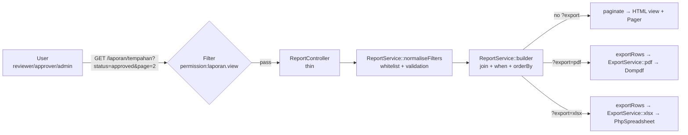
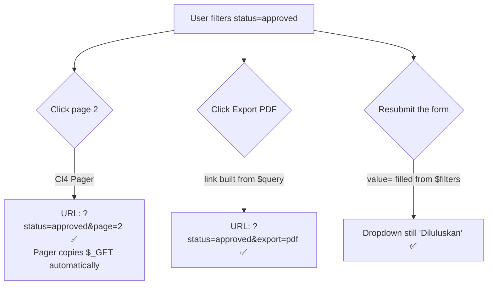
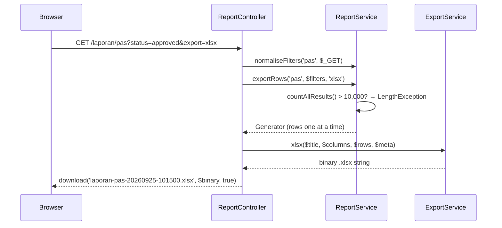

# Day 9 — Reports Module (M3)

[← Schedule](../JADUAL.md) · [SPEC Canon](../docs/spesifikasi-sistem.md) · [🧪 Day 9 Lab](./lab.md) · [Day 10 →](../hari-10/README.md)

> **Phase C — Report & Hand Over.** M1 (TLK, Special Vehicle Parking) and M2 (Pass) already generate data. Today we turn that data into **information people can trust**: filtered lists, aggregate summaries, and PDF/Excel files that can be sent to management.

---

## 🎯 Learning Objectives

By the end of today, participants can:

| # | Objective (measurable) | Session |
|---|-------------------------|------|
| O1 | **Write** the report specifications for RPT-01, RPT-02 and RPT-03 (purpose, users, columns, filters, default sort order, who can view) in report-card format. | S1 |
| O2 | **Build** a `method="get"` filter form that keeps the filter values after submission and carries the same query string to pagination & the export buttons. | S1 |
| O3 | **Write** a `ReportService` with the Query Builder: `join()`, dynamic `when()` filters, correct date ranges, `groupBy()` + `selectCount()`, and a **whitelist** of sort columns. | S2 |
| O4 | **Generate** PDF files (Dompdf, A4 landscape, header/footer + page numbers) and `.xlsx` files (PhpSpreadsheet, bold header, automatic width, frozen rows) from the **same** filters as the HTML view. | S3 |
| O5 | **Test** that report totals = a direct SQL count with PHPUnit tests, and **analyse** the query plan with `EXPLAIN` to propose an index. | S4 |
| O6 | **Explain** the memory/time risks of large exports and how to control them (record limits, row streaming). | S3, S4 |
| O7 | **Build** quick-period GET links (This month / Last month / This year) and active filter chips that keep the other filters, and **add** both to the spec cards. | S5 |
| O8 | **Write** a status summary with `fromSubquery()` + `groupBy()` on the same list builder, and a weighted RPT-03 JUMLAH (TOTAL) row. | S6 |
| O9 | **Generate** an Excel *Ringkasan* (Summary) sheet with an `=SUM()` formula and a PDF summary table from the same `statusSummary()` as the screen. | S7 |
| O10 | **Test** the summary and JUMLAH against a SQL `GROUP BY` and hand-calculated numbers, and **prove** with mutations that a test without filters can pass falsely. | S8 |

---

## 📅 Today's Schedule

| Time | Session | Activity | Objectives |
|------|------|----------|----------|
| 08:30–09:00 | — | Day 8 recap (Pass flow + RBAC) | — |
| 09:00–10:00 | **S1** | Report design (types, search/filter criteria) | O1, O2 |
| 10:00–10:30 | **S5** | S1 follow-up: quick periods & active filter chips | O7 |
| 10:30–10:45 | — | Morning break | — |
| 10:45–12:00 | **S2** | Aggregate queries & data search | O3 |
| 12:00–12:30 | **S6** | S2 follow-up: status summary & RPT-03 JUMLAH row | O8 |
| 12:30–14:30 | — | Lunch | — |
| 14:30–15:30 | **S3** | PDF/Excel export | O4, O6 |
| 15:30–16:00 | **S7** | S3 follow-up: Excel Summary sheet & PDF summary | O9 |
| 16:00–16:35 | **S4** | Testing the reports module — **M3 done** | O5, O6 |
| 16:35–17:00 | **S8** | S4 follow-up: summary tests & mutations; wrap-up | O10 |

---

## 🧭 Why today matters

System owners rarely open the "create booking" screen. What they open every week is the **report** — and what they bring to meetings is the **PDF/Excel**. If a report shows 47 approved bookings but the database actually has 52, trust in the *whole* system collapses, even if the TLK and Pass modules work perfectly.

So today we hold on to three principles:

1. **One source of truth** — HTML, PDF and Excel must call *the same builder*. No "copied" query for exports.
2. **Filters are user input** — they must be validated and whitelisted, just like a POST form.
3. **Numbers must be provable** — automated tests compare report totals with a direct `COUNT(*)`.



---

## S1 · Report design (09:00–10:30)

### 1.1 A report starts with a question, not with SQL

Before writing a single line of code, answer five questions for each report:

| Question | Sample answer (RPT-01) |
|--------|--------------------------|
| **Who** reads it? | TLK approving officers, administrators |
| **What decision** is made from it? | Are there enough OKU slots in zone B? Who is still waiting for a decision? |
| **Which columns** are needed? | Reference no., applicant, plate, zone, slot, category, start/end date, status |
| **Which filters**? | Date range, zone, category, status (SPEC §2.3) |
| **Default sort order**? | Latest start date first |

### 1.2 Specification cards RPT-01..03 (per SPEC §2.3)

| | **RPT-01** TLK booking list | **RPT-02** Pass application list | **RPT-03** Slot utilisation by zone |
|---|---|---|---|
| URL | `/laporan/tempahan` | `/laporan/pas` | `/laporan/penggunaan` |
| Type | List (row = 1 booking) | List (row = 1 application) | **Aggregate** (row = 1 zone) |
| Columns | Reference No., Applicant, Plate No., Zone, Slot, Category, Start Date, End Date, Status | Reference No., Applicant, Employee No., Department, Pass Type, Valid From, Valid Until, Status, Application Date | Zone Code, Zone Name, No. of Active Slots, No. of Bookings, Booked Slot-Days, Capacity, Utilisation (%) |
| Filters | `from`, `to`, `zone_id`, `category`, `status` | `from`, `to`, `department_id`, `pass_type`, `status` | `year`, `month` (empty = whole year) |
| Meaning of the date range | Bookings **active** within the range (overlapping) | **Application** date (`created_at`) | Month/year period |
| Default sort order | `start_date` DESC | `created_at` DESC | `zone_code` ASC |
| Sortable by | ref_no, zone, start/end date, status | ref_no, department, type, status, application date | zone code, utilisation |
| Pagination | 20/page | 20/page | 20/page (usually 1 page) |
| Export | PDF (≤2,000) · Excel (≤10,000) | same | same |
| Who can view | `laporan.view` → **reviewer, approver, admin** (SPEC §4). `applicant` **cannot**. | same | same |

**RPT-03 formula:** Utilisation (%) = booked slot-days ÷ (no. of active slots × no. of days in the period) × 100. Example: Zone A has 2 active slots and June has 30 days → capacity 60 slot-days; two approved bookings cover 10 + 5 days → 15/60 = **25.0 %**. Only the statuses `approved` and `expired` are counted.

Reviewers can view all three reports because `laporan.view` covers them all. Finer control (e.g. `laporan.tlk`) is a **SPEC change** — record it as an open question.

### 1.3 Why does the filter form use `GET`, not `POST`?

| `GET` (our choice) | `POST` |
|---|---|
| The URL can be bookmarked & shared: `/laporan/pas?status=approved&department_id=3` | Same URL for every search |
| The browser *Back* button works | "Confirm form resubmission" |
| Pagination & export only need to add `&page=2` / `&export=pdf` | Filters must be stored in the session — complicated |
| Does not change data → no CSRF needed | Needs a CSRF token |

General rule: **GET to read, POST to change.** Reports only read.

### 1.4 Three ways filters can "get lost" — and the fixes



1. **The form is not refilled** → use `value="<?= esc($filters['from'], 'attr') ?>"` and `selected` for `<option>`. (Not `old()` — `old()` is for a redirect after POST.)
2. **Pagination drops the filters** → the CI4 Pager **already** copies the current query string. Don't build your own page links.
3. **The export does not carry the filters** → build the link from the **clean** filters + `export=pdf`:

```php
// in the view — $query = ReportService::toQuery($filters) (empty values removed)
<a href="<?= current_url() . '?' . esc(http_build_query($query + ['export' => 'pdf']), 'attr') ?>">Eksport PDF</a>
```

The export link is built from the normalised `$filters`, **not** from raw `$_GET`, so the PDF never filters by a value the screen ignores (e.g. `status=bogus`).

### 🎯 Quiz S1

1. Why does the report filter form use `GET` and not `POST`?
   - [ ] `GET` is safer for confidential data
   - [x] Reports only read data: the URL can be bookmarked and shared, the *Back* button works, and pagination/export only add `&page=2` or `&export=pdf`
   - [ ] CI4 does not support pagination for `POST`
   - [ ] `GET` does not need to be checked by the `permission:laporan.view` filter, so applicants can also open the reports without extra configuration in Routes
   > General rule: GET to read, POST to change. The `permission:laporan.view` filter is still applied to the report routes.

2. Zone B has 3 active slots. For June 2026 (30 days), `approved` bookings cover 18 slot-days and `pending` bookings cover 12 slot-days. What is the RPT-03 Utilisation (%)?
   - [ ] 33.3 %
   - [ ] 60.0 %
   - [ ] 10.0 %
   - [x] 20.0 %
   > Capacity = 3 slots × 30 days = 90 slot-days. Only the statuses `approved` and `expired` are counted, so 18 ÷ 90 × 100 = 20.0 %. Bookings that are `pending`, `rejected` and `cancelled` are not counted.

---

## S2 · Aggregate queries & data search (10:45–12:30)

### 2.1 Step 1 — normalise the filters (whitelist)

Every `$_GET` value is **untrusted text**. `ReportService::normaliseFilters()` turns raw input into a clean array:

```php
// Date: only a Y-m-d that REALLY exists (reject 2026-02-31)
$d = DateTimeImmutable::createFromFormat('!Y-m-d', $value);
return ($d !== false && $d->format('Y-m-d') === $value) ? $value : null;

// Enum: tryFrom() returns null for foreign values — an enum is a free whitelist
$f['status'] = BookingStatus::tryFrom($this->str($input, 'status') ?? '')?->value;

// Sorting: URL key → SQL column. Key not in the list? Use the default.
private const SORTABLE = ['tempahan' => ['ref_no' => 'b.ref_no', 'zone' => 'z.code', /* ... */]];
```

> ⚠️ **Warning:** Never pass user input straight to `orderBy()` — column names are identifiers and are not escaped. Always map them through a **whitelist** (`SORTABLE`).

### 2.2 Step 2 — a builder with `join()` + dynamic `when()` filters

`when($syarat, $callback)` (CI 4.3+) runs the callback **only if** the condition is *truthy*. This replaces a pile of `if`s:

```php
private function bookingsBuilder(array $f): BaseBuilder
{
    return $this->db->table('slot_bookings b')
        ->select('b.id, b.ref_no, b.start_date, b.end_date, b.status')
        ->select('u.full_name, v.plate_no, s.slot_no, s.category, z.code AS zone_code')
        ->join('users u', 'u.id = b.user_id')             // INNER: every booking has an applicant
        ->join('vehicles v', 'v.id = b.vehicle_id')
        ->join('parking_slots s', 's.id = b.slot_id')
        ->join('parking_zones z', 'z.id = s.zone_id')
        // Range = bookings ACTIVE within the range → overlap condition BR-TLK-01
        ->when($f['to'] ?? null,   static fn ($q, $to)   => $q->where('b.start_date <=', $to))
        ->when($f['from'] ?? null, static fn ($q, $from) => $q->where('b.end_date >=', $from))
        ->when($f['zone_id'] ?? null, static fn ($q, $id) => $q->where('s.zone_id', $id))
        ->when($f['status'] ?? null,  static fn ($q, $s)  => $q->where('b.status', $s));
}
```

**Why INNER vs LEFT join?**

| Join | Use when | Example |
|------|-----------|--------|
| `join('users u', ...)` (INNER) | **Mandatory** relationship (FK NOT NULL) | booking → applicant |
| `join('departments d', ..., 'left')` | **Optional** relationship (FK NULL) | user → department (`department_id` NULL) |

> ⚠️ **Common mistake:** An INNER JOIN to `departments` will **silently drop** applications from users without a department. The RPT-02 total comes out lower — and there is no error at all! The "report total = SQL total" test in S4 catches this bug.

### 2.3 Date ranges — two kinds of field, two approaches

```text
DATE (start_date)        : '2026-09-30'            → where('start_date <=', '2026-09-30') ✅
DATETIME (created_at)    : '2026-09-30 14:00:00'   → where('created_at <=', '2026-09-30') ❌
                                                     (= only up to 30/09 00:00:00!)
```

For DATETIME, use a **half-open** range `[from 00:00, to + 1 day 00:00)`:

```php
->where('p.created_at >=', $from . ' 00:00:00')
->where('p.created_at <', (new DateTimeImmutable($to))->modify('+1 day')->format('Y-m-d 00:00:00'))
```

### 2.4 Aggregates: `selectCount()` + `groupBy()` (RPT-03)

```php
// (a) No. of active slots per zone — LEFT JOIN so zones without slots appear with 0
$zones = $this->db->table('parking_zones z')
    ->select('z.id, z.code, z.name')
    ->selectCount('s.id', 'total_slots')                       // COUNT(s.id) AS total_slots
    ->join('parking_slots s', 's.zone_id = z.id AND s.is_active = 1 AND s.deleted_at IS NULL', 'left', false)
    ->groupBy(['z.id', 'z.code', 'z.name'])                    // ALL non-aggregate columns
    ->get()->getResultArray();

// (b) Booked slot-days per zone — only the part that overlaps the period
$usage = $this->db->table('slot_bookings b')
    ->select('s.zone_id')
    ->selectCount('b.id', 'total_bookings')
    ->select("SUM(DATEDIFF(LEAST(b.end_date, {$endQ}), GREATEST(b.start_date, {$startQ})) + 1) AS booked_days", false)
    ->join('parking_slots s', 's.id = b.slot_id')
    ->whereIn('b.status', [BookingStatus::Approved->value, BookingStatus::Expired->value])
    ->where('b.start_date <=', $end)->where('b.end_date >=', $start)
    ->groupBy('s.zone_id')
    ->get()->getResultArray();
```

Three important points:

1. **`COUNT(s.id)` not `COUNT(*)`** — with a LEFT JOIN, a zone without slots produces one row with `s.id = NULL`. `COUNT(*)` counts 1; `COUNT(s.id)` counts 0 ✅.
2. **`ONLY_FULL_GROUP_BY`** — MySQL 8 rejects `SELECT z.code ... GROUP BY z.id` if `z.code` is not in the GROUP BY (error 1055). List all non-aggregate columns.
3. **`select(..., false)`** turns off escaping for SQL expressions. It is **only** safe because `$startQ`/`$endQ` are generated by us *and* wrapped in `$this->db->escape()`. Never put `$_GET` text here.

`LEAST/GREATEST` trims a booking to the part inside the period:

```text
June period     :        01/06 ======================== 30/06
Booking #2      : 25/05 ========= 05/06
Overlap         :        01/06 == 05/06   → DATEDIFF(05/06, 01/06) + 1 = 5 days
```

### 2.5 Pagination with filters kept

```php
$builder = $this->builder($report, $filters);
$total   = $builder->countAllResults(false);   // false = DON'T reset → where/join kept
$rows    = $this->applySort($builder, $report, $filters)
    ->limit($perPage, ($page - 1) * $perPage)
    ->get()->getResultArray();
```

In the view: `<?= $pager->makeLinks($result['page'], $result['perPage'], $result['total']) ?>` — the Pager reads `$_GET` and adds `page=N`.

> ⚠️ **Common mistake — records "jumping" between pages.** If you sort only by `status`, many rows share the same value; MySQL is free to return a different order on every query → the same record appears on page 1 *and* page 2. Always add a **unique second sort key**: `->orderBy('b.id', $dir)`.

### 🎯 Quiz S2

1. What is the problem with the following code?
   ```php
   $builder->orderBy($this->request->getGet('sort'), 'DESC');
   ```
   - [ ] No problem — the Query Builder escapes all input, including column names in `orderBy()`, `where()` and `select()`, so SQL injection cannot happen
   - [ ] `orderBy()` does not accept the `DESC` direction
   - [x] The column name in `orderBy()` is an identifier, not a value; it is not escaped like a value — use a whitelist map (`SORTABLE`) from URL key to SQL column
   - [ ] The only problem is performance, because there is no index
   > Input such as `sort=(SELECT SLEEP(5))` can slip through or produce an SQL error that leaks the structure. Keys not in the whitelist fall back to the default sort order.

2. A user filters RPT-02 with `to = 2026-09-30`. An application was submitted at `2026-09-30 14:00:00`. Which filter correctly **includes** that application and does not prevent use of an index (if one is added)?
   - [ ] `->where('p.created_at <=', '2026-09-30')`
   - [x] `->where('p.created_at <', '2026-10-01 00:00:00')`
   - [ ] `->where('DATE(p.created_at) <=', '2026-09-30')`
   - [ ] `->where('p.created_at =', '2026-09-30')`
   > For DATETIME, use a half-open range `[from 00:00, to + 1 day 00:00)`. `<= '2026-09-30'` means only up to 00:00:00. `DATE(created_at)` is logically correct but prevents the use of an index.

---

## S3 · PDF/Excel export (14:30–16:00)

### 3.1 Architecture: one dataset, three presentations



`ExportService` **does not know** what a booking or a pass is. It only receives `$columns` + `$rows` + `$meta`. So one service can be used for every report — now and in the future.

### 3.2 Dompdf — HTML to PDF

```bash
composer require dompdf/dompdf phpoffice/phpspreadsheet
```

```php
$options = new Options();
$options->setDefaultFont('DejaVu Sans');   // built-in Unicode font — "Nur'aini", "Ābdul" display correctly
$options->setIsRemoteEnabled(false);       // don't load external URLs
$dompdf = new Dompdf($options);
$dompdf->loadHtml($html, 'UTF-8');
$dompdf->setPaper('A4', 'landscape');      // 9 columns don't fit in portrait
$dompdf->render();

// Page numbers are only known AFTER rendering → write directly on the canvas
$font = $dompdf->getFontMetrics()->getFont('DejaVu Sans');
$dompdf->getCanvas()->page_text(760, 572, 'Muka {PAGE_NUM} / {PAGE_COUNT}', $font, 8);
```

Repeating header/footer with CSS (Dompdf supports CSS 2.1, **not** flexbox/grid):

```css
@page  { margin: 85px 28px 50px 28px; }       /* room for the header & footer */
header { position: fixed; top: -70px; }       /* fixed = repeated on every page */
footer { position: fixed; bottom: -35px; }    /* "Generated on … by …" */
thead  { display: table-header-group; }       /* table header repeated */
tr     { page-break-inside: avoid; }
```

The "Generated on … by …" footer is a simple **audit trail**: a printed report outlives the screen, so the reader must know when and by whom the figures were generated.

### 3.3 PhpSpreadsheet — a tidy `.xlsx`

```php
$sheet->fromArray(array_values($columns), null, 'A5');                    // header
$sheet->getStyle("A5:{$lastCol}5")->getFont()->setBold(true);             // bold
$sheet->setCellValueExplicit('C6', '001234', DataType::TYPE_STRING);       // "001234" stays text
$sheet->getColumnDimension('A')->setAutoSize(true);                        // automatic width
$sheet->freezePane('A6');                                                  // rows 1–5 frozen
$sheet->setAutoFilter("A5:{$lastCol}{$lastRow}");                          // Excel filter
```

| Why `setCellValueExplicit(... TYPE_STRING)`? | |
|---|---|
| Employee no. `001234` | Without explicit → the number `1234` (zeros lost) |
| Text starting with `=` (e.g. `=HYPERLINK(...)`) | Without explicit → Excel treats it as a **formula** (*CSV/formula injection*) |
| Real numbers (`total_slots`, `utilisation`) | Stay numbers — can be summed in Excel |

### 3.4 Memory & time for large exports

| Risk | Cause | Control in our code |
|--------|-------|------------------------|
| `Allowed memory size of 134217728 bytes exhausted` | PhpSpreadsheet ~1 KB/cell → 10,000 rows × 9 columns ≈ 90 MB | `EXPORT_LIMIT['xlsx'] = 10000`; `disconnectWorksheets()` after writing |
| `Maximum execution time of 30 seconds exceeded` | Dompdf calculates the layout of every cell; thousands of rows = tens of seconds | `EXPORT_LIMIT['pdf'] = 2000` |
| Giant PHP array | `getResultArray()` builds all rows at once | `exportRows()` returns a **Generator** + `getUnbufferedRow()` |

```php
// NOT a generator function → the limit check happens IMMEDIATELY
public function exportRows(string $report, array $filters, string $format): iterable
{
    $total = $builder->countAllResults(false);
    if ($total > $limit) {
        throw new LengthException('Terlalu banyak rekod … Sila kecilkan julat penapis.');
    }
    return $this->streamRows($report, $this->applySort($builder, $report, $filters)); // ← generator
}
```

### 🎯 Quiz S3

1. Why does `ExportService` write the Employee No. with `setCellValueExplicit(..., DataType::TYPE_STRING)`?
   - [x] So that `001234` stays text (leading zeros are not lost) and text starting with `=` is not treated as a formula (*formula injection*)
   - [ ] So that the Employee No. column can be summed and sorted as a number in Excel without the "Number stored as text" warning
   - [ ] Because PhpSpreadsheet does not support numbers
   - [ ] So that the `.xlsx` file is smaller
   > Text values are written explicitly as strings. Real numbers (e.g. `total_slots`, `utilisation`) stay numbers so they can be summed.

2. The RPT-01 Excel export fails with `Allowed memory size … exhausted` for 50,000 rows. What is the recommended design?
   - [ ] Set `memory_limit = -1` in `php.ini` and `set_time_limit(0)` in `ReportController` so large exports always succeed with no row limit
   - [x] Enforce a limit (`EXPORT_LIMIT['xlsx'] = 10000`) with a `LengthException` and a "narrow the filter range" message; stream the rows through a Generator
   - [ ] Switch to PDF because Dompdf uses less memory
   - [ ] Remove `countAllResults()` so the query runs faster
   > Raising `memory_limit` only postpones the problem until the production server goes down. The PDF limit is lower (2,000) because Dompdf is slow for thousands of rows.

---

## S4 · Testing the reports module & performance (16:00–17:00)

### 4.1 "Report total = SQL total"

A good report test does **not** test HTML. It tests the **numbers**, with a small fixture whose answer we know:

```php
public function testRpt01PenapisStatusSamaDenganKiraanSql(): void
{
    $f      = $this->service->normaliseFilters('tempahan', ['status' => 'approved']);
    $result = $this->service->paginate('tempahan', $f, 1);

    $expected = $this->db->table('slot_bookings')->where('status', 'approved')->countAllResults();

    $this->assertSame($expected, $result['total']);   // compare with direct SQL
    $this->assertSame(3, $result['total']);           // AND with the answer we worked out by hand
}
```

Why **two** assertions? If both queries share the same bug (e.g. a wrong INNER JOIN), the first assertion can pass falsely. The number worked out by hand is the anchor of truth.

Minimum cases for M3 done (all in `templates/kod/ReportServiceTest.php.txt` (**Templat & Rujukan** module)):

| Case | Proves |
|-----|-------------|
| No filter = the table's `COUNT(*)` | No JOIN drops rows |
| Status / zone / department filter | `where` is correct |
| Overlapping date range (RPT-01) | Condition BR-TLK-01 is reused |
| The last day of the range is not missed (RPT-02) | DATETIME half-open range |
| Invalid values ignored; unknown `sort` falls back to the default | The whitelist works |
| Export = HTML total | One source of truth |
| RPT-03 June 2026 = 25.0 % | Aggregate formula |

### 4.2 `EXPLAIN` — does the query use an index?

```php
// Take the REAL SQL from the same builder (not SQL retyped by hand)
$sql  = (new \App\Services\ReportService())->builder('tempahan', ['status' => 'approved'])->getCompiledSelect();
$plan = db_connect()->query('EXPLAIN ' . $sql)->getResultArray();
```

How to read the main columns:

| Column | Good | Warning |
|-------|------|--------|
| `type` | `const`, `eq_ref`, `ref`, `range` | `ALL` (full table scan) |
| `key` | index name (e.g. `status`) | `NULL` |
| `rows` | small compared with the table size | ≈ total rows in the table |
| `Extra` | `Using index`, `Using where` | `Using filesort`, `Using temporary` (on large tables) |

SPEC §3 already provides `INDEX(status)` and `INDEX(slot_id, start_date, end_date)` on `slot_bookings`, and `INDEX(status)` on `pass_applications`. The RPT-02 filter on `created_at` has **no** index — with 500 training rows it is not noticeable, with 500,000 rows it is. The S4 lab shows how to measure before deciding.

### 🎯 Quiz S4

1. Why does the RPT-01 test have **two** assertions: one against a direct SQL count, and one against a number worked out by hand (`3`)?
   - [ ] PHPUnit requires at least two assertions per test
   - [ ] So that the test runs faster
   - [x] If both queries share the same bug (e.g. a wrong JOIN), the first assertion can pass falsely; the number worked out by hand is the anchor of truth
   - [ ] So that the report HTML and the export links are tested too, because the second assertion compares the number of `<tr>` rows in the page
   > Report tests test **numbers**, not HTML, using a small fixture whose answer we know. The `<tr>` option is wrong because the second assertion compares the service result with the fixed number `3`, not with rows in the page.

2. `EXPLAIN` for a report query shows `type = ALL`, `key = NULL` and `rows` ≈ the total rows in the table. What does it mean?
   - [ ] The query uses an index efficiently — `ALL` means every suitable index is used, and `key = NULL` means no extra index is needed
   - [ ] The query failed and no rows were returned
   - [ ] MySQL is using a cache
   - [x] A full table scan — no index is used; measure and consider an index (record the decision in `docs/pelan-kerja.md`)
   > A good `type` is `const`, `eq_ref`, `ref` or `range` with a named `key`. An index speeds up `SELECT` but slows down `INSERT/UPDATE` — measure first before adding one.

---

## S5 — S1 follow-up: Quick Periods & Active Filter Chips (after Lab 9.1)

Lab 9.1 built a form that keeps its values. Report users rarely type dates: they want "last month" in one click, and they want to see (and remove) the filters that are active. Both are just **GET links** built from the current filters:

| Link | Built from | Effect |
|--------|-----------------|-------|
| **Bulan ini / Bulan lepas / Tahun ini** (This month / Last month / This year) | `$preset + $keep` | The period values **overwrite** `from`/`to` (or `year`/`month`); the other filters stay |
| Chip *Status: Diluluskan* ✕ | `array_diff_key($keep, ['status' => true])` | Removes **one** filter; the other filters stay |
| Both | No `page` in the link | Back to page 1 when a filter changes |

The `+` operator on arrays keeps the keys of the **left** array: `['from' => 'baharu'] + ['from' => 'lama', 'status' => 'approved']` gives the new `from` and keeps `status`. "Last month" is calculated with `modify('first day of last month')`, because `modify('-1 month')` on 31/03 gives 03/03.

Lab: [Lab 9.1b](./lab.en.md#lab-91b--quick-periods--active-filter-chips-s5)

### 🎯 Quiz S5

> Answer after Lab 9.1b on your laptop — the answers come from the real URL in the browser. Passing this quiz marks the Lab 9.1b checkpoint.

1. Lab 9.1b step 4: you click **Bulan ini** on RPT-01, choose Status *Diluluskan* (Approved), click **Tapis** (Filter), then click the *Dari: …* (From) chip. What is the query string of the new URL?
   - [ ] `?status=approved` — both dates are removed
   - [x] `?to=<hari terakhir bulan ini>&status=approved`
   - [ ] `?from=&to=<hari terakhir bulan ini>&zone_id=&category=&status=approved&sort=&dir=` — `from` is emptied, the empty keys stay
   - [ ] No query string — every filter is removed
   > The chip link is built from `$keep` without the `from` key. `$keep` has already dropped the empty values (`zone_id=`, `sort=`…), so only `to` and `status` remain. (`<hari terakhir bulan ini>` = the last day of this month.)

2. Lab 9.1b step 4: on RPT-03 you choose Bulan *Jun* (June), click **Tapis**, then click **Tahun ini**. What is shown?
   - [ ] Bulan *Jun* stays selected and the **Bulan ini** button is dark
   - [ ] The Bulan dropdown shows *Setahun* (Whole year), but no button is dark
   - [ ] The error `Undefined array key "month"`
   - [x] The Bulan dropdown shows *Setahun*, the **Tahun ini** button is dark, and the *Bulan: Jun* chip is gone
   > The **Tahun ini** preset is `['year' => …, 'month' => null]`. `null` overwrites the current `month` and `$urlWith()` drops that key. Without `month`, every preset value equals the current filter, so `$isOn` is true.

---

## S6 — S2 follow-up: Status Summary on the Same Builder (after Lab 9.2)

"Jumlah rekod" (total records) answers *how many*. Management's next question is *how many per status*. The safe answer does not write a second query; it wraps the list builder as a **subquery**:

```sql
SELECT r.status, COUNT(r.id) AS total
FROM ( <SQL senarai RPT-01: 4 join + when() yang sama> ) r
GROUP BY r.status
```

| Approach | Same filters as the list? | Effect |
|------|-----------------------------|-------|
| `newQuery()->fromSubquery($this->builder(...), 'r')` | Yes — the same builder | The sum of all buttons = "Jumlah rekod" |
| `table('slot_bookings')->groupBy('status')` | No | Right without filters, wrong as soon as a filter is chosen |
| Count in PHP from `$result['rows']` | The current page only | Wrong when there are > 20 records |

The RPT-03 **JUMLAH** (TOTAL) row uses a **weighted** average: Σ slot-days ÷ Σ capacity × 100, not the average of the zone percentages. Example: Zone A 15/60 slot-days (25.0 %), Zone B 0/30 (0.0 %). Overall usage = 15/90 = 16.7 %, not (25.0 + 0.0) ÷ 2 = 12.5 %.

Lab: [Lab 9.2b](./lab.en.md#lab-92b--status-summary--rpt-03-totals-row-s6)

### 🎯 Quiz S6

> Answer after Lab 9.2b on your laptop — the answers come from the real report pages. Passing this quiz marks the Lab 9.2b checkpoint.

1. Lab 9.2b step 5: you open `/laporan/tempahan?status=approved`. What is shown under *Ringkasan status* (Status summary)?
   - [x] One button (*Diluluskan*), and its number equals "Jumlah rekod"
   - [ ] Five buttons (every `BookingStatus`); the statuses other than *Diluluskan* show 0
   - [ ] The same buttons as without filters, because the summary counts the whole table
   - [ ] No summary; the summary only appears when there is no status filter
   > The subquery carries the same `WHERE b.status = 'approved'`, so `GROUP BY` finds only one status. Statuses with a count of 0 are not shown because the `cases()` loop only adds statuses that are in `$counts`.

2. Lab 9.2b step 5: you filter RPT-01 by Zon *A*, then click one button under *Ringkasan status*. What happens to the URL?
   - [ ] `status=<butang>` is added, and `zone_id` is removed
   - [ ] The URL does not change; the button only highlights rows in the table
   - [x] `status=<butang>` is added; `zone_id`, `sort` and `dir` stay; there is no `page`
   - [ ] `status=<butang>&page=1` is added, and the other filters are removed
   > The button link is `['status' => …] + $query`. `$query` holds the clean filters (including `zone_id`, `sort`, `dir`) and no `page`, so the list goes back to page 1. (`<butang>` = the status of the clicked button.)

---

## S7 — S3 follow-up: Summary in the Export Files (after Lab 9.3)

Management opens files, not the screen. The same summary must be in the export files, and it must come from `statusSummary($report, $filters)` with the same `$filters` as `exportRows()`:

| Format | Summary | API |
|--------|-----------|-----|
| Excel | A second *Ringkasan* (Summary) sheet; JUMLAH is the formula `=SUM(B2:Bn)` | `createSheet()`, `setTitle()`, `setActiveSheetIndex(0)` |
| PDF | A Status/Bilangan (Count) table after "Jumlah rekod" | The `laporan/pdf.php` view receives `$summary` |
| RPT-03 | None (`statusSummary()` returns `[]`) | `if ($summary !== [])` |

JUMLAH is written as a **formula**, not as a number calculated in PHP: if a user corrects a number in Excel, JUMLAH is recalculated. Counts are written as numbers (`setCellValue()`); labels are written explicitly as strings, as in Lab 9.3.

Lab: [Lab 9.3b](./lab.en.md#lab-93b--excel-summary-sheet--pdf-summary-s7)

### 🎯 Quiz S7

> Answer after Lab 9.3b on your laptop — the answers come from the real Excel file. Passing this quiz marks the Lab 9.3b checkpoint.

1. Lab 9.3b step 7: you export RPT-03 to Excel. How many tabs are shown at the bottom of the Excel window?
   - [ ] Two: data and *Ringkasan* with one JUMLAH row
   - [ ] Two: data and an empty *Ringkasan*
   - [x] Only one — `statusSummary('penggunaan', …)` returns `[]`, so `addSummarySheet()` is not called
   - [ ] Three: data, *Ringkasan* and *Worksheet*
   > `xlsx()` only calls `addSummarySheet()` when `$summary !== []`. RPT-03 is already an aggregate and has no status column.

2. Lab 9.3b step 7: in the RPT-02 Excel file (no filters), you click the JUMLAH cell in column B on the *Ringkasan* tab. What does the formula bar show?
   - [ ] A fixed number, e.g. `18`
   - [x] The formula `=SUM(B2:B…)` down to the last status row
   - [ ] The formula `=COUNT(B2:B…)`
   - [ ] `#REF!`, because the sheet is created after the data
   > `addSummarySheet()` writes `'=SUM(B2:B' . ($r - 1) . ')'` with `setCellValue()`. Excel shows the result in the cell and the formula in the formula bar.

---

## S8 — S4 follow-up: Summary Tests & Mutations (after Lab 9.4)

A test without filters can **pass falsely**. Without filters, a `GROUP BY status` straight on the table gives the same numbers as the summary. Only tests **with filters** (the June range, the September range) catch a query that was rewritten without the list builder:

| Lab 9.4b test | Proves |
|----------------|-------------|
| Summary without filters = SQL `GROUP BY` | Counts & enum order are right |
| June 2026 summary = 4 = the list | The summary uses the same date filter |
| September 2026 pass summary | The half-open range is inherited |
| RPT-03 JUMLAH June 2026 = 16.7 % | A weighted average, not 12.5 % |
| *Ringkasan* sheet in a real `.xlsx` | 2 sheets, an `=SUM()` formula, the data tab active |

The Lab 9.4b commit is pushed to the same `feat/laporan` branch: the MR that is already open is updated (Day 4), there is no new MR.

Lab: [Lab 9.4b](./lab.en.md#lab-94b--testing-the-summary-jumlah--excel-sheet-s8)

### 🎯 Quiz S8

> Answer after Lab 9.4b on your laptop — the answers come from the real `composer test` output. Passing this quiz marks the Lab 9.4b checkpoint.

1. Lab 9.4b step 4 (mutation A — `from()` on the table directly, without `fromSubquery()`): which tests fail?
   - [ ] All five Lab 9.4b tests
   - [ ] `testRingkasanStatusSamaDenganGroupBySql` only
   - [ ] None — the summary is still right
   - [x] `testRingkasanIkutJulatTarikhSamaDenganSenarai` and `testRingkasanPasIkutJulatSeptember`; the summary test without filters still passes
   > Without filters, the table and the subquery give the same counts. With filters, the mutated query counts booking #5 (July) and the 01/10 application, so `approved` becomes 3 and `approved => 1` appears in the pass summary.

2. Lab 9.4b step 5 (mutation B — the average of the zone percentages): what is the PHPUnit failure message?
   - [x] `Failed asserting that 12.5 is identical to 16.7.`
   - [ ] `Failed asserting that 16.7 is identical to 12.5.`
   - [ ] `Failed asserting that 25.0 is identical to 16.7.`
   - [ ] `Failed asserting that 8.3 is identical to 16.7.`
   > PHPUnit names the **actual** value first: (25.0 + 0.0) ÷ 2 = 12.5. The expected value 16.7 = 15 ÷ 90 × 100, because Zone A has 2 active slots and Zone B has 1.

---

## 🤖 Today's prompting

Use Claude Code in *Plan* mode (`Shift+Tab` / `Alt+M`) for the prompts below: Claude explains, reviews and plans; you write and understand every committed line ([`kolaborasi.md`](../docs/kolaborasi.en.md) §3). Full prompts: [`pustaka-prompt.md`](../docs/pustaka-prompt.en.md). Record the answers you verified in `docs/nota-claude.md`.

| Session | Prompt & Claude Code feature | Verify it yourself | Lab |
|---|---|---|---|
| S1 · Report design | Check `@docs/laporan-spec.md` against the filter form; `esc(…, 'attr')`; the `routes` MCP tool for `permission:laporan.view` | *View Page Source* with `?from=%22%3E%3Cb%3Ex` | 9.1 step 7 |
| S2 · Aggregate queries | Query Builder binding & `applySort()` whitelist review (AI-04 style); the `db_table` MCP tool for indexes | Debug Toolbar → Database; `php spark db:table slot_bookings --metadata` | 9.2 step 11 |
| S3 · PDF/Excel export | Export security review, AI-06 style: formula injection, PDF `esc()`, permission, row limit | The synthetic name `=1+1` stays text in Excel | 9.3 step 8 |
| S4 · Tests & performance | AI-09 for untested branches; explain the `laporan:explain` output (AI-03) | `!composer test -- tests/Services/ReportServiceTest.php` | 9.4 step 9 |
| S5–S8 · Extensions | AI-04 on the status summary methods & the JUMLAH row; AI-09 for the summary tests | Summary totals = your SQL `GROUP BY` | — |

---

## 📦 Deliverables — Today's Output

- [ ] `app/Services/ReportService.php` — whitelisted filters, 2 builders (RPT-01/02), RPT-03 aggregate, pagination, limited `exportRows()`
- [ ] `app/Services/ExportService.php` — `pdf()` (A4 landscape, header/footer, page numbers) & `xlsx()` (bold, autosize, frozen rows, autofilter)
- [ ] `service('reportService')` & `service('exportService')` registered in `app/Config/Services.php`
- [ ] `app/Controllers/Laporan/ReportController.php` — thin; `bookings()`, `passes()`, `usage()`
- [ ] `app/Views/laporan/index.php` (GET form + table + export) & `app/Views/laporan/pdf.php`
- [ ] Routes `/laporan/{tempahan|pas|penggunaan}` with `permission:laporan.view`
- [ ] `tests/Services/ReportServiceTest.php` — green
- [ ] EXPLAIN note (1 paragraph) in the project README
- [ ] Commit `RPT: ...` on the `feat/laporan` branch → **M3 done** ✅
- [ ] Lab 9.1b: quick-period buttons + active filter chips in `app/Views/laporan/index.php`; new rows in `docs/laporan-spec.md`
- [ ] Lab 9.2b: `ReportService::statusSummary()` & `usageTotals()`; *Ringkasan status* buttons and the RPT-03 JUMLAH row
- [ ] Lab 9.3b: Excel *Ringkasan* sheet (`addSummarySheet()`, `=SUM()` formula) and the PDF summary table
- [ ] Lab 9.4b: 5 new tests in `ReportServiceTest` (≥ 12 green) pushed to the `feat/laporan` MR

---

## 🧠 Self-check

**1. Why does the report filter form use `method="get"`, and does it need a CSRF token?**
<details><summary>Answer</summary>

GET makes the filters part of the URL — it can be bookmarked and shared, the *Back* button works, and pagination/export only need to add a parameter. GET does not change data, so it does **not** need CSRF. CSRF protects requests that **change state** (POST/PUT/DELETE).
</details>

**2. A user filters `to=2026-09-30` on RPT-02, but an application submitted on 30/09 at 14:00 does not appear. What is the cause and the fix?**
<details><summary>Answer</summary>

`created_at` is a DATETIME. `where('created_at <=', '2026-09-30')` is compared as `2026-09-30 00:00:00`, so every record after midnight on 30/09 is missed. Use a half-open range: `created_at < '2026-10-01 00:00:00'` (to + 1 day).
</details>

**3. Why is `orderBy($this->request->getGet('sort'))` dangerous even though we use the Query Builder?**
<details><summary>Answer</summary>

The Query Builder escapes **values** (bindings), but the argument of `orderBy()` is an SQL **identifier/expression**. User input can inject an expression (e.g. a subquery) or cause an error that leaks the structure. Fix: a whitelist map `['ref_no' => 'b.ref_no', ...]` and use the default value if the key is missing.
</details>

**4. In RPT-03, why `selectCount('s.id', ...)` and not `COUNT(*)` after a LEFT JOIN?**
<details><summary>Answer</summary>

A zone without active slots still produces one row with `s.id = NULL` (a property of LEFT JOIN). `COUNT(*)` counts that row (1), while `COUNT(s.id)` ignores NULL (0) — the correct answer.
</details>

**5. An Excel export of 50,000 rows fails with "Allowed memory size exhausted". Give two correct actions and one wrong one.**
<details><summary>Answer</summary>

Correct: (a) enforce a record limit with a "narrow the filter range" message (`EXPORT_LIMIT`); (b) for large-data needs, offer a streamed CSV or a background job that generates the file and notifies the user. Also good: streaming rows with a Generator, `disconnectWorksheets()`.
Wrong: `ini_set('memory_limit', '-1')` — postpones the problem until the server goes down.
</details>

---

## ➡️ Preparation for tomorrow

Day 10 is the last day: **Statistics + Capstone**.

1. Make sure **M1, M2, M3** are merged into `main` and `composer test` is green.
2. Run `php spark db:seed DatabaseSeeder` again so there is enough synthetic data (at least 2 zones, 20 bookings, 15 pass applications with various statuses) — empty charts are not convincing during the demo.
3. Skim the Chart.js 4 *Getting Started* documentation: <https://www.chartjs.org/docs/latest/getting-started/>.
4. Each participant: list the **3 things** you are proudest of and **1 bug** that is still known — material for tomorrow's demo & retrospective.
5. Review the UAT templates: `templates/dokumen/uat-signoff-templat.md` (**Templat & Rujukan** module) and `templates/dokumen/kes-ujian-templat.md` (**Templat & Rujukan** module).
