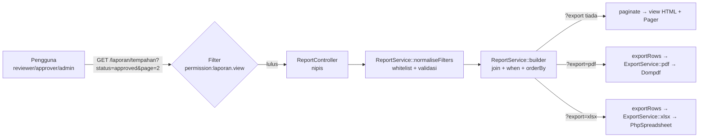
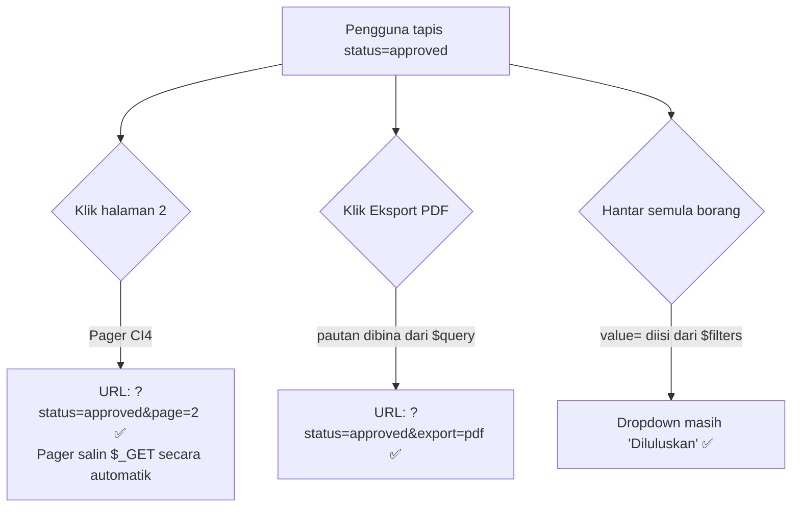
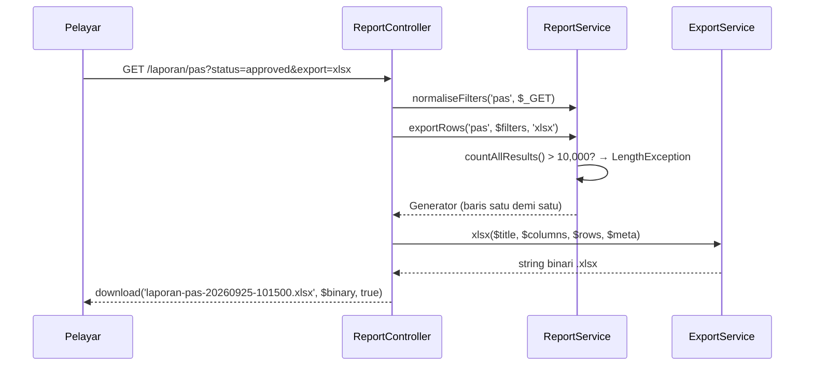

# Hari 9 — Modul Laporan (M3)

[← Jadual](../JADUAL.md) · [Kanun SPEC](../docs/spesifikasi-sistem.md) · [🧪 Lab Hari 9](./lab.md) · [Hari 10 →](../hari-10/README.md)

> **Fasa C — Lapor & Serah.** M1 (TLK) dan M2 (Pas) sudah menjana data. Hari ini kita mengubah data itu menjadi **maklumat yang boleh dipercayai**: senarai bertapis, ringkasan aggregate, dan fail PDF/Excel yang boleh dihantar kepada pengurusan.

---

## 🎯 Objektif Pembelajaran

Di akhir hari ini, peserta boleh:

| # | Objektif (boleh diukur) | Sesi |
|---|-------------------------|------|
| O1 | **Menulis** spesifikasi laporan RPT-01, RPT-02 dan RPT-03 (tujuan, pengguna, lajur, filter, susunan lalai, siapa boleh lihat) dalam format kad laporan. | S1 |
| O2 | **Membina** borang filter `method="get"` yang mengekalkan nilai filter selepas dihantar dan membawa query string yang sama ke pagination & butang eksport. | S1 |
| O3 | **Menulis** `ReportService` dengan Query Builder: `join()`, filter dinamik `when()`, julat tarikh yang betul, `groupBy()` + `selectCount()`, dan **whitelist** lajur susunan. | S2 |
| O4 | **Menjana** fail PDF (Dompdf, A4 landskap, pengepala/pengaki + nombor muka) dan `.xlsx` (PhpSpreadsheet, pengepala tebal, lebar automatik, baris beku) daripada filter yang **sama** dengan paparan HTML. | S3 |
| O5 | **Menguji** bahawa jumlah laporan = kiraan SQL terus melalui ujian PHPUnit, dan **menganalisis** pelan query dengan `EXPLAIN` untuk mencadangkan index. | S4 |
| O6 | **Menerangkan** risiko memori/masa bagi eksport besar dan cara mengawalnya (had rekod, penstriman baris). | S3, S4 |

---

## 📅 Jadual Hari Ini

| Masa | Sesi | Aktiviti | Objektif |
|------|------|----------|----------|
| 08:30–09:00 | — | Recap Hari 8 (aliran Pas + RBAC) | — |
| 09:00–10:30 | **S1** | Reka bentuk laporan (jenis, kriteria carian/filter) | O1, O2 |
| 10:30–10:45 | — | Rehat pagi | — |
| 10:45–12:30 | **S2** | Query aggregate & carian data | O3 |
| 12:30–14:30 | — | Makan tengah hari | — |
| 14:30–16:00 | **S3** | Eksport PDF/Excel | O4, O6 |
| 16:00–17:00 | **S4** | Ujian modul laporan; wrap-up — **M3 siap** | O5, O6 |

---

## 🧭 Kenapa hari ini penting

Pemilik sistem jarang membuka skrin "cipta tempahan". Yang mereka buka setiap minggu ialah **laporan** — dan yang mereka bawa ke mesyuarat ialah **PDF/Excel**. Jika laporan menunjukkan 47 tempahan diluluskan tetapi database sebenarnya ada 52, kepercayaan terhadap *seluruh* sistem runtuh, walaupun modul TLK dan Pas berfungsi sempurna.

Maka hari ini ada tiga prinsip yang kita pegang:

1. **Satu sumber kebenaran** — HTML, PDF dan Excel mesti memanggil *builder yang sama*. Tiada query "salinan" untuk eksport.
2. **Filter ialah input pengguna** — ia mesti divalidasi dan di-whitelist, sama seperti borang POST.
3. **Nombor mesti boleh dibuktikan** — ujian automatik membandingkan jumlah laporan dengan `COUNT(*)` terus.



---

## S1 · Reka bentuk laporan (09:00–10:30)

### 1.1 Laporan bermula dengan soalan, bukan dengan SQL

Sebelum menulis satu baris kod, jawab lima soalan untuk setiap laporan:

| Soalan | Contoh jawapan (RPT-01) |
|--------|--------------------------|
| **Siapa** membaca? | Pegawai pelulus TLK, pentadbir |
| **Keputusan apa** yang dibuat daripadanya? | Adakah slot OKU zon B cukup? Siapa yang masih menunggu keputusan? |
| **Lajur** apa yang perlu? | No. rujukan, pemohon, plat, zon, slot, kategori, tarikh mula/tamat, status |
| **Filter** apa? | Julat tarikh, zon, kategori, status (SPEC §2.3) |
| **Susunan lalai**? | Tarikh mula terbaru dahulu |

### 1.2 Kad spesifikasi RPT-01..03 (ikut SPEC §2.3)

| | **RPT-01** Senarai tempahan TLK | **RPT-02** Senarai permohonan Pas | **RPT-03** Penggunaan slot ikut zon |
|---|---|---|---|
| URL | `/laporan/tempahan` | `/laporan/pas` | `/laporan/penggunaan` |
| Jenis | Senarai (baris = 1 tempahan) | Senarai (baris = 1 permohonan) | **Aggregate** (baris = 1 zon) |
| Lajur | No. Rujukan, Pemohon, No. Plat, Zon, Slot, Kategori, Tarikh Mula, Tarikh Tamat, Status | No. Rujukan, Pemohon, No. Pekerja, Jabatan, Jenis Pas, Sah Dari, Sah Hingga, Status, Tarikh Mohon | Kod Zon, Nama Zon, Bil. Slot Aktif, Bil. Tempahan, Hari-Slot Ditempah, Kapasiti, Penggunaan (%) |
| Filter | `from`, `to`, `zone_id`, `category`, `status` | `from`, `to`, `department_id`, `pass_type`, `status` | `year`, `month` (kosong = setahun) |
| Makna julat tarikh | Tempahan **aktif** dalam julat (bertindih) | Tarikh **mohon** (`created_at`) | Tempoh bulan/tahun |
| Susunan lalai | `start_date` DESC | `created_at` DESC | `zone_code` ASC |
| Boleh susun | ref_no, zon, tarikh mula/tamat, status | ref_no, jabatan, jenis, status, tarikh mohon | kod zon, penggunaan |
| Pagination | 20/halaman | 20/halaman | 20/halaman (biasanya 1 halaman) |
| Eksport | PDF (≤2,000) · Excel (≤10,000) | sama | sama |
| Siapa boleh lihat | `laporan.view` → **reviewer, approver, admin** (SPEC §4). `applicant` **tidak**. | sama | sama |

> 💡 **Tip — rumus RPT-03.** Penggunaan (%) = hari-slot ditempah ÷ (bil. slot aktif × bil. hari dalam tempoh) × 100. Contoh: Zon A ada 2 slot aktif, Jun ada 30 hari → kapasiti 60 hari-slot. Dua tempahan diluluskan meliputi 10 + 5 hari dalam Jun → 15/60 = **25.0 %**. Hanya status `approved` dan `expired` (pernah digunakan) dikira; `pending`, `rejected`, `cancelled` tidak.

> ⚠️ **Kesilapan lazim — "reviewer boleh lihat RPT-01?"** Ya, kerana SPEC memberi `laporan.view` kepada reviewer, dan kebenaran itu meliputi ketiga-tiga laporan. Jika pemilik sistem mahu kawalan lebih halus (cth `laporan.tlk`), itu **perubahan SPEC** — rekod sebagai soalan terbuka, jangan ubah senyap-senyap.

### 1.3 Kenapa borang penapis guna `GET`, bukan `POST`?

| `GET` (pilihan kita) | `POST` |
|---|---|
| URL boleh ditanda buku & dikongsi: `/laporan/pas?status=approved&department_id=3` | URL sama untuk semua carian |
| Butang *Back* pelayar berfungsi | "Confirm form resubmission" |
| Pagination & eksport hanya perlu tambah `&page=2` / `&export=pdf` | Perlu simpan filter dalam sesi — rumit |
| Tidak mengubah data → tiada CSRF diperlukan | Perlu token CSRF |

Peraturan am: **GET untuk membaca, POST untuk mengubah.** Laporan hanya membaca.

### 1.4 Tiga cara penapis boleh "hilang" — dan penyelesaiannya



1. **Borang tidak diisi semula** → guna `value="<?= esc($filters['from'], 'attr') ?>"` dan `selected` untuk `<option>`. (Bukan `old()` — `old()` untuk redirect selepas POST.)
2. **Pagination membuang filter** → Pager CI4 **sudah** menyalin query string semasa. Jangan bina pautan halaman sendiri.
3. **Eksport tidak membawa filter** → bina pautan daripada filter **bersih** + `export=pdf`:

```php
// dalam view — $query = ReportService::toQuery($filters) (nilai kosong dibuang)
<a href="<?= current_url() . '?' . esc(http_build_query($query + ['export' => 'pdf']), 'attr') ?>">Eksport PDF</a>
```

> 💡 **Tip:** Bina pautan eksport daripada `$filters` yang telah dinormalkan, **bukan** `$_GET` mentah. Nilai tidak sah (cth `status=bogus`) sudah dibuang, jadi PDF tidak akan "menapis" dengan sesuatu yang skrin abaikan.

### 🎯 Kuiz S1

1. Kenapa borang filter laporan menggunakan `GET` dan bukan `POST`?
   - [ ] `GET` lebih selamat untuk data sulit
   - [x] Laporan hanya membaca data: URL boleh ditanda buku dan dikongsi, butang *Back* berfungsi, dan pagination/eksport cuma menambah `&page=2` atau `&export=pdf`
   - [ ] CI4 tidak menyokong pagination untuk `POST`
   - [ ] `GET` tidak perlu disemak oleh filter `permission:laporan.view`, jadi pemohon juga boleh membuka laporan tanpa konfigurasi tambahan pada Routes
   > Peraturan am: GET untuk membaca, POST untuk mengubah. Filter `permission:laporan.view` tetap dikenakan pada route laporan.

2. Zon B ada 3 slot aktif. Bagi bulan Jun 2026 (30 hari), tempahan `approved` meliputi 18 hari-slot dan tempahan `pending` meliputi 12 hari-slot. Berapakah Penggunaan (%) RPT-03?
   - [ ] 33.3 %
   - [ ] 60.0 %
   - [ ] 10.0 %
   - [x] 20.0 %
   > Kapasiti = 3 slot × 30 hari = 90 hari-slot. Hanya status `approved` dan `expired` dikira, jadi 18 ÷ 90 × 100 = 20.0 %. Tempahan `pending`, `rejected` dan `cancelled` tidak dikira.

---

## S2 · Query aggregate & carian data (10:45–12:30)

### 2.1 Langkah 1 — normalkan penapis (whitelist)

Setiap nilai `$_GET` ialah **teks tidak dipercayai**. `ReportService::normaliseFilters()` menukar input mentah kepada array bersih:

```php
// Tarikh: hanya Y-m-d yang BENAR-BENAR wujud (tolak 2026-02-31)
$d = DateTimeImmutable::createFromFormat('!Y-m-d', $value);
return ($d !== false && $d->format('Y-m-d') === $value) ? $value : null;

// Enum: tryFrom() pulang null untuk nilai asing — enum ialah whitelist percuma
$f['status'] = BookingStatus::tryFrom($this->str($input, 'status') ?? '')?->value;

// Susunan: kunci URL → lajur SQL. Kunci tiada dalam senarai? Guna lalai.
private const SORTABLE = ['tempahan' => ['ref_no' => 'b.ref_no', 'zone' => 'z.code', /* ... */]];
```

> ⚠️ **Kesilapan lazim — `orderBy($this->request->getGet('sort'))`.** Query Builder meng-escape **nilai**, tetapi nama lajur dalam `orderBy()` ialah **pengecam**, bukan nilai. Input seperti `sort=(SELECT SLEEP(5))` boleh lolos atau menyebabkan ralat SQL yang membocorkan struktur jadual. Sentiasa guna **peta whitelist**.

### 2.2 Langkah 2 — builder dengan `join()` + penapis dinamik `when()`

`when($syarat, $callback)` (CI 4.3+) menjalankan callback **hanya jika** syarat truthy. Ini menggantikan timbunan `if`:

```php
private function bookingsBuilder(array $f): BaseBuilder
{
    return $this->db->table('slot_bookings b')
        ->select('b.id, b.ref_no, b.start_date, b.end_date, b.status')
        ->select('u.full_name, v.plate_no, s.slot_no, s.category, z.code AS zone_code')
        ->join('users u', 'u.id = b.user_id')             // INNER: setiap tempahan ada pemohon
        ->join('vehicles v', 'v.id = b.vehicle_id')
        ->join('parking_slots s', 's.id = b.slot_id')
        ->join('parking_zones z', 'z.id = s.zone_id')
        // Julat = tempahan AKTIF dalam julat → syarat bertindih BR-TLK-01
        ->when($f['to'] ?? null,   static fn ($q, $to)   => $q->where('b.start_date <=', $to))
        ->when($f['from'] ?? null, static fn ($q, $from) => $q->where('b.end_date >=', $from))
        ->when($f['zone_id'] ?? null, static fn ($q, $id) => $q->where('s.zone_id', $id))
        ->when($f['status'] ?? null,  static fn ($q, $s)  => $q->where('b.status', $s));
}
```

**Kenapa INNER vs LEFT join?**

| Join | Guna bila | Contoh |
|------|-----------|--------|
| `join('users u', ...)` (INNER) | Hubungan **wajib** (FK NOT NULL) | tempahan → pemohon |
| `join('departments d', ..., 'left')` | Hubungan **pilihan** (FK NULL) | pengguna → jabatan (`department_id` NULL) |

> ⚠️ **Kesilapan lazim:** INNER JOIN ke `departments` akan **membuang senyap** permohonan daripada pengguna tanpa jabatan. Jumlah RPT-02 jadi kurang — dan tiada ralat pun! Ujian "jumlah laporan = jumlah SQL" di S4 menangkap pepijat ini.

### 2.3 Julat tarikh — dua jenis medan, dua cara

```text
DATE (start_date)        : '2026-09-30'            → where('start_date <=', '2026-09-30') ✅
DATETIME (created_at)    : '2026-09-30 14:00:00'   → where('created_at <=', '2026-09-30') ❌
                                                     (= sehingga 30/09 00:00:00 sahaja!)
```

Untuk DATETIME, guna julat **separuh-terbuka** `[from 00:00, to+1 hari 00:00)`:

```php
->where('p.created_at >=', $from . ' 00:00:00')
->where('p.created_at <', (new DateTimeImmutable($to))->modify('+1 day')->format('Y-m-d 00:00:00'))
```

> 💡 **Tip:** Jangan balut lajur dengan fungsi (`WHERE DATE(created_at) <= ?`). Ia betul dari segi logik tetapi MySQL tidak boleh guna index pada lajur tersebut — lihat EXPLAIN di S4.

### 2.4 Aggregate: `selectCount()` + `groupBy()` (RPT-03)

```php
// (a) Bil. slot aktif setiap zon — LEFT JOIN supaya zon tanpa slot muncul dengan 0
$zones = $this->db->table('parking_zones z')
    ->select('z.id, z.code, z.name')
    ->selectCount('s.id', 'total_slots')                       // COUNT(s.id) AS total_slots
    ->join('parking_slots s', 's.zone_id = z.id AND s.is_active = 1 AND s.deleted_at IS NULL', 'left', false)
    ->groupBy(['z.id', 'z.code', 'z.name'])                    // SEMUA lajur bukan-aggregate
    ->get()->getResultArray();

// (b) Hari-slot ditempah setiap zon — hanya bahagian yang bertindih dengan tempoh
$usage = $this->db->table('slot_bookings b')
    ->select('s.zone_id')
    ->selectCount('b.id', 'total_bookings')
    ->select("SUM(DATEDIFF(LEAST(b.end_date, {$endQ}), GREATEST(b.start_date, {$startQ})) + 1) AS booked_days", false)
    ->join('parking_slots s', 's.id = b.slot_id')
    ->whereIn('b.status', [BookingStatus::Approved->value, BookingStatus::Expired->value])
    ->where('b.start_date <=', $end)->where('b.end_date >=', $start)
    ->groupBy('s.zone_id')
    ->get()->getResultArray();
```

Tiga perkara penting:

1. **`COUNT(s.id)` bukan `COUNT(*)`** — dengan LEFT JOIN, zon tanpa slot menghasilkan satu baris `s.id = NULL`. `COUNT(*)` kira 1; `COUNT(s.id)` kira 0 ✅.
2. **`ONLY_FULL_GROUP_BY`** — MySQL 8 menolak `SELECT z.code ... GROUP BY z.id` jika `z.code` tiada dalam GROUP BY (ralat 1055). Senaraikan semua lajur bukan-aggregate.
3. **`select(..., false)`** mematikan escape untuk ungkapan SQL. **Hanya** selamat kerana `$startQ`/`$endQ` dijana oleh kita *dan* dibalut `$this->db->escape()`. Jangan sekali-kali letak teks `$_GET` di sini.

`LEAST/GREATEST` memotong tempahan kepada bahagian dalam tempoh:

```text
Tempoh Jun      :        01/06 ======================== 30/06
Tempahan #2     : 25/05 ========= 05/06
Bertindih       :        01/06 == 05/06   → DATEDIFF(05/06, 01/06) + 1 = 5 hari
```

### 2.5 Pagination dengan penapis kekal

```php
$builder = $this->builder($report, $filters);
$total   = $builder->countAllResults(false);   // false = JANGAN reset → where/join kekal
$rows    = $this->applySort($builder, $report, $filters)
    ->limit($perPage, ($page - 1) * $perPage)
    ->get()->getResultArray();
```

Dalam view: `<?= $pager->makeLinks($result['page'], $result['perPage'], $result['total']) ?>` — Pager membaca `$_GET` dan menambah `page=N`.

> ⚠️ **Kesilapan lazim — rekod "melompat" antara halaman.** Jika susun hanya ikut `status`, banyak baris ada nilai sama; MySQL bebas memulangkan susunan berbeza setiap query → rekod sama muncul di halaman 1 *dan* 2. Sentiasa tambah **susunan kedua yang unik**: `->orderBy('b.id', $dir)`.

### 🎯 Kuiz S2

1. Apakah masalah kod berikut?
   ```php
   $builder->orderBy($this->request->getGet('sort'), 'DESC');
   ```
   - [ ] Tiada masalah — Query Builder meng-escape semua input, termasuk nama lajur dalam `orderBy()`, `where()` dan `select()`, jadi SQL injection tidak mungkin berlaku
   - [ ] `orderBy()` tidak menerima arah `DESC`
   - [x] Nama lajur dalam `orderBy()` ialah pengecam, bukan nilai; ia tidak di-escape seperti nilai — guna peta whitelist (`SORTABLE`) dari kunci URL ke lajur SQL
   - [ ] Masalahnya hanya prestasi kerana tiada index
   > Input seperti `sort=(SELECT SLEEP(5))` boleh lolos atau menghasilkan ralat SQL yang membocorkan struktur. Kunci yang tiada dalam whitelist jatuh ke susunan lalai.

2. Pengguna menapis RPT-02 dengan `to = 2026-09-30`. Permohonan dihantar pada `2026-09-30 14:00:00`. Filter manakah yang **memasukkan** permohonan itu dengan betul dan tidak menghalang penggunaan index (jika ditambah)?
   - [ ] `->where('p.created_at <=', '2026-09-30')`
   - [x] `->where('p.created_at <', '2026-10-01 00:00:00')`
   - [ ] `->where('DATE(p.created_at) <=', '2026-09-30')`
   - [ ] `->where('p.created_at =', '2026-09-30')`
   > Untuk DATETIME, guna julat separuh-terbuka `[from 00:00, to+1 hari 00:00)`. `<= '2026-09-30'` bermaksud sehingga 00:00:00 sahaja. `DATE(created_at)` betul dari segi logik tetapi menghalang penggunaan index.

---

## S3 · Eksport PDF/Excel (14:30–16:00)

### 3.1 Seni bina: satu data, tiga persembahan



`ExportService` **tidak tahu** apa itu tempahan atau pas. Ia hanya menerima `$columns` + `$rows` + `$meta`. Maka satu service boleh digunakan untuk semua laporan — sekarang dan akan datang.

### 3.2 Dompdf — HTML ke PDF

```bash
composer require dompdf/dompdf phpoffice/phpspreadsheet
```

```php
$options = new Options();
$options->setDefaultFont('DejaVu Sans');   // fon Unicode terbina — "Nur'aini", "Ābdul" dipapar betul
$options->setIsRemoteEnabled(false);       // jangan muat URL luar
$dompdf = new Dompdf($options);
$dompdf->loadHtml($html, 'UTF-8');
$dompdf->setPaper('A4', 'landscape');      // 9 lajur tidak muat dalam potret
$dompdf->render();

// Nombor muka hanya diketahui SELEPAS render → tulis terus pada canvas
$font = $dompdf->getFontMetrics()->getFont('DejaVu Sans');
$dompdf->getCanvas()->page_text(760, 572, 'Muka {PAGE_NUM} / {PAGE_COUNT}', $font, 8);
```

Pengepala/pengaki berulang dengan CSS (Dompdf menyokong CSS 2.1, **bukan** flexbox/grid):

```css
@page  { margin: 85px 28px 50px 28px; }       /* ruang untuk header & footer */
header { position: fixed; top: -70px; }       /* fixed = diulang setiap muka */
footer { position: fixed; bottom: -35px; }    /* "Dijana pada … oleh …" */
thead  { display: table-header-group; }       /* pengepala jadual diulang */
tr     { page-break-inside: avoid; }
```

> 💡 **Tip — kenapa "Dijana pada … oleh …"?** Laporan yang dicetak akan hidup lebih lama daripada skrin. Tanpa tarikh jana dan nama pengguna, tiada siapa tahu sama ada angka itu semalam atau tahun lepas — ini keperluan **jejak audit** yang ringkas.

### 3.3 PhpSpreadsheet — `.xlsx` yang kemas

```php
$sheet->fromArray(array_values($columns), null, 'A5');                    // pengepala
$sheet->getStyle("A5:{$lastCol}5")->getFont()->setBold(true);             // tebal
$sheet->setCellValueExplicit('C6', '001234', DataType::TYPE_STRING);       // "001234" kekal teks
$sheet->getColumnDimension('A')->setAutoSize(true);                        // lebar automatik
$sheet->freezePane('A6');                                                  // baris 1–5 beku
$sheet->setAutoFilter("A5:{$lastCol}{$lastRow}");                          // penapis Excel
```

| Kenapa `setCellValueExplicit(... TYPE_STRING)`? | |
|---|---|
| No. pekerja `001234` | Tanpa explicit → nombor `1234` (sifar hilang) |
| Teks bermula `=` (cth `=HYPERLINK(...)`) | Tanpa explicit → Excel anggap **formula** (CSV/formula injection) |
| Nombor sebenar (`total_slots`, `utilisation`) | Kekal nombor — boleh dijumlah dalam Excel |

### 3.4 Memori & masa untuk eksport besar

| Risiko | Punca | Kawalan dalam kod kita |
|--------|-------|------------------------|
| `Allowed memory size of 134217728 bytes exhausted` | PhpSpreadsheet ~1 KB/sel → 10,000 baris × 9 lajur ≈ 90 MB | `EXPORT_LIMIT['xlsx'] = 10000`; `disconnectWorksheets()` selepas tulis |
| `Maximum execution time of 30 seconds exceeded` | Dompdf mengira susun atur setiap sel; ribuan baris = puluhan saat | `EXPORT_LIMIT['pdf'] = 2000` |
| Array PHP gergasi | `getResultArray()` membina semua baris sekaligus | `exportRows()` pulang **Generator** + `getUnbufferedRow()` |

```php
// BUKAN fungsi generator → semakan had berlaku SERTA-MERTA
public function exportRows(string $report, array $filters, string $format): iterable
{
    $total = $builder->countAllResults(false);
    if ($total > $limit) {
        throw new LengthException('Terlalu banyak rekod … Sila kecilkan julat penapis.');
    }
    return $this->streamRows($report, $this->applySort($builder, $report, $filters)); // ← generator
}
```

> ⚠️ **Kesilapan lazim — "naikkan sahaja `memory_limit` ke -1".** Itu menangguhkan masalah sehingga server pengeluaran jatuh. Had yang jelas + mesej "kecilkan julat filter" ialah reka bentuk yang jujur. Untuk data > 10,000 baris, cadangkan CSV (penstriman sebenar) atau kerja latar belakang — ⭐ cabaran.

### 🎯 Kuiz S3

1. Kenapa `ExportService` menulis No. Pekerja dengan `setCellValueExplicit(..., DataType::TYPE_STRING)`?
   - [x] Supaya `001234` kekal teks (sifar di hadapan tidak hilang) dan teks bermula `=` tidak dianggap formula (formula injection)
   - [ ] Supaya lajur No. Pekerja boleh dijumlahkan dan diisih sebagai nombor dalam Excel tanpa amaran "Number stored as text"
   - [ ] Kerana PhpSpreadsheet tidak menyokong nombor
   - [ ] Supaya fail `.xlsx` lebih kecil
   > Nilai teks ditulis secara eksplisit sebagai string. Nombor sebenar (cth `total_slots`, `utilisation`) kekal nombor supaya boleh dijumlahkan.

2. Eksport Excel RPT-01 gagal dengan `Allowed memory size … exhausted` untuk 50,000 baris. Apakah reka bentuk yang disyorkan?
   - [ ] Tetapkan `memory_limit = -1` dalam `php.ini` dan `set_time_limit(0)` dalam `ReportController` supaya eksport besar sentiasa berjaya tanpa had baris
   - [x] Kuatkuasa had (`EXPORT_LIMIT['xlsx'] = 10000`) dengan `LengthException` dan mesej "kecilkan julat filter"; baris distrim melalui Generator
   - [ ] Tukar kepada PDF kerana Dompdf lebih jimat memori
   - [ ] Buang `countAllResults()` supaya query lebih cepat
   > Menaikkan `memory_limit` hanya menangguhkan masalah sehingga server pengeluaran jatuh. Had PDF lebih rendah (2,000) kerana Dompdf perlahan untuk ribuan baris.

---

## S4 · Ujian modul laporan & prestasi (16:00–17:00)

### 4.1 "Jumlah laporan = jumlah SQL"

Ujian laporan yang baik **tidak** menguji HTML. Ia menguji **nombor**, dengan fixture kecil yang kita tahu jawapannya:

```php
public function testRpt01PenapisStatusSamaDenganKiraanSql(): void
{
    $f      = $this->service->normaliseFilters('tempahan', ['status' => 'approved']);
    $result = $this->service->paginate('tempahan', $f, 1);

    $expected = $this->db->table('slot_bookings')->where('status', 'approved')->countAllResults();

    $this->assertSame($expected, $result['total']);   // bandingan dengan SQL terus
    $this->assertSame(3, $result['total']);           // DAN dengan jawapan yang kita kira dengan tangan
}
```

Kenapa **dua** assertion? Jika kedua-dua query berkongsi pepijat sama (cth INNER JOIN yang salah), assertion pertama boleh lulus secara palsu. Nombor yang dikira dengan tangan ialah jangkar kebenaran.

Kes minimum untuk M3 siap (semua ada dalam `templates/kod/ReportServiceTest.php.txt` (modul **Templat & Rujukan**)):

| Kes | Membuktikan |
|-----|-------------|
| Tanpa filter = `COUNT(*)` jadual | Tiada JOIN yang membuang baris |
| Filter status / zon / jabatan | `where` betul |
| Julat tarikh bertindih (RPT-01) | Syarat BR-TLK-01 diguna semula |
| Hari terakhir julat tidak tercicir (RPT-02) | Julat separuh-terbuka DATETIME |
| Nilai tidak sah diabaikan; `sort` asing jatuh ke lalai | Whitelist berfungsi |
| Eksport = jumlah HTML | Satu sumber kebenaran |
| RPT-03 Jun 2026 = 25.0 % | Rumus aggregate |

### 4.2 `EXPLAIN` — adakah query guna index?

```php
// Ambil SQL SEBENAR daripada builder yang sama (bukan SQL yang ditaip semula dengan tangan)
$sql  = (new \App\Services\ReportService())->builder('tempahan', ['status' => 'approved'])->getCompiledSelect();
$plan = db_connect()->query('EXPLAIN ' . $sql)->getResultArray();
```

Cara membaca lajur utama:

| Lajur | Baik | Amaran |
|-------|------|--------|
| `type` | `const`, `eq_ref`, `ref`, `range` | `ALL` (imbas penuh jadual) |
| `key` | nama index (cth `status`) | `NULL` |
| `rows` | kecil berbanding saiz jadual | ≈ jumlah baris jadual |
| `Extra` | `Using index`, `Using where` | `Using filesort`, `Using temporary` (pada jadual besar) |

SPEC §3 sudah menyediakan `INDEX(status)` dan `INDEX(slot_id, start_date, end_date)` pada `slot_bookings`, serta `INDEX(status)` pada `pass_applications`. Filter RPT-02 mengikut `created_at` **tiada** index — pada 500 baris latihan ia tidak ketara, pada 500,000 baris ia ketara. Lab S4 menunjukkan cara mengukur sebelum memutuskan.

> 💡 **Tip:** Index mempercepat `SELECT` tetapi memperlahankan `INSERT/UPDATE` dan memakan ruang. **Ukur dahulu** (EXPLAIN + Debug Toolbar → tab *Database*), baru tambah. Index tambahan ialah keputusan reka bentuk — rekod dalam `docs/log-keputusan.md` (Hari 2).

### 🎯 Kuiz S4

1. Kenapa ujian RPT-01 mempunyai **dua** assertion: satu terhadap kiraan SQL terus, satu terhadap nombor yang dikira dengan tangan (`3`)?
   - [ ] PHPUnit memerlukan sekurang-kurangnya dua assertion setiap ujian
   - [ ] Supaya ujian berjalan lebih cepat
   - [x] Jika kedua-dua query berkongsi pepijat yang sama (cth JOIN salah), assertion pertama boleh lulus secara palsu; nombor yang dikira dengan tangan ialah jangkar kebenaran
   - [ ] Supaya HTML laporan dan pautan eksport turut diuji, kerana assertion kedua membandingkan bilangan baris `<tr>` dalam paparan
   > Ujian laporan menguji **nombor**, bukan HTML, menggunakan fixture kecil yang jawapannya kita tahu. Pilihan `<tr>` salah kerana assertion kedua membandingkan hasil service dengan nombor tetap `3`, bukan baris dalam paparan.

2. `EXPLAIN` bagi query laporan memaparkan `type = ALL`, `key = NULL` dan `rows` ≈ jumlah baris jadual. Apakah maksudnya?
   - [ ] Query menggunakan index dengan cekap — `ALL` bermaksud semua index yang sesuai digunakan, dan `key = NULL` bermaksud tiada index tambahan diperlukan
   - [ ] Query gagal dan tiada baris dipulangkan
   - [ ] MySQL menggunakan cache
   - [x] Imbasan penuh jadual — tiada index digunakan; ukur dan pertimbangkan index (rekod keputusan dalam `docs/pelan-kerja.md`)
   > `type` yang baik ialah `const`, `eq_ref`, `ref` atau `range` dengan `key` bernama. Index mempercepat `SELECT` tetapi memperlahankan `INSERT/UPDATE` — ukur dahulu sebelum menambah.

---

## 📦 Hasil Hari Ini

- [ ] `app/Services/ReportService.php` — filter whitelist, 2 builder (RPT-01/02), aggregate RPT-03, pagination, `exportRows()` berhad
- [ ] `app/Services/ExportService.php` — `pdf()` (A4 landskap, header/footer, nombor muka) & `xlsx()` (tebal, autosize, beku, autofilter)
- [ ] `service('reportService')` & `service('exportService')` didaftar dalam `app/Config/Services.php`
- [ ] `app/Controllers/Laporan/ReportController.php` — nipis; `bookings()`, `passes()`, `usage()`
- [ ] `app/Views/laporan/index.php` (borang GET + jadual + eksport) & `app/Views/laporan/pdf.php`
- [ ] Route `/laporan/{tempahan|pas|penggunaan}` dengan `permission:laporan.view`
- [ ] `tests/Services/ReportServiceTest.php` — hijau
- [ ] Nota EXPLAIN (1 perenggan) dalam README projek
- [ ] Commit `RPT: ...` dalam branch `feat/laporan` → **M3 siap** ✅

---

## 🧠 Semakan Kendiri

**1. Kenapa borang filter laporan menggunakan `method="get"`, dan adakah ia perlu token CSRF?**
<details><summary>Jawapan</summary>

GET menjadikan filter sebahagian daripada URL — boleh ditanda buku, dikongsi, butang *Back* berfungsi, dan pagination/eksport hanya perlu menambah parameter. GET tidak mengubah data, jadi **tidak** perlu CSRF. CSRF melindungi permintaan yang **mengubah keadaan** (POST/PUT/DELETE).
</details>

**2. Pengguna menapis `to=2026-09-30` pada RPT-02, tetapi permohonan yang dihantar 30/09 jam 14:00 tidak muncul. Apakah puncanya dan pembetulannya?**
<details><summary>Jawapan</summary>

`created_at` ialah DATETIME. `where('created_at <=', '2026-09-30')` dibanding sebagai `2026-09-30 00:00:00`, jadi semua rekod selepas tengah malam 30/09 tercicir. Guna julat separuh-terbuka: `created_at < '2026-10-01 00:00:00'` (to + 1 hari).
</details>

**3. Kenapa `orderBy($this->request->getGet('sort'))` berbahaya walaupun kita guna Query Builder?**
<details><summary>Jawapan</summary>

Query Builder meng-escape **nilai** (binding), tetapi argumen `orderBy()` ialah **pengecam/ungkapan** SQL. Input pengguna boleh menyuntik ungkapan (cth subquery) atau menyebabkan ralat yang membocorkan struktur. Penyelesaian: peta whitelist `['ref_no' => 'b.ref_no', ...]` dan guna nilai lalai jika kunci tiada.
</details>

**4. Dalam RPT-03, kenapa `selectCount('s.id', ...)` dan bukan `COUNT(*)` selepas LEFT JOIN?**
<details><summary>Jawapan</summary>

Zon tanpa slot aktif tetap menghasilkan satu baris dengan `s.id = NULL` (sifat LEFT JOIN). `COUNT(*)` mengira baris itu (1), manakala `COUNT(s.id)` mengabaikan NULL (0) — jawapan yang betul.
</details>

**5. Eksport Excel 50,000 baris gagal dengan "Allowed memory size exhausted". Beri dua tindakan yang betul dan satu yang salah.**
<details><summary>Jawapan</summary>

Betul: (a) kuatkuasa had rekod dengan mesej "kecilkan julat filter" (`EXPORT_LIMIT`); (b) untuk keperluan data besar, tawarkan CSV berstrim atau kerja latar belakang yang menjana fail dan memaklumkan pengguna. Juga baik: penstriman baris dengan Generator, `disconnectWorksheets()`.
Salah: `ini_set('memory_limit', '-1')` — menangguhkan masalah sehingga server jatuh.
</details>

---

## ➡️ Persediaan untuk esok

Hari 10 ialah hari terakhir: **Statistik + Capstone**.

1. Pastikan **M1, M2, M3** sudah di-merge ke `main` dan `composer test` hijau.
2. Jalankan `php spark db:seed DatabaseSeeder` semula supaya ada data sintetik yang cukup (sekurang-kurangnya 2 zon, 20 tempahan, 15 permohonan pas pelbagai status) — carta kosong tidak meyakinkan semasa demo.
3. Baca sekali imbas dokumentasi Chart.js 4 *Getting Started*: <https://www.chartjs.org/docs/latest/getting-started/>.
4. Setiap peserta: senaraikan **3 perkara** yang paling anda banggakan dan **1 pepijat** yang masih diketahui — ia bahan untuk demo & retrospektif esok.
5. Semak templat UAT: `templates/dokumen/uat-signoff-templat.md` (modul **Templat & Rujukan**) dan `templates/dokumen/kes-ujian-templat.md` (modul **Templat & Rujukan**).
