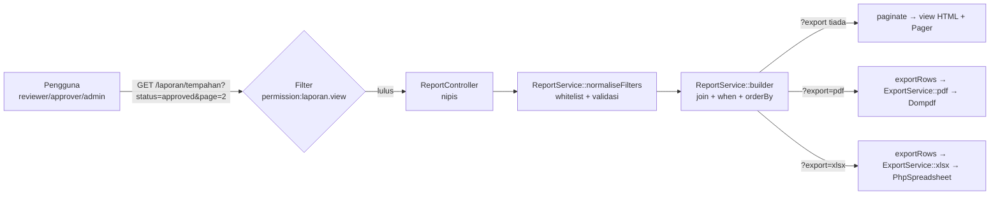
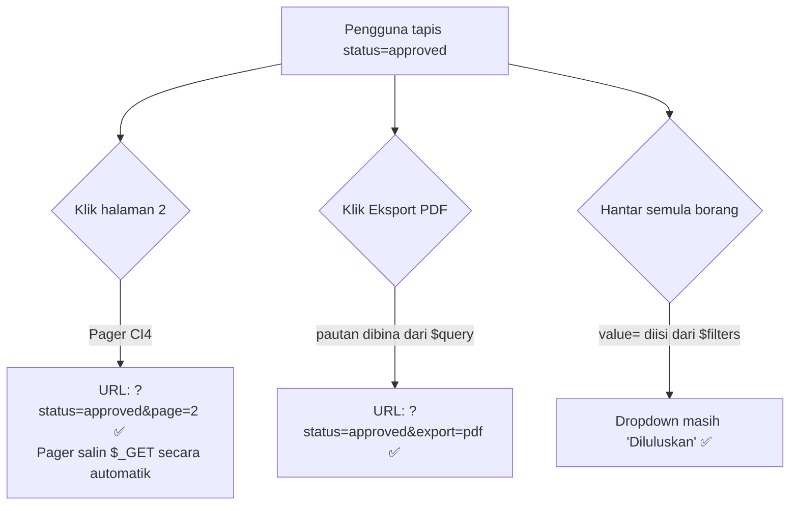
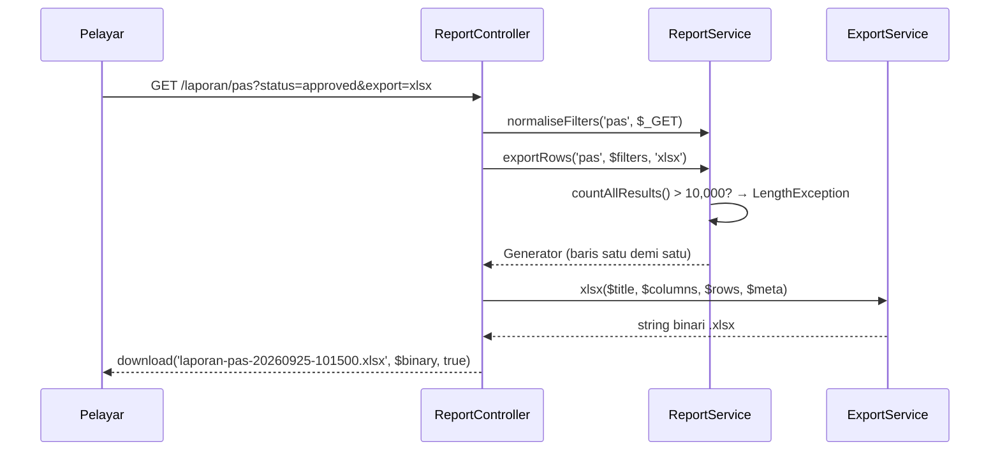

# Hari 9 — Modul Laporan (M3)

[← Jadual](../JADUAL.md) · [Kanun SPEC](../docs/spesifikasi-sistem.md) · [🧪 Lab Hari 9](./lab.md) · [Hari 10 →](../hari-10/README.md)

> **Fasa C — Lapor & Serah.** M1 (TLK) dan M2 (Pas) sudah menjana data. Hari ini kita mengubah data itu menjadi **maklumat yang boleh dipercayai**: senarai bertapis, ringkasan aggregate, dan fail PDF/Excel yang boleh dihantar kepada pengurusan.

---

## 🎯 Objektif Pembelajaran

Di akhir hari ini, peserta boleh:

| # | Objektif (boleh diukur) | Sesi |
|---|-------------------------|------|
| O1 | **Menulis** spesifikasi laporan RPT-01, RPT-02 dan RPT-03 (tujuan, pengguna, lajur, filter, susunan lalai, siapa boleh lihat) dalam format kad laporan. | S1 |
| O2 | **Membina** borang filter `method="get"` yang mengekalkan nilai filter selepas dihantar dan membawa query string yang sama ke pagination & butang eksport. | S1 |
| O3 | **Menulis** `ReportService` dengan Query Builder: `join()`, filter dinamik `when()`, julat tarikh yang betul, `groupBy()` + `selectCount()`, dan **whitelist** lajur susunan. | S2 |
| O4 | **Menjana** fail PDF (Dompdf, A4 landskap, pengepala/pengaki + nombor muka) dan `.xlsx` (PhpSpreadsheet, pengepala tebal, lebar automatik, baris beku) daripada filter yang **sama** dengan paparan HTML. | S3 |
| O5 | **Menguji** bahawa jumlah laporan = kiraan SQL terus melalui ujian PHPUnit, dan **menganalisis** pelan query dengan `EXPLAIN` untuk mencadangkan index. | S4 |
| O6 | **Menerangkan** risiko memori/masa bagi eksport besar dan cara mengawalnya (had rekod, penstriman baris). | S3, S4 |
| O7 | **Membina** pautan GET tempoh pantas (Bulan ini / Bulan lepas / Tahun ini) dan cip filter aktif yang mengekalkan filter lain, dan **menambah** kedua-duanya pada kad spesifikasi. | S5 |
| O8 | **Menulis** ringkasan status dengan `fromSubquery()` + `groupBy()` atas builder senarai yang sama, dan baris JUMLAH RPT-03 berwajaran. | S6 |
| O9 | **Menjana** lembaran Excel *Ringkasan* dengan formula `=SUM()` dan jadual ringkasan PDF daripada `statusSummary()` yang sama dengan skrin. | S7 |
| O10 | **Menguji** ringkasan dan JUMLAH terhadap `GROUP BY` SQL dan nombor yang dikira dengan tangan, dan **membuktikan** dengan mutasi bahawa ujian tanpa filter boleh lulus secara palsu. | S8 |
| O11 | **Membina** `ReportService` (penapis whitelist, builder berbinding) dengan Claude Code dan **membuktikan** jadual *input → hasil penapis* yang anda tulis sendiri dengan `php spark shell`. | S9 |
| O12 | **Menilai** diff paparan senarai Claude (satu sumber penapis, `esc(..., 'attr')`, `GET`) dan **menguji** XSS atribut, pagination dan akses sendiri. | S10 |
| O13 | **Membuktikan** eksport PDF/Excel yang dijana Claude: skrin = PDF = Excel, dan teks `=1+1` kekal teks (formula injection). | S11 |
| O14 | **Menguji** `ReportService` dengan nilai yang dikira dengan tangan + mutasi, dan **menganalisis** index (`db_table`) dan `EXPLAIN` untuk cadangan index yang direkod. | S12 |

---

## 📅 Jadual Hari Ini

> ℹ️ **Jadual Hari 9 (dikemas kini):** Modul Laporan dibina **dengan Claude Code** (S9–S12, Lab 9.10–9.13) di branch `feat/laporan-claude`. Lab manual (S1–S8, Lab 9.1–9.4b) ialah **kod rujukan, tidak wajib**: setiap lab baharu ada langkah *Banding dengan kod rujukan* yang menunjuk ke bahagian manual yang sepadan. Nota konsep S1–S4 kekal sebagai bacaan untuk menilai diff.

| Masa | Sesi | Aktiviti | Objektif |
|------|------|----------|----------|
| 08:30–09:00 | — | Recap Hari 8 (aliran Pas + RBAC) | — |
| 09:00–10:30 | **S9** | Claude Code: `ReportService` & penapis whitelist (slice L1) | O11 |
| 10:30–10:45 | — | Rehat pagi | — |
| 10:45–12:30 | **S10** | Claude Code: paparan senarai & RPT-03 (slice L2) | O12 |
| 12:30–14:30 | — | Makan tengah hari | — |
| 14:30–16:00 | **S11** | Claude Code: eksport PDF & Excel selamat (slice L3) | O13 |
| 16:00–17:00 | **S12** | Claude Code: ujian laporan & prestasi — **M3 siap** | O14 |

---

## 🧭 Kenapa hari ini penting

Pemilik sistem jarang membuka skrin "cipta tempahan". Yang mereka buka setiap minggu ialah **laporan** — dan yang mereka bawa ke mesyuarat ialah **PDF/Excel**. Jika laporan menunjukkan 47 tempahan diluluskan tetapi database sebenarnya ada 52, kepercayaan terhadap *seluruh* sistem runtuh, walaupun modul TLK dan Pas berfungsi sempurna.

Maka hari ini ada tiga prinsip yang kita pegang:

1. **Satu sumber kebenaran** — HTML, PDF dan Excel mesti memanggil *builder yang sama*. Tiada query "salinan" untuk eksport.
2. **Filter ialah input pengguna** — ia mesti divalidasi dan di-whitelist, sama seperti borang POST.
3. **Nombor mesti boleh dibuktikan** — ujian automatik membandingkan jumlah laporan dengan `COUNT(*)` terus.



---

## S9 — Claude Code: ReportService & Penapis Whitelist (09:00–10:30)

Modul Laporan dibina **bersama Claude Code** dengan tujuh gerbang yang sama seperti Hari 8 (S9): SPEC & ID → pelan slice dalam mod Plan (anda menyunting) → laksana dalam mod Manual (anda meluluskan setiap diff; *accept edits*/*auto*/*bypass* dilarang) → sahkan (`composer test`, pelayar, tool MCP `ci4-spark`) → `semak-ci4` → gerbang terang 3 baris dalam `docs/nota-claude.md` → commit kecil di `feat/laporan-claude`.

Modul ini tiada BR bernombor seperti TLK/Pas. "Peraturan" anda datang dari SPEC §2.3 (RPT-01..03 dan penapisnya), §10 (*tiada SQL mentah dengan input pengguna*) dan prinsip README ini: **penapis ialah input pengguna**. Sebelum Claude menulis apa-apa, anda menulis jadual *input → hasil penapis* sendiri. Jadual itulah yang menilai kod Claude:

| Input | Jika kod betul | Jika kod salah (tolak) |
|-------|----------------|------------------------|
| `status=bogus` | `status` dibuang (`tryFrom()` → `null`) | `WHERE status = 'bogus'` → laporan kosong secara senyap |
| `sort=b.id; DROP TABLE users` | `sort` lalai dari `SORTABLE` | Masuk ke `orderBy()` — nama lajur **tidak boleh** di-bind |
| `from=2026-06-30&to=2026-06-01` | julat ditukar | laporan kosong |
| RPT-02 `to=2026-09-30` | `created_at < '2026-10-01 00:00:00'` | `<= '2026-09-30'` → rekod 30/09 14:00 tercicir |

Nilai (`status`, tarikh) di-bind oleh Query Builder; **nama lajur** (`sort`) tidak boleh di-bind, jadi hanya whitelist yang melindunginya.

Lab: [Lab 9.10](./lab.md#lab-910--claude-code-reportservice--penapis-whitelist-s9)

### 🎯 Kuiz S9

> Jawab selepas Lab 9.10 — jawapan datang daripada pelan, diff dan output `php spark shell` anda. Lulus kuiz ini menanda checkpoint Lab 9.10.

1. Diff Claude mengandungi `->orderBy($this->request->getGet('sort'), 'desc')`. Kenapa anda menolaknya walaupun Query Builder melepaskan nilai?
   - [ ] Kerana `orderBy()` hanya menerima nombor lajur
   - [x] Kerana `sort` ialah nama lajur, bukan nilai — ia tidak di-bind, jadi mesti melalui whitelist `SORTABLE`
   - [ ] Kerana `getGet()` tidak wujud dalam CodeIgniter 4
   - [ ] Tidak perlu ditolak; filter `permission:laporan.view` sudah melindungi route
   > Binding melindungi **nilai** dalam `WHERE`. Nama lajur dan arah susunan disisipkan ke dalam SQL, jadi hanya kunci yang dikenali (`SORTABLE`) dan `asc`/`desc` boleh diterima.

2. Dalam `php spark shell`, anda menjalankan `normaliseFilters('pas', ['status' => ['approved'], 'sort' => 'b.id; DROP TABLE users'])`. Apakah hasil yang betul?
   - [ ] `status` = `approved` dan `sort` = `b.id; DROP TABLE users`
   - [ ] `InvalidArgumentException` kerana input mengandungi SQL
   - [ ] `status` = `approved` dan `sort` = `created_at`
   - [x] `status` kosong (array ditolak) dan `sort` = `created_at` (lalai RPT-02)
   > `str()` menolak array (`?status[]=…`), jadi `tryFrom('')` memulangkan `null`. Kunci `sort` yang tiada dalam `SORTABLE` jatuh ke lalai. Penapis tidak membaling exception — laporan tetap dipaparkan dengan penapis yang sah.

---

## S10 — Claude Code: Paparan Senarai & RPT-03 (10:45–12:30)

Slice L2 menyambungkan service kepada skrin: borang penapis `GET` (§1.3), pagination yang mengekalkan penapis (§2.5), dan RPT-03 aggregate (§2.4). Peraturan untuk diff Claude: **satu sumber penapis**. Borang, pager, pengepala susun dan pautan eksport semuanya dibina daripada `$filters` bersih dari `normaliseFilters()`, bukan dari `$_GET`:

| Elemen | Dibina daripada | Konteks `esc()` |
|--------|-----------------|-----------------|
| Nilai borang | `$filters` | `esc($v, 'attr')` |
| Pautan halaman & susun | `toQuery($filters)` | `esc(..., 'attr')` |
| Pautan Eksport PDF/Excel | `toQuery($filters) + ['export' => …]` | `esc(..., 'attr')` |
| Sel jadual | baris dari `builder()` | `esc($v)` |

Anda menguji sendiri: XSS dalam atribut (`?from=%22%3E%3Cb%3Ex`), penapis di halaman 2, dan `pemohon1` ditolak di server (menu yang disembunyikan hanyalah UX).

Lab: [Lab 9.11](./lab.md#lab-911--claude-code-paparan-senarai-laporan--rpt-03-s10)

### 🎯 Kuiz S10

> Jawab selepas Lab 9.11 — jawapan datang daripada pelayar dan *View Page Source* anda. Lulus kuiz ini menanda checkpoint Lab 9.11.

1. Claude mencadangkan pautan eksport `href="<?= current_url() . '?' . http_build_query($_GET + ['export' => 'pdf']) ?>"`. Apakah masalahnya?
   - [x] Ia dibina dari `$_GET` mentah dan tanpa `esc(..., 'attr')`: penapis eksport boleh berbeza daripada skrin, dan atribut terdedah kepada XSS
   - [ ] Tiada masalah; `http_build_query()` sudah selamat untuk HTML
   - [ ] `current_url()` tidak boleh digunakan dalam view
   - [ ] Eksport mesti menggunakan `POST`, bukan pautan
   > `http_build_query()` mengekod untuk URL, bukan HTML. Bina dari `toQuery($filters)` (penapis bersih yang sama dengan skrin) dan lepaskan dengan `esc(..., 'attr')`.

2. Claude mencadangkan borang penapis `method="post"`. Kenapa pelan meminta `GET`?
   - [ ] `POST` tidak menyokong input `type="date"`
   - [ ] `GET` lebih pantas kerana tiada CSRF
   - [x] Penapis ialah bacaan: URL boleh ditanda buku dan dikongsi, butang *Back* berfungsi, dan query string yang sama dibawa ke pagination dan eksport
   - [ ] `POST` tidak boleh dilindungi oleh `permission:laporan.view`
   > Borang yang **mengubah** data memerlukan `POST` + CSRF. Borang yang hanya **membaca** guna `GET` supaya keadaan laporan hidup dalam URL.

---

## S11 — Claude Code: Eksport PDF & Excel Selamat (14:30–16:00)

Slice L3 menambah eksport (§3.1–§3.4). Tiga perkara yang kod AI sering terlepas:

1. **Satu sumber kebenaran.** `exportRows()` memanggil `builder()` yang **sama** dengan skrin. Query eksport yang ditulis semula = skrin 47 rekod, Excel 52 rekod.
2. **Formula injection.** Nama `=HYPERLINK(...)` atau `=1+1` yang ditulis dengan `setCellValue()`/`fromArray()` menjadi formula apabila fail dibuka. Teks mesti ditulis dengan `setCellValueExplicit(..., DataType::TYPE_STRING)`.
3. **Had sebelum baca.** `countAllResults(false)` dan `LengthException` sebelum baris pertama dibaca; baris distrim dengan `getUnbufferedRow()`, bukan `getResultArray()`.

PDF ialah HTML: setiap nilai dalam `pdf.php` melalui `esc()`, dan `isRemoteEnabled` kekal `false`.

Lab: [Lab 9.12](./lab.md#lab-912--claude-code-eksport-pdf--excel-selamat-s11)

### 🎯 Kuiz S11

> Jawab selepas Lab 9.12 — jawapan datang daripada fail eksport sebenar anda. Lulus kuiz ini menanda checkpoint Lab 9.12.

1. `full_name` sintetik ditukar kepada `=1+1`, kemudian RPT-02 dieksport ke Excel melalui `setCellValueExplicit(..., DataType::TYPE_STRING)`. Apakah yang dipaparkan dalam sel nama?
   - [ ] `2`
   - [x] Teks `=1+1`
   - [ ] `#NAME?`
   - [ ] Sel kosong kerana PhpSpreadsheet membuang formula
   > `TYPE_STRING` menyimpan nilai sebagai teks, jadi Excel tidak menilainya. Dengan `setCellValue()`, PhpSpreadsheet mengesan `=` dan menyimpan formula — sel menunjukkan `2`.

2. Diff Claude untuk `export()` membina query baharu `$db->table('pass_applications')->where('status', $status)->get()`. Kenapa anda menolaknya?
   - [ ] Kerana `get()` lebih perlahan daripada `getResultArray()`
   - [ ] Kerana eksport tidak boleh menggunakan Query Builder
   - [ ] Kerana `status` mesti di-escape secara manual
   - [x] Kerana eksport mesti melalui `exportRows()` yang memanggil `builder()` yang sama — jika tidak, penapis dan join boleh berbeza dan jumlah fail tidak sama dengan skrin
   > Prinsip §1 README: HTML, PDF dan Excel memanggil builder yang sama. Query ini juga terlepas penapis tarikh, jabatan dan jenis pas.

---

## S12 — Claude Code: Ujian Laporan & Prestasi (16:00–17:00)

Slice L4 membuktikan nombor (§4.1) dan mengukur query (§4.2). Ujian yang dijana Claude hanya bernilai jika **nilai dijangka datang dari anda**: fixture direka di atas kertas dan dikira dengan tangan sebelum Claude menulis ujian. Ujian yang mengira jangkaan dengan memanggil `ReportService` sendiri sentiasa lulus — termasuk apabila kod salah. Satu mutasi (`<` → `<=` pada `created_at`) membuktikan ujian menangkap pepijat.

Untuk prestasi, tool MCP `db_table` menyenaraikan index sedia ada; `php spark laporan:explain` menunjukkan sama ada query menggunakannya. Index baharu ialah perubahan skema: ia direkod sebagai cadangan dalam `docs/log-keputusan.md` dan dibuat kemudian dalam migration **baharu**, bukan dengan menyunting migration lama.

Lab: [Lab 9.13](./lab.md#lab-913--claude-code-ujian-laporan--prestasi-s12)

### 🎯 Kuiz S12

> Jawab selepas Lab 9.13 — jawapan datang daripada output `db_table` dan `laporan:explain` anda. Lulus kuiz ini menanda checkpoint Lab 9.13.

1. `db_table` menunjukkan `pass_applications` ada index `status` dan `ref_no` sahaja. `laporan:explain pas "" 2026-09-01 2026-09-30` menunjukkan `type = ALL` pada `p`. Kenapa?
   - [x] Tiada index pada `created_at`, dan index `status` tidak membantu julat `created_at`
   - [ ] `EXPLAIN` sentiasa menunjukkan `ALL` untuk `LEFT JOIN`
   - [ ] Index `ref_no` UNIQUE menyekat penggunaan index lain
   - [ ] Query Builder tidak menghantar `WHERE` kepada MySQL
   > Penapis utama RPT-02 tanpa status ialah julat tarikh. Tanpa index yang bermula dengan `created_at`, MySQL membaca semua baris.

2. Claude mencadangkan menambah `INDEX(created_at)` dengan menyunting migration `CreatePassApplications` yang sudah dijalankan. Apakah tindakan yang betul?
   - [ ] Terima, kemudian jalankan `php spark migrate:refresh` di `kkm_latihan`
   - [ ] Terima, kerana index tidak mengubah data
   - [x] Tolak: jangan ubah migration yang sudah dijalankan; rekod cadangan dalam `docs/log-keputusan.md` dan, jika diluluskan, tulis migration baharu
   - [ ] Tambah index terus dalam HeidiSQL supaya tiada migration diperlukan
   > Migration lama sudah dijalankan di setiap mesin; menyuntingnya tidak memberi kesan tanpa `refresh` (yang memadam data). Perubahan skema melalui migration baharu dan keputusan pemilik sistem.

---

## S1 · Reka bentuk laporan (09:00–10:30)

### 1.1 Laporan bermula dengan soalan, bukan dengan SQL

Sebelum menulis satu baris kod, jawab lima soalan untuk setiap laporan:

| Soalan | Contoh jawapan (RPT-01) |
|--------|--------------------------|
| **Siapa** membaca? | Pegawai pelulus TLK, pentadbir |
| **Keputusan apa** yang dibuat daripadanya? | Adakah slot OKU zon B cukup? Siapa yang masih menunggu keputusan? |
| **Lajur** apa yang perlu? | No. rujukan, pemohon, plat, zon, slot, kategori, tarikh mula/tamat, status |
| **Filter** apa? | Julat tarikh, zon, kategori, status (SPEC §2.3) |
| **Susunan lalai**? | Tarikh mula terbaru dahulu |

### 1.2 Kad spesifikasi RPT-01..03 (ikut SPEC §2.3)

| | **RPT-01** Senarai tempahan TLK | **RPT-02** Senarai permohonan Pas | **RPT-03** Penggunaan slot ikut zon |
|---|---|---|---|
| URL | `/laporan/tempahan` | `/laporan/pas` | `/laporan/penggunaan` |
| Jenis | Senarai (baris = 1 tempahan) | Senarai (baris = 1 permohonan) | **Aggregate** (baris = 1 zon) |
| Lajur | No. Rujukan, Pemohon, No. Plat, Zon, Slot, Kategori, Tarikh Mula, Tarikh Tamat, Status | No. Rujukan, Pemohon, No. Pekerja, Jabatan, Jenis Pas, Sah Dari, Sah Hingga, Status, Tarikh Mohon | Kod Zon, Nama Zon, Bil. Slot Aktif, Bil. Tempahan, Hari-Slot Ditempah, Kapasiti, Penggunaan (%) |
| Filter | `from`, `to`, `zone_id`, `category`, `status` | `from`, `to`, `department_id`, `pass_type`, `status` | `year`, `month` (kosong = setahun) |
| Makna julat tarikh | Tempahan **aktif** dalam julat (bertindih) | Tarikh **mohon** (`created_at`) | Tempoh bulan/tahun |
| Susunan lalai | `start_date` DESC | `created_at` DESC | `zone_code` ASC |
| Boleh susun | ref_no, zon, tarikh mula/tamat, status | ref_no, jabatan, jenis, status, tarikh mohon | kod zon, penggunaan |
| Pagination | 20/halaman | 20/halaman | 20/halaman (biasanya 1 halaman) |
| Eksport | PDF (≤2,000) · Excel (≤10,000) | sama | sama |
| Siapa boleh lihat | `laporan.view` → **reviewer, approver, admin** (SPEC §4). `applicant` **tidak**. | sama | sama |

**Rumus RPT-03:** Penggunaan (%) = hari-slot ditempah ÷ (bil. slot aktif × bil. hari dalam tempoh) × 100. Contoh: Zon A ada 2 slot aktif dan Jun ada 30 hari → kapasiti 60 hari-slot; dua tempahan diluluskan meliputi 10 + 5 hari → 15/60 = **25.0 %**. Hanya status `approved` dan `expired` dikira.

Reviewer boleh melihat ketiga-tiga laporan kerana `laporan.view` meliputi semuanya. Kawalan lebih halus (cth `laporan.tlk`) ialah **perubahan SPEC** — rekod sebagai soalan terbuka.

### 1.3 Kenapa borang penapis guna `GET`, bukan `POST`?

| `GET` (pilihan kita) | `POST` |
|---|---|
| URL boleh ditanda buku & dikongsi: `/laporan/pas?status=approved&department_id=3` | URL sama untuk semua carian |
| Butang *Back* pelayar berfungsi | "Confirm form resubmission" |
| Pagination & eksport hanya perlu tambah `&page=2` / `&export=pdf` | Perlu simpan filter dalam sesi — rumit |
| Tidak mengubah data → tiada CSRF diperlukan | Perlu token CSRF |

Peraturan am: **GET untuk membaca, POST untuk mengubah.** Laporan hanya membaca.

### 1.4 Tiga cara penapis boleh "hilang" — dan penyelesaiannya



1. **Borang tidak diisi semula** → guna `value="<?= esc($filters['from'], 'attr') ?>"` dan `selected` untuk `<option>`. (Bukan `old()` — `old()` untuk redirect selepas POST.)
2. **Pagination membuang filter** → Pager CI4 **sudah** menyalin query string semasa. Jangan bina pautan halaman sendiri.
3. **Eksport tidak membawa filter** → bina pautan daripada filter **bersih** + `export=pdf`:

```php
// dalam view — $query = ReportService::toQuery($filters) (nilai kosong dibuang)
<a href="<?= current_url() . '?' . esc(http_build_query($query + ['export' => 'pdf']), 'attr') ?>">Eksport PDF</a>
```

Pautan eksport dibina daripada `$filters` yang telah dinormalkan, **bukan** `$_GET` mentah, supaya PDF tidak menapis dengan nilai yang skrin abaikan (cth `status=bogus`).

### 🎯 Kuiz S1

1. Kenapa borang filter laporan menggunakan `GET` dan bukan `POST`?
   - [ ] `GET` lebih selamat untuk data sulit
   - [x] Laporan hanya membaca data: URL boleh ditanda buku dan dikongsi, butang *Back* berfungsi, dan pagination/eksport cuma menambah `&page=2` atau `&export=pdf`
   - [ ] CI4 tidak menyokong pagination untuk `POST`
   - [ ] `GET` tidak perlu disemak oleh filter `permission:laporan.view`, jadi pemohon juga boleh membuka laporan tanpa konfigurasi tambahan pada Routes
   > Peraturan am: GET untuk membaca, POST untuk mengubah. Filter `permission:laporan.view` tetap dikenakan pada route laporan.

2. Zon B ada 3 slot aktif. Bagi bulan Jun 2026 (30 hari), tempahan `approved` meliputi 18 hari-slot dan tempahan `pending` meliputi 12 hari-slot. Berapakah Penggunaan (%) RPT-03?
   - [ ] 33.3 %
   - [ ] 60.0 %
   - [ ] 10.0 %
   - [x] 20.0 %
   > Kapasiti = 3 slot × 30 hari = 90 hari-slot. Hanya status `approved` dan `expired` dikira, jadi 18 ÷ 90 × 100 = 20.0 %. Tempahan `pending`, `rejected` dan `cancelled` tidak dikira.

---

## S2 · Query aggregate & carian data (10:45–12:30)

### 2.1 Langkah 1 — normalkan penapis (whitelist)

Setiap nilai `$_GET` ialah **teks tidak dipercayai**. `ReportService::normaliseFilters()` menukar input mentah kepada array bersih:

```php
// Tarikh: hanya Y-m-d yang BENAR-BENAR wujud (tolak 2026-02-31)
$d = DateTimeImmutable::createFromFormat('!Y-m-d', $value);
return ($d !== false && $d->format('Y-m-d') === $value) ? $value : null;

// Enum: tryFrom() pulang null untuk nilai asing — enum ialah whitelist percuma
$f['status'] = BookingStatus::tryFrom($this->str($input, 'status') ?? '')?->value;

// Susunan: kunci URL → lajur SQL. Kunci tiada dalam senarai? Guna lalai.
private const SORTABLE = ['tempahan' => ['ref_no' => 'b.ref_no', 'zone' => 'z.code', /* ... */]];
```

> ⚠️ **Amaran:** Jangan hantar input pengguna terus ke `orderBy()` — nama lajur ialah pengecam dan tidak di-escape. Sentiasa petakan melalui **whitelist** (`SORTABLE`).

### 2.2 Langkah 2 — builder dengan `join()` + penapis dinamik `when()`

`when($syarat, $callback)` (CI 4.3+) menjalankan callback **hanya jika** syarat truthy. Ini menggantikan timbunan `if`:

```php
private function bookingsBuilder(array $f): BaseBuilder
{
    return $this->db->table('slot_bookings b')
        ->select('b.id, b.ref_no, b.start_date, b.end_date, b.status')
        ->select('u.full_name, v.plate_no, s.slot_no, s.category, z.code AS zone_code')
        ->join('users u', 'u.id = b.user_id')             // INNER: setiap tempahan ada pemohon
        ->join('vehicles v', 'v.id = b.vehicle_id')
        ->join('parking_slots s', 's.id = b.slot_id')
        ->join('parking_zones z', 'z.id = s.zone_id')
        // Julat = tempahan AKTIF dalam julat → syarat bertindih BR-TLK-01
        ->when($f['to'] ?? null,   static fn ($q, $to)   => $q->where('b.start_date <=', $to))
        ->when($f['from'] ?? null, static fn ($q, $from) => $q->where('b.end_date >=', $from))
        ->when($f['zone_id'] ?? null, static fn ($q, $id) => $q->where('s.zone_id', $id))
        ->when($f['status'] ?? null,  static fn ($q, $s)  => $q->where('b.status', $s));
}
```

**Kenapa INNER vs LEFT join?**

| Join | Guna bila | Contoh |
|------|-----------|--------|
| `join('users u', ...)` (INNER) | Hubungan **wajib** (FK NOT NULL) | tempahan → pemohon |
| `join('departments d', ..., 'left')` | Hubungan **pilihan** (FK NULL) | pengguna → jabatan (`department_id` NULL) |

> ⚠️ **Kesilapan lazim:** INNER JOIN ke `departments` akan **membuang senyap** permohonan daripada pengguna tanpa jabatan. Jumlah RPT-02 jadi kurang — dan tiada ralat pun! Ujian "jumlah laporan = jumlah SQL" di S4 menangkap pepijat ini.

### 2.3 Julat tarikh — dua jenis medan, dua cara

```text
DATE (start_date)        : '2026-09-30'            → where('start_date <=', '2026-09-30') ✅
DATETIME (created_at)    : '2026-09-30 14:00:00'   → where('created_at <=', '2026-09-30') ❌
                                                     (= sehingga 30/09 00:00:00 sahaja!)
```

Untuk DATETIME, guna julat **separuh-terbuka** `[from 00:00, to+1 hari 00:00)`:

```php
->where('p.created_at >=', $from . ' 00:00:00')
->where('p.created_at <', (new DateTimeImmutable($to))->modify('+1 day')->format('Y-m-d 00:00:00'))
```

### 2.4 Aggregate: `selectCount()` + `groupBy()` (RPT-03)

```php
// (a) Bil. slot aktif setiap zon — LEFT JOIN supaya zon tanpa slot muncul dengan 0
$zones = $this->db->table('parking_zones z')
    ->select('z.id, z.code, z.name')
    ->selectCount('s.id', 'total_slots')                       // COUNT(s.id) AS total_slots
    ->join('parking_slots s', 's.zone_id = z.id AND s.is_active = 1 AND s.deleted_at IS NULL', 'left', false)
    ->groupBy(['z.id', 'z.code', 'z.name'])                    // SEMUA lajur bukan-aggregate
    ->get()->getResultArray();

// (b) Hari-slot ditempah setiap zon — hanya bahagian yang bertindih dengan tempoh
$usage = $this->db->table('slot_bookings b')
    ->select('s.zone_id')
    ->selectCount('b.id', 'total_bookings')
    ->select("SUM(DATEDIFF(LEAST(b.end_date, {$endQ}), GREATEST(b.start_date, {$startQ})) + 1) AS booked_days", false)
    ->join('parking_slots s', 's.id = b.slot_id')
    ->whereIn('b.status', [BookingStatus::Approved->value, BookingStatus::Expired->value])
    ->where('b.start_date <=', $end)->where('b.end_date >=', $start)
    ->groupBy('s.zone_id')
    ->get()->getResultArray();
```

Tiga perkara penting:

1. **`COUNT(s.id)` bukan `COUNT(*)`** — dengan LEFT JOIN, zon tanpa slot menghasilkan satu baris `s.id = NULL`. `COUNT(*)` kira 1; `COUNT(s.id)` kira 0 ✅.
2. **`ONLY_FULL_GROUP_BY`** — MySQL 8 menolak `SELECT z.code ... GROUP BY z.id` jika `z.code` tiada dalam GROUP BY (ralat 1055). Senaraikan semua lajur bukan-aggregate.
3. **`select(..., false)`** mematikan escape untuk ungkapan SQL. **Hanya** selamat kerana `$startQ`/`$endQ` dijana oleh kita *dan* dibalut `$this->db->escape()`. Jangan sekali-kali letak teks `$_GET` di sini.

`LEAST/GREATEST` memotong tempahan kepada bahagian dalam tempoh:

```text
Tempoh Jun      :        01/06 ======================== 30/06
Tempahan #2     : 25/05 ========= 05/06
Bertindih       :        01/06 == 05/06   → DATEDIFF(05/06, 01/06) + 1 = 5 hari
```

### 2.5 Pagination dengan penapis kekal

```php
$builder = $this->builder($report, $filters);
$total   = $builder->countAllResults(false);   // false = JANGAN reset → where/join kekal
$rows    = $this->applySort($builder, $report, $filters)
    ->limit($perPage, ($page - 1) * $perPage)
    ->get()->getResultArray();
```

Dalam view: `<?= $pager->makeLinks($result['page'], $result['perPage'], $result['total']) ?>` — Pager membaca `$_GET` dan menambah `page=N`.

> ⚠️ **Kesilapan lazim — rekod "melompat" antara halaman.** Jika susun hanya ikut `status`, banyak baris ada nilai sama; MySQL bebas memulangkan susunan berbeza setiap query → rekod sama muncul di halaman 1 *dan* 2. Sentiasa tambah **susunan kedua yang unik**: `->orderBy('b.id', $dir)`.

### 🎯 Kuiz S2

1. Apakah masalah kod berikut?
   ```php
   $builder->orderBy($this->request->getGet('sort'), 'DESC');
   ```
   - [ ] Tiada masalah — Query Builder meng-escape semua input, termasuk nama lajur dalam `orderBy()`, `where()` dan `select()`, jadi SQL injection tidak mungkin berlaku
   - [ ] `orderBy()` tidak menerima arah `DESC`
   - [x] Nama lajur dalam `orderBy()` ialah pengecam, bukan nilai; ia tidak di-escape seperti nilai — guna peta whitelist (`SORTABLE`) dari kunci URL ke lajur SQL
   - [ ] Masalahnya hanya prestasi kerana tiada index
   > Input seperti `sort=(SELECT SLEEP(5))` boleh lolos atau menghasilkan ralat SQL yang membocorkan struktur. Kunci yang tiada dalam whitelist jatuh ke susunan lalai.

2. Pengguna menapis RPT-02 dengan `to = 2026-09-30`. Permohonan dihantar pada `2026-09-30 14:00:00`. Filter manakah yang **memasukkan** permohonan itu dengan betul dan tidak menghalang penggunaan index (jika ditambah)?
   - [ ] `->where('p.created_at <=', '2026-09-30')`
   - [x] `->where('p.created_at <', '2026-10-01 00:00:00')`
   - [ ] `->where('DATE(p.created_at) <=', '2026-09-30')`
   - [ ] `->where('p.created_at =', '2026-09-30')`
   > Untuk DATETIME, guna julat separuh-terbuka `[from 00:00, to+1 hari 00:00)`. `<= '2026-09-30'` bermaksud sehingga 00:00:00 sahaja. `DATE(created_at)` betul dari segi logik tetapi menghalang penggunaan index.

---

## S3 · Eksport PDF/Excel (14:30–16:00)

### 3.1 Seni bina: satu data, tiga persembahan



`ExportService` **tidak tahu** apa itu tempahan atau pas. Ia hanya menerima `$columns` + `$rows` + `$meta`. Maka satu service boleh digunakan untuk semua laporan — sekarang dan akan datang.

### 3.2 Dompdf — HTML ke PDF

```bash
composer require dompdf/dompdf phpoffice/phpspreadsheet
```

```php
$options = new Options();
$options->setDefaultFont('DejaVu Sans');   // fon Unicode terbina — "Nur'aini", "Ābdul" dipapar betul
$options->setIsRemoteEnabled(false);       // jangan muat URL luar
$dompdf = new Dompdf($options);
$dompdf->loadHtml($html, 'UTF-8');
$dompdf->setPaper('A4', 'landscape');      // 9 lajur tidak muat dalam potret
$dompdf->render();

// Nombor muka hanya diketahui SELEPAS render → tulis terus pada canvas
$font = $dompdf->getFontMetrics()->getFont('DejaVu Sans');
$dompdf->getCanvas()->page_text(760, 572, 'Muka {PAGE_NUM} / {PAGE_COUNT}', $font, 8);
```

Pengepala/pengaki berulang dengan CSS (Dompdf menyokong CSS 2.1, **bukan** flexbox/grid):

```css
@page  { margin: 85px 28px 50px 28px; }       /* ruang untuk header & footer */
header { position: fixed; top: -70px; }       /* fixed = diulang setiap muka */
footer { position: fixed; bottom: -35px; }    /* "Dijana pada … oleh …" */
thead  { display: table-header-group; }       /* pengepala jadual diulang */
tr     { page-break-inside: avoid; }
```

Pengaki "Dijana pada … oleh …" ialah **jejak audit** ringkas: laporan bercetak hidup lebih lama daripada skrin, jadi pembaca perlu tahu bila dan oleh siapa angka itu dijana.

### 3.3 PhpSpreadsheet — `.xlsx` yang kemas

```php
$sheet->fromArray(array_values($columns), null, 'A5');                    // pengepala
$sheet->getStyle("A5:{$lastCol}5")->getFont()->setBold(true);             // tebal
$sheet->setCellValueExplicit('C6', '001234', DataType::TYPE_STRING);       // "001234" kekal teks
$sheet->getColumnDimension('A')->setAutoSize(true);                        // lebar automatik
$sheet->freezePane('A6');                                                  // baris 1–5 beku
$sheet->setAutoFilter("A5:{$lastCol}{$lastRow}");                          // penapis Excel
```

| Kenapa `setCellValueExplicit(... TYPE_STRING)`? | |
|---|---|
| No. pekerja `001234` | Tanpa explicit → nombor `1234` (sifar hilang) |
| Teks bermula `=` (cth `=HYPERLINK(...)`) | Tanpa explicit → Excel anggap **formula** (CSV/formula injection) |
| Nombor sebenar (`total_slots`, `utilisation`) | Kekal nombor — boleh dijumlah dalam Excel |

### 3.4 Memori & masa untuk eksport besar

| Risiko | Punca | Kawalan dalam kod kita |
|--------|-------|------------------------|
| `Allowed memory size of 134217728 bytes exhausted` | PhpSpreadsheet ~1 KB/sel → 10,000 baris × 9 lajur ≈ 90 MB | `EXPORT_LIMIT['xlsx'] = 10000`; `disconnectWorksheets()` selepas tulis |
| `Maximum execution time of 30 seconds exceeded` | Dompdf mengira susun atur setiap sel; ribuan baris = puluhan saat | `EXPORT_LIMIT['pdf'] = 2000` |
| Array PHP gergasi | `getResultArray()` membina semua baris sekaligus | `exportRows()` pulang **Generator** + `getUnbufferedRow()` |

```php
// BUKAN fungsi generator → semakan had berlaku SERTA-MERTA
public function exportRows(string $report, array $filters, string $format): iterable
{
    $total = $builder->countAllResults(false);
    if ($total > $limit) {
        throw new LengthException('Terlalu banyak rekod … Sila kecilkan julat penapis.');
    }
    return $this->streamRows($report, $this->applySort($builder, $report, $filters)); // ← generator
}
```

### 🎯 Kuiz S3

1. Kenapa `ExportService` menulis No. Pekerja dengan `setCellValueExplicit(..., DataType::TYPE_STRING)`?
   - [x] Supaya `001234` kekal teks (sifar di hadapan tidak hilang) dan teks bermula `=` tidak dianggap formula (formula injection)
   - [ ] Supaya lajur No. Pekerja boleh dijumlahkan dan diisih sebagai nombor dalam Excel tanpa amaran "Number stored as text"
   - [ ] Kerana PhpSpreadsheet tidak menyokong nombor
   - [ ] Supaya fail `.xlsx` lebih kecil
   > Nilai teks ditulis secara eksplisit sebagai string. Nombor sebenar (cth `total_slots`, `utilisation`) kekal nombor supaya boleh dijumlahkan.

2. Eksport Excel RPT-01 gagal dengan `Allowed memory size … exhausted` untuk 50,000 baris. Apakah reka bentuk yang disyorkan?
   - [ ] Tetapkan `memory_limit = -1` dalam `php.ini` dan `set_time_limit(0)` dalam `ReportController` supaya eksport besar sentiasa berjaya tanpa had baris
   - [x] Kuatkuasa had (`EXPORT_LIMIT['xlsx'] = 10000`) dengan `LengthException` dan mesej "kecilkan julat filter"; baris distrim melalui Generator
   - [ ] Tukar kepada PDF kerana Dompdf lebih jimat memori
   - [ ] Buang `countAllResults()` supaya query lebih cepat
   > Menaikkan `memory_limit` hanya menangguhkan masalah sehingga server pengeluaran jatuh. Had PDF lebih rendah (2,000) kerana Dompdf perlahan untuk ribuan baris.

---

## S4 · Ujian modul laporan & prestasi (16:00–17:00)

### 4.1 "Jumlah laporan = jumlah SQL"

Ujian laporan yang baik **tidak** menguji HTML. Ia menguji **nombor**, dengan fixture kecil yang kita tahu jawapannya:

```php
public function testRpt01PenapisStatusSamaDenganKiraanSql(): void
{
    $f      = $this->service->normaliseFilters('tempahan', ['status' => 'approved']);
    $result = $this->service->paginate('tempahan', $f, 1);

    $expected = $this->db->table('slot_bookings')->where('status', 'approved')->countAllResults();

    $this->assertSame($expected, $result['total']);   // bandingan dengan SQL terus
    $this->assertSame(3, $result['total']);           // DAN dengan jawapan yang kita kira dengan tangan
}
```

Kenapa **dua** assertion? Jika kedua-dua query berkongsi pepijat sama (cth INNER JOIN yang salah), assertion pertama boleh lulus secara palsu. Nombor yang dikira dengan tangan ialah jangkar kebenaran.

Kes minimum untuk M3 siap (semua ada dalam `templates/kod/ReportServiceTest.php.txt` (modul **Templat & Rujukan**)):

| Kes | Membuktikan |
|-----|-------------|
| Tanpa filter = `COUNT(*)` jadual | Tiada JOIN yang membuang baris |
| Filter status / zon / jabatan | `where` betul |
| Julat tarikh bertindih (RPT-01) | Syarat BR-TLK-01 diguna semula |
| Hari terakhir julat tidak tercicir (RPT-02) | Julat separuh-terbuka DATETIME |
| Nilai tidak sah diabaikan; `sort` asing jatuh ke lalai | Whitelist berfungsi |
| Eksport = jumlah HTML | Satu sumber kebenaran |
| RPT-03 Jun 2026 = 25.0 % | Rumus aggregate |

### 4.2 `EXPLAIN` — adakah query guna index?

```php
// Ambil SQL SEBENAR daripada builder yang sama (bukan SQL yang ditaip semula dengan tangan)
$sql  = (new \App\Services\ReportService())->builder('tempahan', ['status' => 'approved'])->getCompiledSelect();
$plan = db_connect()->query('EXPLAIN ' . $sql)->getResultArray();
```

Cara membaca lajur utama:

| Lajur | Baik | Amaran |
|-------|------|--------|
| `type` | `const`, `eq_ref`, `ref`, `range` | `ALL` (imbas penuh jadual) |
| `key` | nama index (cth `status`) | `NULL` |
| `rows` | kecil berbanding saiz jadual | ≈ jumlah baris jadual |
| `Extra` | `Using index`, `Using where` | `Using filesort`, `Using temporary` (pada jadual besar) |

SPEC §3 sudah menyediakan `INDEX(status)` dan `INDEX(slot_id, start_date, end_date)` pada `slot_bookings`, serta `INDEX(status)` pada `pass_applications`. Filter RPT-02 mengikut `created_at` **tiada** index — pada 500 baris latihan ia tidak ketara, pada 500,000 baris ia ketara. Lab S4 menunjukkan cara mengukur sebelum memutuskan.

### 🎯 Kuiz S4

1. Kenapa ujian RPT-01 mempunyai **dua** assertion: satu terhadap kiraan SQL terus, satu terhadap nombor yang dikira dengan tangan (`3`)?
   - [ ] PHPUnit memerlukan sekurang-kurangnya dua assertion setiap ujian
   - [ ] Supaya ujian berjalan lebih cepat
   - [x] Jika kedua-dua query berkongsi pepijat yang sama (cth JOIN salah), assertion pertama boleh lulus secara palsu; nombor yang dikira dengan tangan ialah jangkar kebenaran
   - [ ] Supaya HTML laporan dan pautan eksport turut diuji, kerana assertion kedua membandingkan bilangan baris `<tr>` dalam paparan
   > Ujian laporan menguji **nombor**, bukan HTML, menggunakan fixture kecil yang jawapannya kita tahu. Pilihan `<tr>` salah kerana assertion kedua membandingkan hasil service dengan nombor tetap `3`, bukan baris dalam paparan.

2. `EXPLAIN` bagi query laporan memaparkan `type = ALL`, `key = NULL` dan `rows` ≈ jumlah baris jadual. Apakah maksudnya?
   - [ ] Query menggunakan index dengan cekap — `ALL` bermaksud semua index yang sesuai digunakan, dan `key = NULL` bermaksud tiada index tambahan diperlukan
   - [ ] Query gagal dan tiada baris dipulangkan
   - [ ] MySQL menggunakan cache
   - [x] Imbasan penuh jadual — tiada index digunakan; ukur dan pertimbangkan index (rekod keputusan dalam `docs/pelan-kerja.md`)
   > `type` yang baik ialah `const`, `eq_ref`, `ref` atau `range` dengan `key` bernama. Index mempercepat `SELECT` tetapi memperlahankan `INSERT/UPDATE` — ukur dahulu sebelum menambah.

---

## S5 — Lanjutan S1: Tempoh Pantas & Cip Filter Aktif (selepas Lab 9.1)

Lab 9.1 membina borang yang mengekalkan nilai. Pengguna laporan jarang menaip tarikh: mereka mahu "bulan lepas" dengan satu klik, dan mahu melihat (serta membuang) filter yang sedang aktif. Kedua-duanya hanyalah **pautan GET** yang dibina daripada filter semasa:

| Pautan | Dibina daripada | Kesan |
|--------|-----------------|-------|
| **Bulan ini / Bulan lepas / Tahun ini** | `$preset + $keep` | Nilai tempoh **menimpa** `from`/`to` (atau `year`/`month`); filter lain kekal |
| Cip *Status: Diluluskan* ✕ | `array_diff_key($keep, ['status' => true])` | Buang **satu** filter; filter lain kekal |
| Kedua-duanya | Tiada `page` dalam pautan | Kembali ke halaman 1 apabila filter berubah |

Operator `+` pada array mengekalkan kunci array **kiri**: `['from' => 'baharu'] + ['from' => 'lama', 'status' => 'approved']` memberi `from` baharu dan `status` kekal. "Bulan lepas" dikira dengan `modify('first day of last month')`, kerana `modify('-1 month')` pada 31/03 memberi 03/03.

Lab: [Lab 9.1b](./lab.md#lab-91b--tempoh-pantas--cip-penapis-aktif-s5)

### 🎯 Kuiz S5

> Jawab selepas Lab 9.1b di laptop anda — jawapan datang daripada URL sebenar dalam pelayar. Lulus kuiz ini menanda checkpoint Lab 9.1b.

1. Lab 9.1b langkah 4: anda klik **Bulan ini** pada RPT-01, pilih Status *Diluluskan*, klik **Tapis**, kemudian klik cip *Dari: …*. Apakah query string URL baharu?
   - [ ] `?status=approved` — kedua-dua tarikh dibuang
   - [x] `?to=<hari terakhir bulan ini>&status=approved`
   - [ ] `?from=&to=<hari terakhir bulan ini>&zone_id=&category=&status=approved&sort=&dir=` — `from` dikosongkan, kunci kosong kekal
   - [ ] Tiada query string — semua filter dibuang
   > Pautan cip dibina daripada `$keep` tanpa kunci `from`. `$keep` sudah membuang nilai kosong (`zone_id=`, `sort=`…), jadi hanya `to` dan `status` tinggal.

2. Lab 9.1b langkah 4: di RPT-03 anda pilih Bulan *Jun*, klik **Tapis**, kemudian klik **Tahun ini**. Apakah yang dipaparkan?
   - [ ] Bulan *Jun* kekal dipilih dan butang **Bulan ini** gelap
   - [ ] Dropdown Bulan *Setahun*, tetapi tiada butang yang gelap
   - [ ] Ralat `Undefined array key "month"`
   - [x] Dropdown Bulan *Setahun*, butang **Tahun ini** gelap, dan cip *Bulan: Jun* hilang
   > Preset **Tahun ini** ialah `['year' => …, 'month' => null]`. `null` menimpa `month` semasa dan `$urlWith()` membuang kunci itu. Tanpa `month`, setiap nilai preset sama dengan filter semasa, jadi `$isOn` benar.

---

## S6 — Lanjutan S2: Ringkasan Status atas Builder yang Sama (selepas Lab 9.2)

"Jumlah rekod" menjawab *berapa*. Soalan pengurusan seterusnya ialah *berapa bagi setiap status*. Jawapan yang selamat tidak menulis query kedua; ia membalut builder senarai sebagai **subquery**:

```sql
SELECT r.status, COUNT(r.id) AS total
FROM ( <SQL senarai RPT-01: 4 join + when() yang sama> ) r
GROUP BY r.status
```

| Cara | Filter sama dengan senarai? | Kesan |
|------|-----------------------------|-------|
| `newQuery()->fromSubquery($this->builder(...), 'r')` | Ya — builder yang sama | Jumlah semua butang = "Jumlah rekod" |
| `table('slot_bookings')->groupBy('status')` | Tidak | Betul tanpa filter, salah sebaik filter dipilih |
| Kira dalam PHP daripada `$result['rows']` | Halaman semasa sahaja | Salah apabila rekod > 20 |

Baris **JUMLAH** RPT-03 menggunakan purata **berwajaran**: Σ hari-slot ÷ Σ kapasiti × 100, bukan purata peratus zon. Contoh: Zon A 15/60 hari-slot (25.0 %), Zon B 0/30 (0.0 %). Penggunaan keseluruhan = 15/90 = 16.7 %, bukan (25.0 + 0.0) ÷ 2 = 12.5 %.

Lab: [Lab 9.2b](./lab.md#lab-92b--ringkasan-status--baris-jumlah-rpt-03-s6)

### 🎯 Kuiz S6

> Jawab selepas Lab 9.2b di laptop anda — jawapan datang daripada halaman laporan sebenar. Lulus kuiz ini menanda checkpoint Lab 9.2b.

1. Lab 9.2b langkah 5: anda buka `/laporan/tempahan?status=approved`. Apakah yang dipaparkan dalam *Ringkasan status*?
   - [x] Satu butang (*Diluluskan*), dan nombornya sama dengan "Jumlah rekod"
   - [ ] Lima butang (semua status `BookingStatus`); status selain *Diluluskan* bernilai 0
   - [ ] Butang yang sama seperti tanpa filter, kerana ringkasan mengira seluruh jadual
   - [ ] Tiada ringkasan; ringkasan hanya dipapar apabila tiada filter status
   > Subquery membawa `WHERE b.status = 'approved'` yang sama, jadi `GROUP BY` hanya menjumpai satu status. Status dengan kiraan 0 tidak dipapar kerana gelung `cases()` hanya menambah status yang ada dalam `$counts`.

2. Lab 9.2b langkah 5: anda tapis RPT-01 dengan Zon *A*, kemudian klik satu butang dalam *Ringkasan status*. Apakah yang berlaku kepada URL?
   - [ ] `status=<butang>` ditambah, dan `zone_id` dibuang
   - [ ] URL tidak berubah; butang hanya menyerlahkan baris dalam jadual
   - [x] `status=<butang>` ditambah; `zone_id`, `sort` dan `dir` kekal; tiada `page`
   - [ ] `status=<butang>&page=1` ditambah, dan filter lain dibuang
   > Pautan butang ialah `['status' => …] + $query`. `$query` ialah filter bersih (termasuk `zone_id`, `sort`, `dir`) dan tidak mengandungi `page`, jadi senarai kembali ke halaman 1.

---

## S7 — Lanjutan S3: Ringkasan dalam Fail Eksport (selepas Lab 9.3)

Pengurusan membuka fail, bukan skrin. Ringkasan yang sama mesti ada dalam fail eksport, dan ia mesti datang daripada `statusSummary($report, $filters)` dengan `$filters` yang sama seperti `exportRows()`:

| Format | Ringkasan | API |
|--------|-----------|-----|
| Excel | Lembaran kedua *Ringkasan*; JUMLAH ialah formula `=SUM(B2:Bn)` | `createSheet()`, `setTitle()`, `setActiveSheetIndex(0)` |
| PDF | Jadual Status/Bilangan selepas "Jumlah rekod" | View `laporan/pdf.php` menerima `$summary` |
| RPT-03 | Tiada (`statusSummary()` memulangkan `[]`) | `if ($summary !== [])` |

JUMLAH ditulis sebagai **formula**, bukan nombor yang dikira dalam PHP: jika pengguna membetulkan satu angka dalam Excel, JUMLAH dikira semula. Bilangan ditulis sebagai nombor (`setCellValue()`); label ditulis eksplisit sebagai string, seperti Lab 9.3.

Lab: [Lab 9.3b](./lab.md#lab-93b--lembaran-ringkasan-excel--ringkasan-pdf-s7)

### 🎯 Kuiz S7

> Jawab selepas Lab 9.3b di laptop anda — jawapan datang daripada fail Excel sebenar. Lulus kuiz ini menanda checkpoint Lab 9.3b.

1. Lab 9.3b langkah 7: anda eksport Excel RPT-03. Berapa tab dipaparkan di bawah tetingkap Excel?
   - [ ] Dua: data dan *Ringkasan* dengan satu baris JUMLAH
   - [ ] Dua: data dan *Ringkasan* yang kosong
   - [x] Satu sahaja — `statusSummary('penggunaan', …)` memulangkan `[]`, jadi `addSummarySheet()` tidak dipanggil
   - [ ] Tiga: data, *Ringkasan* dan *Worksheet*
   > `xlsx()` hanya memanggil `addSummarySheet()` apabila `$summary !== []`. RPT-03 sudah aggregate dan tiada lajur status.

2. Lab 9.3b langkah 7: dalam fail Excel RPT-02 (tanpa filter), anda klik sel JUMLAH lajur B dalam tab *Ringkasan*. Apakah yang dipaparkan bar formula?
   - [ ] Nombor tetap, cth `18`
   - [x] Formula `=SUM(B2:B…)` hingga baris status terakhir
   - [ ] Formula `=COUNT(B2:B…)`
   - [ ] `#REF!`, kerana lembaran dicipta selepas data
   > `addSummarySheet()` menulis `'=SUM(B2:B' . ($r - 1) . ')'` dengan `setCellValue()`. Excel memaparkan hasilnya dalam sel dan formula dalam bar formula.

---

## S8 — Lanjutan S4: Ujian Ringkasan & Mutasi (selepas Lab 9.4)

Ujian tanpa filter boleh **lulus secara palsu**. Tanpa filter, `GROUP BY status` terus pada jadual memberi nombor yang sama seperti ringkasan. Hanya ujian **dengan filter** (julat Jun, julat September) menangkap query yang ditulis semula tanpa builder senarai:

| Ujian Lab 9.4b | Membuktikan |
|----------------|-------------|
| Ringkasan tanpa filter = `GROUP BY` SQL | Kiraan & susunan enum betul |
| Ringkasan Jun 2026 = 4 = senarai | Ringkasan guna filter tarikh yang sama |
| Ringkasan pas September 2026 | Julat separuh-terbuka diwarisi |
| JUMLAH RPT-03 Jun 2026 = 16.7 % | Purata berwajaran, bukan 12.5 % |
| Lembaran *Ringkasan* dalam `.xlsx` sebenar | 2 lembaran, formula `=SUM()`, tab data aktif |

Commit Lab 9.4b di-push ke branch `feat/laporan` yang sama: MR yang sudah dibuka dikemas kini (Hari 4), tiada MR baharu.

Lab: [Lab 9.4b](./lab.md#lab-94b--ujian-ringkasan-jumlah--lembaran-excel-s8)

### 🎯 Kuiz S8

> Jawab selepas Lab 9.4b di laptop anda — jawapan datang daripada output `composer test` sebenar. Lulus kuiz ini menanda checkpoint Lab 9.4b.

1. Lab 9.4b langkah 4 (mutasi A — `from()` jadual terus, tanpa `fromSubquery()`): ujian manakah gagal?
   - [ ] Kelima-lima ujian Lab 9.4b
   - [ ] `testRingkasanStatusSamaDenganGroupBySql` sahaja
   - [ ] Tiada — ringkasan tetap betul
   - [x] `testRingkasanIkutJulatTarikhSamaDenganSenarai` dan `testRingkasanPasIkutJulatSeptember`; ujian ringkasan tanpa filter tetap lulus
   > Tanpa filter, jadual terus dan subquery memberi kiraan yang sama. Dengan filter, query mutasi mengira tempahan #5 (Julai) dan permohonan 01/10, jadi `approved` menjadi 3 dan `approved => 1` muncul dalam ringkasan pas.

2. Lab 9.4b langkah 5 (mutasi B — purata peratus zon): apakah mesej kegagalan PHPUnit?
   - [x] `Failed asserting that 12.5 is identical to 16.7.`
   - [ ] `Failed asserting that 16.7 is identical to 12.5.`
   - [ ] `Failed asserting that 25.0 is identical to 16.7.`
   - [ ] `Failed asserting that 8.3 is identical to 16.7.`
   > PHPUnit menyebut nilai **sebenar** dahulu: (25.0 + 0.0) ÷ 2 = 12.5. Nilai dijangka 16.7 = 15 ÷ 90 × 100, kerana Zon A ada 2 slot aktif dan Zon B 1.

---

## 🤖 Prompting hari ini

Guna Claude Code dalam mod *Plan* (`Shift+Tab` / `Alt+M`) untuk prompt di bawah: Claude menerang, menyemak dan merancang; anda menulis dan memahami setiap baris yang di-commit ([`kolaborasi.md`](../docs/kolaborasi.md) §3). Prompt penuh: [`pustaka-prompt.md`](../docs/pustaka-prompt.md). Rekod jawapan yang anda sahkan dalam `docs/nota-claude.md`.

| Sesi | Prompt & ciri Claude Code | Sahkan sendiri | Lab |
|---|---|---|---|
| S1 · Reka bentuk laporan | Semak `@docs/laporan-spec.md` lawan borang penapis; `esc(…, 'attr')`; tool MCP `routes` untuk `permission:laporan.view` | *View Page Source* dengan `?from=%22%3E%3Cb%3Ex` | 9.1 langkah 7 |
| S2 · Query aggregate | Semakan binding Query Builder & whitelist `applySort()` (gaya AI-04); tool MCP `db_table` untuk index | Debug Toolbar → Database; `php spark db:table slot_bookings --metadata` | 9.2 langkah 11 |
| S3 · Eksport PDF/Excel | Semakan keselamatan eksport gaya AI-06: formula injection, `esc()` PDF, kebenaran, had baris | Nama sintetik `=1+1` kekal teks dalam Excel | 9.3 langkah 8 |
| S4 · Ujian & prestasi | AI-09 untuk cabang tanpa ujian; terangkan output `laporan:explain` (AI-03) | `!composer test -- tests/Services/ReportServiceTest.php` | 9.4 langkah 9 |
| S5–S8 · Lanjutan | AI-04 pada kaedah ringkasan status & baris JUMLAH; AI-09 untuk ujian ringkasan | Jumlah ringkasan = `GROUP BY` SQL anda | — |

---

## 📦 Hasil Hari Ini

- [ ] `app/Services/ReportService.php` — filter whitelist, 2 builder (RPT-01/02), aggregate RPT-03, pagination, `exportRows()` berhad
- [ ] `app/Services/ExportService.php` — `pdf()` (A4 landskap, header/footer, nombor muka) & `xlsx()` (tebal, autosize, beku, autofilter)
- [ ] `service('reportService')` & `service('exportService')` didaftar dalam `app/Config/Services.php`
- [ ] `app/Controllers/Laporan/ReportController.php` — nipis; `bookings()`, `passes()`, `usage()`
- [ ] `app/Views/laporan/index.php` (borang GET + jadual + eksport) & `app/Views/laporan/pdf.php`
- [ ] Route `/laporan/{tempahan|pas|penggunaan}` dengan `permission:laporan.view`
- [ ] `tests/Services/ReportServiceTest.php` — hijau
- [ ] Nota EXPLAIN (1 perenggan) dalam README projek
- [ ] Commit `RPT: ...` dalam branch `feat/laporan` → **M3 siap** ✅
- [ ] Lab 9.1b: butang tempoh pantas + cip filter aktif dalam `app/Views/laporan/index.php`; baris baharu dalam `docs/laporan-spec.md`
- [ ] Lab 9.2b: `ReportService::statusSummary()` & `usageTotals()`; butang *Ringkasan status* dan baris JUMLAH RPT-03
- [ ] Lab 9.3b: lembaran Excel *Ringkasan* (`addSummarySheet()`, formula `=SUM()`) dan jadual ringkasan PDF
- [ ] Lab 9.4b: 5 ujian baharu dalam `ReportServiceTest` (≥ 12 hijau) di-push ke MR `feat/laporan`

---

## 🧠 Semakan Kendiri

**1. Kenapa borang filter laporan menggunakan `method="get"`, dan adakah ia perlu token CSRF?**
<details><summary>Jawapan</summary>

GET menjadikan filter sebahagian daripada URL — boleh ditanda buku, dikongsi, butang *Back* berfungsi, dan pagination/eksport hanya perlu menambah parameter. GET tidak mengubah data, jadi **tidak** perlu CSRF. CSRF melindungi permintaan yang **mengubah keadaan** (POST/PUT/DELETE).
</details>

**2. Pengguna menapis `to=2026-09-30` pada RPT-02, tetapi permohonan yang dihantar 30/09 jam 14:00 tidak muncul. Apakah puncanya dan pembetulannya?**
<details><summary>Jawapan</summary>

`created_at` ialah DATETIME. `where('created_at <=', '2026-09-30')` dibanding sebagai `2026-09-30 00:00:00`, jadi semua rekod selepas tengah malam 30/09 tercicir. Guna julat separuh-terbuka: `created_at < '2026-10-01 00:00:00'` (to + 1 hari).
</details>

**3. Kenapa `orderBy($this->request->getGet('sort'))` berbahaya walaupun kita guna Query Builder?**
<details><summary>Jawapan</summary>

Query Builder meng-escape **nilai** (binding), tetapi argumen `orderBy()` ialah **pengecam/ungkapan** SQL. Input pengguna boleh menyuntik ungkapan (cth subquery) atau menyebabkan ralat yang membocorkan struktur. Penyelesaian: peta whitelist `['ref_no' => 'b.ref_no', ...]` dan guna nilai lalai jika kunci tiada.
</details>

**4. Dalam RPT-03, kenapa `selectCount('s.id', ...)` dan bukan `COUNT(*)` selepas LEFT JOIN?**
<details><summary>Jawapan</summary>

Zon tanpa slot aktif tetap menghasilkan satu baris dengan `s.id = NULL` (sifat LEFT JOIN). `COUNT(*)` mengira baris itu (1), manakala `COUNT(s.id)` mengabaikan NULL (0) — jawapan yang betul.
</details>

**5. Eksport Excel 50,000 baris gagal dengan "Allowed memory size exhausted". Beri dua tindakan yang betul dan satu yang salah.**
<details><summary>Jawapan</summary>

Betul: (a) kuatkuasa had rekod dengan mesej "kecilkan julat filter" (`EXPORT_LIMIT`); (b) untuk keperluan data besar, tawarkan CSV berstrim atau kerja latar belakang yang menjana fail dan memaklumkan pengguna. Juga baik: penstriman baris dengan Generator, `disconnectWorksheets()`.
Salah: `ini_set('memory_limit', '-1')` — menangguhkan masalah sehingga server jatuh.
</details>

---

## ➡️ Persediaan untuk esok

Hari 10 ialah hari terakhir: **Statistik + Capstone**.

1. Pastikan **M1, M2, M3** sudah di-merge ke `main` dan `composer test` hijau.
2. Jalankan `php spark db:seed DatabaseSeeder` semula supaya ada data sintetik yang cukup (sekurang-kurangnya 2 zon, 20 tempahan, 15 permohonan pas pelbagai status) — carta kosong tidak meyakinkan semasa demo.
3. Baca sekali imbas dokumentasi Chart.js 4 *Getting Started*: <https://www.chartjs.org/docs/latest/getting-started/>.
4. Setiap peserta: senaraikan **3 perkara** yang paling anda banggakan dan **1 pepijat** yang masih diketahui — ia bahan untuk demo & retrospektif esok.
5. Semak templat UAT: `templates/dokumen/uat-signoff-templat.md` (modul **Templat & Rujukan**) dan `templates/dokumen/kes-ujian-templat.md` (modul **Templat & Rujukan**).
