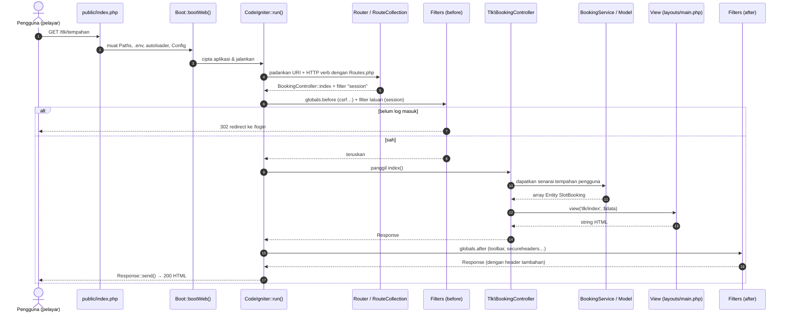

# 01 · MVC dan Kitaran Request CodeIgniter 4

> Nota topikal (rujukan merentas hari) · Kanun: [`SPEC-KURSUS.md`](../SPEC-KURSUS.md) · Indeks: [`README.md`](./README.md)

## Objektif nota

- **Menerangkan** perjalanan satu request HTTP dalam CI4 — dari `public/index.php` hingga respons dihantar — dengan merujuk diagram jujukan.
- **Menulis** route group dengan filter Shield menggunakan sintaks `[Controller::class, 'method']`.
- **Membina** controller nipis yang memulangkan view dengan layout `app/Views/layouts/main.php`.
- **Membezakan** peranan filter *before* dan *after*, dan menerangkan kenapa kawalan akses mesti di server.

---

## 1. Kenapa MVC?

MVC memisahkan tiga tanggungjawab supaya perubahan di satu tempat tidak memecahkan tempat lain:

| Lapisan | Tanggungjawab dalam projek ini | Contoh |
|---------|-------------------------------|--------|
| **Model** | Akses data + peraturan validasi medan | `SlotBookingModel`, `PassApplicationModel` |
| **View** | Paparan HTML sahaja — tiada query, tiada logik perniagaan | `app/Views/tlk/index.php` |
| **Controller** | Terima request → panggil service → pulang view/redirect | `Tlk\BookingController` |

Projek kita menambah satu lapisan lagi: **Service** (`BookingService`, `PassWorkflowService`, …) untuk logik perniagaan. Sebabnya: peraturan seperti BR-TLK-01 (tiada pertindihan) perlu digunakan dari controller, Spark command **dan** ujian PHPUnit. Jika logik itu terperangkap dalam controller, ia tidak boleh diguna semula dan sukar diuji. Lihat [`05-service-layer-dan-transaksi.md`](./05-service-layer-dan-transaksi.md).

> **Prinsip SPEC §5:** *Controller nipis. Logik perniagaan dalam Service. Model = akses data + `$validationRules`. Enum = satu-satunya sumber status.*

---

## 2. Kitaran hidup satu request

Apabila pelayar menghantar `GET /tlk/tempahan`, inilah yang berlaku:



Perkara penting yang ditunjukkan diagram:

1. **Semua request masuk melalui satu pintu** — `public/index.php`. Sebab itu document root web server mesti menghala ke `public/`, bukan ke akar projek (jika tidak, `.env` dan `writable/` boleh dicapai terus).
2. **`Boot::bootWeb()`** (CI 4.5+) memuat `.env`, pemalar path (`APPPATH`, `WRITEPATH`), autoloader Composer dan konfigurasi.
3. **Router** memadankan URI **dan** HTTP verb. `GET /tlk/tempahan` dan `POST /tlk/tempahan` boleh pergi ke method berbeza.
4. **Filter before** boleh **memintas** request (contoh: pulang redirect ke `/login`). Controller tidak dipanggil langsung — ini sebab kawalan akses di filter adalah kukuh.
5. **Filter after** mengubah respons (header keselamatan, debug toolbar) sebelum dihantar.

---

## 3. Routes — peta URL aplikasi

Projek ini **mematikan auto-routing** (lalai CI 4.6: `$autoRoute = false` dalam `app/Config/Routing.php`). Kenapa? Auto-routing membuka setiap method `public` dalam controller sebagai URL — termasuk method yang tidak sepatutnya boleh dicapai. Dengan route eksplisit, apa yang tidak ditulis dalam `Routes.php` **tidak wujud**.

```php
<?php
// app/Config/Routes.php

use App\Controllers\Admin\SlotController;
use App\Controllers\Tlk\BookingController;
use App\Controllers\Tlk\DecisionController;
use CodeIgniter\Router\RouteCollection;

/**
 * @var RouteCollection $routes
 */
$routes->get('/', 'Home::index');

service('auth')->routes($routes); // laluan Shield: /login, /register, /logout

// Kumpulan TLK — semua perlu log masuk (filter Shield "session")
$routes->group('tlk', ['filter' => 'session'], static function (RouteCollection $routes) {
    $routes->get('tempahan', [BookingController::class, 'index']);             // senarai
    $routes->get('tempahan/baru', [BookingController::class, 'new']);          // borang
    $routes->post('tempahan', [BookingController::class, 'create']);           // simpan
    $routes->get('tempahan/(:num)', [BookingController::class, 'show']);       // papar
    $routes->post('tempahan/(:num)/batal', [BookingController::class, 'cancel']);
});

// Keputusan TLK — hanya pemegang kebenaran tlk.decide
$routes->group('tlk/keputusan', ['filter' => 'permission:tlk.decide'], static function (RouteCollection $routes) {
    $routes->get('/', [DecisionController::class, 'index']);
    $routes->post('(:num)/lulus', [DecisionController::class, 'approve']);
    $routes->post('(:num)/tolak', [DecisionController::class, 'reject']);
});

// Admin slot — hanya group admin
$routes->group('admin', ['filter' => 'group:admin'], static function (RouteCollection $routes) {
    $routes->resource('slot', ['controller' => SlotController::class, 'except' => 'show']);
});
```

Catatan:

- `(:num)` menangkap segmen nombor dan menghantarnya sebagai argumen method: `show(int $id)`.
- Tindakan yang **mengubah data** (batal, lulus, tolak) guna `POST`, bukan `GET` — supaya ia dilindungi CSRF dan tidak boleh dicetuskan oleh pautan ``.
- Semak semua route dengan:

```bash
php spark routes
# +--------+--------------------------+------+----------------------------------------------+----------------+---------------+
# | Method | Route                    | Name | Handler                                      | Before Filters | After Filters |
# | GET    | tlk/tempahan             | »    | \App\Controllers\Tlk\BookingController::index | session        | toolbar       |
# ...
```

Lajur **Before Filters** ialah cara paling cepat untuk mengesahkan route anda benar-benar dilindungi.

---

## 4. Controller nipis

```php
<?php
// app/Controllers/Tlk/BookingController.php

namespace App\Controllers\Tlk;

use App\Controllers\BaseController;
use App\Models\SlotBookingModel;
use CodeIgniter\Exceptions\PageNotFoundException;

class BookingController extends BaseController
{
    // Senarai tempahan milik pengguna semasa, berpagination
    public function index(): string
    {
        $model = model(SlotBookingModel::class);

        $bookings = $model
            ->where('user_id', auth()->id())     // skop pemilik — jangan papar milik orang lain
            ->orderBy('created_at', 'DESC')
            ->paginate(10);                      // 10 rekod setiap halaman

        return view('tlk/index', [
            'title'    => 'Tempahan Saya',
            'bookings' => $bookings,
            'pager'    => $model->pager,         // untuk $pager->links() dalam view
        ]);
    }

    public function show(int $id): string
    {
        $booking = model(SlotBookingModel::class)->find($id);

        // Wujud? milik pengguna ini? Jika tidak → 404 (jangan dedahkan kewujudan rekod)
        if ($booking === null || (int) $booking->user_id !== auth()->id()) {
            throw PageNotFoundException::forPageNotFound();
        }

        return view('tlk/show', ['title' => $booking->ref_no, 'booking' => $booking]);
    }
}
```

Kenapa "nipis"? Setiap method hanya: (1) baca input, (2) panggil model/service, (3) pulang view atau redirect. Jika method controller anda melebihi ~20 baris atau ada `if` peraturan perniagaan (cth semak pertindihan tarikh), itu tanda logik patut dipindah ke service.

---

## 5. View dan layout

CI4 menyediakan **View Layouts** — satu fail kerangka (navbar, CSS Bootstrap) dan setiap halaman hanya mengisi bahagian (`section`).

```php
<!-- app/Views/layouts/main.php -->
<!doctype html>
<html lang="ms">
<head>
    <meta charset="utf-8">
    <title><?= esc($title ?? 'Sistem Latihan KKM') ?></title>
    <link rel="stylesheet" href="<?= base_url('assets/bootstrap/css/bootstrap.min.css') ?>">
</head>
<body>
    <?= $this->include('partials/navbar') ?>
    <main class="container py-4">
        <?= $this->include('partials/flash') ?>
        <?= $this->renderSection('content') ?>
    </main>
</body>
</html>
```

```php
<!-- app/Views/tlk/index.php -->
<?= $this->extend('layouts/main') ?>

<?= $this->section('content') ?>
<h1 class="h4"><?= esc($title) ?></h1>
<table class="table table-striped">
    <thead><tr><th>No. Rujukan</th><th>Tarikh</th><th>Status</th></tr></thead>
    <tbody>
    <?php foreach ($bookings as $b): ?>
        <tr>
            <td><a href="<?= site_url('tlk/tempahan/' . $b->id) ?>"><?= esc($b->ref_no) ?></a></td>
            <td><?= esc($b->start_date) ?> – <?= esc($b->end_date) ?></td>
            <td><span class="badge <?= $b->statusEnum()->badge() ?>"><?= esc($b->statusEnum()->label()) ?></span></td>
        </tr>
    <?php endforeach ?>
    </tbody>
</table>
<?= $pager->links() ?>
<?= $this->endSection() ?>
```

**Kenapa `esc()` setiap kali?** Semua data yang berasal daripada pengguna (sebab tempahan, nama, nombor plat) mesti dilepaskan sebelum dipapar untuk menghalang XSS. `esc()` menukar `<script>` kepada `&lt;script&gt;`. Lihat [`11-keselamatan-aplikasi-web.md`](./11-keselamatan-aplikasi-web.md).

---

## 6. Filters — pengawal di pintu

Filter ialah kelas yang dijalankan **sebelum** atau **selepas** controller. Dua jenis konfigurasi:

| Jenis | Di mana | Contoh |
|-------|---------|--------|
| **Global** | `app/Config/Filters.php` → `$globals` | `csrf` (before), `toolbar` (after) |
| **Route** | `['filter' => '…']` dalam `Routes.php` | `session`, `group:admin`, `permission:tlk.decide` |

```php
// app/Config/Filters.php (petikan)
public array $globals = [
    'before' => [
        'csrf',               // semua POST/PUT/PATCH/DELETE wajib token CSRF
    ],
    'after' => [
        'toolbar',
        'secureheaders',      // X-Frame-Options, X-Content-Type-Options, dll.
    ],
];
```

Filter Shield (`session`, `group`, `permission`) didaftarkan secara automatik oleh package Shield. Argumen selepas titik bertindih dihantar kepada filter: `group:reviewer,approver,admin` bermaksud "mana-mana satu daripada group ini".

**Kenapa filter tidak mencukupi seorang diri?** Filter menjawab soalan *"boleh akses URL ini?"*. Ia **tidak** menjawab *"boleh akses rekod #42 ini?"*. Pemohon A dan B sama-sama lulus filter `session` pada `/pas/permohonan/42` — semakan pemilikan dalam controller/service (BR-PAS-04) yang menghalang A melihat permohonan B. Lihat [`06-shield-auth-dan-rbac.md`](./06-shield-auth-dan-rbac.md).

---

## 7. Struktur folder yang perlu dikenali

```text
kkm-latihan/
├── app/            # kod anda (Config, Controllers, Models, Views, …)
├── public/         # SATU-SATUNYA folder terdedah pada web (index.php, assets/)
├── writable/       # cache, logs, session, uploads — BUKAN awam
├── tests/          # ujian PHPUnit
├── vendor/         # pakej Composer (jangan sunting, jangan commit)
├── .env            # konfigurasi persekitaran (JANGAN commit)
└── spark           # CLI
```

---

## ⚠️ Kesilapan lazim

| Kesilapan | Akibat | Betulkan |
|-----------|--------|----------|
| Document root menghala ke akar projek | `.env` & `writable/` boleh dimuat turun | Halakan ke `public/` (atau guna `php spark serve`) |
| Hidupkan auto-routing untuk "jimat masa" | Method dalaman terdedah sebagai URL | Kekalkan `$autoRoute = false`; tulis route eksplisit |
| Tindakan ubah data melalui `GET` (`/tlk/tempahan/5/batal`) | Tiada perlindungan CSRF; boleh dicetus oleh pautan | Guna `POST` + borang dengan `csrf_field()` |
| Query & peraturan perniagaan dalam controller | Tidak boleh diuji/diguna semula | Pindah ke Service (nota 05) |
| Hanya sembunyi butang "Lulus" dalam view | Pengguna panggil URL terus → berjaya | Filter route **dan** semakan dalam controller/service |
| Lupa `esc()` dalam view | XSS | `<?= esc($nilai) ?>` untuk setiap data dinamik |
| Tertinggal `use` untuk kelas controller dalam `Routes.php` | `Class not found` | Tambah `use App\Controllers\…;` atau guna nama penuh |

## Rujukan rasmi

- [Application Structure](https://codeigniter.com/user_guide/concepts/structure.html)
- [Working with HTTP Requests](https://codeigniter.com/user_guide/concepts/http.html)
- [URI Routing](https://codeigniter.com/user_guide/incoming/routing.html)
- [Controllers](https://codeigniter.com/user_guide/incoming/controllers.html)
- [Controller Filters](https://codeigniter.com/user_guide/incoming/filters.html)
- [View Layouts](https://codeigniter.com/user_guide/outgoing/view_layouts.html)
- [Shield — Protecting Pages](https://shield.codeigniter.com/latest/quick_start_guide/using_authorization/)

## Bacaan buku — *CodeIgniter 4 Foundations*

Lonnie Ezell, [Leanpub](https://leanpub.com/codeigniter4foundations), edisi 2021 (CodeIgniter 4.1). `hlm.` = nombor halaman yang tercetak di kaki halaman buku.

- Primer: MVC — hlm. 3–4
- Primer: namespace — hlm. 5–10
- Projek 1: routes — hlm. 19–21
- Projek 2: controller & routing ke controller — hlm. 22–24
- Projek 4: view layout — hlm. 42–44
- Projek 4: view cell — hlm. 47–49
- Projek 6: controller filter (`Throttle`) — hlm. 94–96

Buku menutup auto-routing secara manual (`setAutoRoute(false)`, hlm. 19); sejak CI 4.2 ia sudah tertutup secara lalai.

---
**Digunakan pada Hari 4** — S1 (menjelaskan aliran request MVC semasa semakan tugasan) & S2 (struktur projek, `.env`, layout Bootstrap); **Hari 5** — S2 (controller & view CRUD asas). Nota berkaitan: [02 · Migration](./02-migration-seeder-dan-query-builder.md) · [05 · Service](./05-service-layer-dan-transaksi.md) · [06 · Shield](./06-shield-auth-dan-rbac.md)
