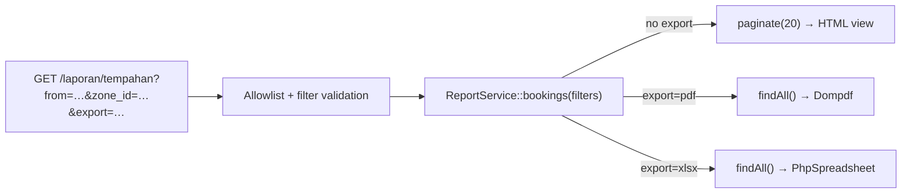

# 08 · Filtered Reports & PDF/Excel Export

> Topic notes (cross-day reference) · Canon: [`SPEC-KURSUS.md`](../SPEC-KURSUS.md) · Index: [`README.md`](./README.md)

## Notes objectives

- **Build** a `ReportService` that is the **single source** of filters for the HTML view, the PDF and the Excel file (RPT-01..03).
- **Write** a GET filter form that is allowlisted and validated, with pagination that keeps the query string.
- **Generate** a PDF with Dompdf and an `.xlsx` with PhpSpreadsheet, and **prevent** *formula injection* in Excel.
- **Confirm** that the number of report rows matches the count in the database.

---

## 1. One filter, three outputs — why?

A common problem: the HTML view filters `status = approved`, but the PDF export code is written again separately and forgets the zone filter. The user prints a PDF that is **not the same** as the screen — and that report is taken to a meeting.

The solution: **one** method in `ReportService` builds the filtered query. The controller only picks the output.



| Code | Report | Filters (SPEC §2.3) |
|-----|---------|---------------------|
| `RPT-01` | List of TLK (Special Vehicle Parking) bookings | date range, zone, category, status |
| `RPT-02` | List of Pass applications | date range, pass type, department, status |
| `RPT-03` | Slot usage by zone (aggregate) | month/year |

---

## 2. Filter form — GET, not POST

A report **reads** data, so use `GET`: the URL can be bookmarked and shared, and the export buttons can carry the same filters. (CSRF is not needed for a GET that does not change data.)

```php
<form method="get" action="<?= site_url('laporan/tempahan') ?>" class="row g-2 mb-3">
    <div class="col-md-2">
        <input type="date" name="from" class="form-control" value="<?= esc($filters['from'] ?? '') ?>">
    </div>
    <div class="col-md-2">
        <input type="date" name="to" class="form-control" value="<?= esc($filters['to'] ?? '') ?>">
    </div>
    <div class="col-md-2">
        <select name="status" class="form-select">
            <option value="">Semua status</option>
            <?php foreach (\App\Enums\BookingStatus::cases() as $s): ?>
                <option value="<?= $s->value ?>" <?= ($filters['status'] ?? '') === $s->value ? 'selected' : '' ?>>
                    <?= esc($s->label()) ?>
                </option>
            <?php endforeach ?>
        </select>
    </div>
    <!-- zone_id & category: same pattern -->
    <div class="col-md-2"><button class="btn btn-primary">Tapis</button></div>
</form>

<?php $qs = static fn (string $fmt) => site_url('laporan/tempahan') . '?' . http_build_query(array_filter($filters) + ['export' => $fmt]); ?>
<a href="<?= esc($qs('pdf'), 'attr') ?>" class="btn btn-outline-danger"><i class="bi bi-filetype-pdf"></i> Eksport PDF</a>
<a href="<?= esc($qs('xlsx'), 'attr') ?>" class="btn btn-outline-success"><i class="bi bi-file-earmark-excel"></i> Eksport Excel</a>
```

---

## 3. `ReportService` — building the filtered query

The service returns a **configured Model** (not yet executed). The caller picks `paginate()` for HTML or `findAll()` for export — the filters are never written twice.

```php
<?php

namespace App\Services;

use App\Models\SlotBookingModel;

class ReportService
{
    /** Allowed keys — anything else is ignored */
    public const RPT01_FILTERS = ['from', 'to', 'zone_id', 'category', 'status'];

    public function bookings(array $f): SlotBookingModel
    {
        $model = model(SlotBookingModel::class, false);   // false = new instance, free of old state

        $model->select('slot_bookings.ref_no, slot_bookings.start_date, slot_bookings.end_date,
                        slot_bookings.status, users.full_name, vehicles.plate_no,
                        parking_zones.code AS zone_code, parking_slots.slot_no, parking_slots.category')
            ->join('users', 'users.id = slot_bookings.user_id')
            ->join('vehicles', 'vehicles.id = slot_bookings.vehicle_id')
            ->join('parking_slots', 'parking_slots.id = slot_bookings.slot_id')
            ->join('parking_zones', 'parking_zones.id = parking_slots.zone_id');

        // DYNAMIC filters — added only when filled in. Values are bound (escaped) by the Query Builder.
        if (! empty($f['from'])) {
            $model->where('slot_bookings.end_date >=', $f['from']);     // overlaps the range
        }
        if (! empty($f['to'])) {
            $model->where('slot_bookings.start_date <=', $f['to']);
        }
        if (! empty($f['zone_id'])) {
            $model->where('parking_slots.zone_id', (int) $f['zone_id']);
        }
        if (! empty($f['category'])) {
            $model->where('parking_slots.category', $f['category']);
        }
        if (! empty($f['status'])) {
            $model->where('slot_bookings.status', $f['status']);
        }

        return $model->orderBy('slot_bookings.start_date', 'DESC');
    }

    /** RPT-03: slot-days used per zone for one month */
    public function usageByZone(int $year, int $month): array
    {
        // Dates are built from a validated INTEGER — not from a user string
        $start = sprintf('%04d-%02d-01', $year, $month);
        $end   = date('Y-m-t', strtotime($start));

        return db_connect()->table('parking_zones z')
            ->select('z.code, z.name')
            ->select('COUNT(DISTINCT s.id) AS total_slots')
            ->select("COALESCE(SUM(DATEDIFF(LEAST(b.end_date, '{$end}'), GREATEST(b.start_date, '{$start}')) + 1), 0) AS used_days", false)
            ->join('parking_slots s', 's.zone_id = z.id AND s.deleted_at IS NULL', 'left')
            ->join('slot_bookings b', "b.slot_id = s.id AND b.status = 'approved'"
                . " AND b.start_date <= '{$end}' AND b.end_date >= '{$start}'", 'left')
            ->groupBy('z.id, z.code, z.name')
            ->orderBy('z.code')
            ->get()->getResultArray();
    }
}
```

> In `usageByZone()` the date values are concatenated into the SQL — this is **safe only because** they are generated by `sprintf('%04d…')` from integers that have already been validated (`in_list`/range). Never concatenate `$this->request->getGet('month')` directly (SPEC §9).
>
> Utilisation rate (%) = `used_days / (total_slots × bilangan hari dalam bulan) × 100` (*bilangan hari dalam bulan* = number of days in the month) — compute it in PHP; avoid dividing by zero if a zone has no slots. Note: `COUNT(DISTINCT s.id)` is correct even though the bookings join duplicates the slot rows.

---

## 4. `ReportController` — picking the output

```php
<?php

namespace App\Controllers\Laporan;

use App\Controllers\BaseController;
use App\Enums\BookingStatus;
use App\Services\ReportService;

class ReportController extends BaseController
{
    public function tempahan()
    {
        // 1. Allowlist: getGet([...]) returns only the keys listed
        $filters = $this->request->getGet(ReportService::RPT01_FILTERS);

        // 2. Validate the filters — GET input is still user input
        $statuses = implode(',', BookingStatus::values());   // static enum helper (notes 03)
        if (! $this->validateData($filters, [
            'from'    => 'permit_empty|valid_date[Y-m-d]',
            'to'      => 'permit_empty|valid_date[Y-m-d]',
            'zone_id' => 'permit_empty|is_natural_no_zero',
            'status'  => "permit_empty|in_list[{$statuses}]",
        ])) {
            return redirect()->to('/laporan/tempahan')->with('error', 'Penapis tidak sah.');
        }

        $model  = (new ReportService())->bookings($filters);
        $export = $this->request->getGet('export');

        return match ($export) {
            'pdf'   => $this->pdf('RPT-01', 'laporan/pdf/tempahan', $model->findAll(5000), $filters),
            'xlsx'  => $this->xlsx('RPT-01', $model->findAll(5000)),
            default => view('laporan/tempahan', [
                'rows'    => $model->paginate(20),
                'pager'   => $model->pager,
                'filters' => $filters,
            ]),
        };
    }
}
```

In the HTML view: `<?= $pager->links() ?>` — the CI4 Pager builds its links from the current URL, so the filter parameters in the query string are **kept** when you change page. Confirm this by clicking page 2 and looking at the URL. The overall total: `$pager->getTotal()`.

`findAll(5000)` — a row limit for export. A 50,000-row PDF will use up `memory_limit` and time. If the limit is exceeded, tell the user to narrow the filters.

---

## 5. PDF export — Dompdf

```bash
composer require dompdf/dompdf
```

```php
use Dompdf\Dompdf;
use Dompdf\Options;

private function pdf(string $code, string $view, array $rows, array $filters)
{
    $options = new Options();
    $options->set('isRemoteEnabled', false);      // don't load external URLs (SSRF, slow)
    $options->set('defaultFont', 'DejaVu Sans');  // supports Unicode characters

    $dompdf = new Dompdf($options);
    // Separate PDF view: simple HTML + inline CSS. Full Bootstrap is too heavy for Dompdf.
    $dompdf->loadHtml(view($view, ['rows' => $rows, 'filters' => $filters, 'code' => $code]));
    $dompdf->setPaper('A4', 'landscape');
    $dompdf->render();

    return $this->response
        ->setContentType('application/pdf')
        ->setHeader('Content-Disposition', 'attachment; filename="' . $code . '-' . date('Ymd') . '.pdf"')
        ->setBody($dompdf->output());
}
```

`app/Views/laporan/pdf/tempahan.php` (short version):

```php
<style>
    body { font-family: "DejaVu Sans", sans-serif; font-size: 9pt; }
    table { width: 100%; border-collapse: collapse; }
    th, td { border: 1px solid #999; padding: 3px; }
    thead { display: table-header-group; }   /* repeat the header on every page */
</style>
<h3><?= esc($code) ?> — Senarai Tempahan TLK</h3>
<p>Penapis: <?= esc(json_encode(array_filter($filters))) ?> · Dijana: <?= date('d/m/Y H:i') ?> · Jumlah: <?= count($rows) ?></p>
<table>
    <thead><tr><th>No. Rujukan</th><th>Pemohon</th><th>Plat</th><th>Zon/Slot</th><th>Tarikh</th><th>Status</th></tr></thead>
    <tbody>
    <?php foreach ($rows as $r): ?>
        <tr>
            <td><?= esc($r->ref_no) ?></td>
            <td><?= esc($r->full_name) ?></td>
            <td><?= esc($r->plate_no) ?></td>
            <td><?= esc($r->zone_code . ' / ' . $r->slot_no) ?></td>
            <td><?= esc($r->start_date) ?> – <?= esc($r->end_date) ?></td>
            <td><?= esc(\App\Enums\BookingStatus::from($r->status)->label()) ?></td>
        </tr>
    <?php endforeach ?>
    </tbody>
</table>
```

> If `SlotBookingModel::$returnType` is the `SlotBooking` Entity, `$r->status` may already be an enum, depending on how you wrote the Entity (see [notes 03](./03-model-entity-dan-enum.md)). Adjust accordingly.

---

## 6. Excel export — PhpSpreadsheet

```bash
composer require phpoffice/phpspreadsheet    # needs the zip, xml, gd, mbstring extensions
```

```php
use PhpOffice\PhpSpreadsheet\Spreadsheet;
use PhpOffice\PhpSpreadsheet\Writer\Xlsx;

private function xlsx(string $code, array $rows)
{
    $spreadsheet = new Spreadsheet();
    $sheet       = $spreadsheet->getActiveSheet();
    $sheet->setTitle($code);

    $header = ['No. Rujukan', 'Pemohon', 'Plat', 'Zon', 'Slot', 'Mula', 'Tamat', 'Status'];
    $data   = array_map(fn ($r) => array_map($this->safeCell(...), [
        $r->ref_no, $r->full_name, $r->plate_no, $r->zone_code, $r->slot_no,
        $r->start_date, $r->end_date, \App\Enums\BookingStatus::from($r->status)->label(),
    ]), $rows);

    $sheet->fromArray($header, null, 'A1');
    $sheet->fromArray($data, null, 'A2');
    $sheet->getStyle('A1:H1')->getFont()->setBold(true);
    foreach (range('A', 'H') as $col) {
        $sheet->getColumnDimension($col)->setAutoSize(true);
    }

    // Write to memory, not to a temporary file
    ob_start();
    (new Xlsx($spreadsheet))->save('php://output');
    $content = ob_get_clean();

    $spreadsheet->disconnectWorksheets();   // free the memory
    unset($spreadsheet);

    return $this->response->download($code . '-' . date('Ymd') . '.xlsx', $content);
}

/**
 * Formula (CSV) injection: a cell that starts with = + - @ (or tab/CR)
 * is EXECUTED as a formula by Excel. An applicant name "=HYPERLINK(...)"
 * can trick the officer who opens the file. Prefix it with ' so it becomes text.
 */
private function safeCell(mixed $v): mixed
{
    if (is_string($v) && $v !== '' && in_array($v[0], ['=', '+', '-', '@', "\t", "\r"], true)) {
        return "'" . $v;
    }

    return $v;
}
```

---

## 7. Confirming the totals (DoD M3)

A report that looks good but counts wrong is more dangerous than no report. Every report must pass this check:

```php
// In a test (see notes 10): report total = DB total
$filters = ['status' => 'approved', 'from' => '2026-03-01', 'to' => '2026-03-31'];
$report  = (new ReportService())->bookings($filters)->countAllResults();

$direct = db_connect()->table('slot_bookings')
    ->where('status', 'approved')
    ->where('end_date >=', '2026-03-01')
    ->where('start_date <=', '2026-03-31')
    ->countAllResults();

$this->assertSame($direct, $report);
```

Also check by hand: the total in HTML (`$pager->getTotal()`) = the number of rows in Excel = the "Jumlah" in the PDF, for the same filters. Watch the `INNER JOIN`: bookings whose vehicle has been deleted will **disappear** from the report — decide whether that is what you want.

---

## ⚠️ Common mistakes

| Mistake | Result | Fix |
|-----------|--------|----------|
| The export query is written separately from the HTML query | PDF/Excel do not match the screen | One `ReportService` method for all three |
| The filter form uses POST | Pagination & export lose the filters | GET + `http_build_query()` on the export buttons |
| `$this->request->getGet()` without an allowlist/validation | Stray parameters, SQL errors, fake status values | `getGet([...])` + `validateData()` |
| Concatenating `$_GET` into a raw `select()`/`where()` | SQL injection | Query Builder binding; concatenate only values generated from integers |
| `isRemoteEnabled = true` in Dompdf | SSRF / loads external URLs, slow | Keep it `false`; use inline CSS |
| No row limit on export | `Allowed memory size exhausted`, timeout | `findAll(5000)` + a message to narrow the filters |
| Writing text values straight into Excel | Formula injection (`=cmd…`, `=HYPERLINK`) | `safeCell()` or `setCellValueExplicit(..., DataType::TYPE_STRING)` |
| Forgetting `esc()` in the HTML/PDF view | XSS in the report | `esc()` every value |

## Official references

- [CI4 — Query Builder (join, groupBy, selectCount)](https://codeigniter.com/user_guide/database/query_builder.html)
- [CI4 — Pagination](https://codeigniter.com/user_guide/libraries/pagination.html)
- [CI4 — IncomingRequest `getGet()`](https://codeigniter.com/user_guide/incoming/incomingrequest.html)
- [CI4 — HTTP Responses & `download()`](https://codeigniter.com/user_guide/outgoing/response.html)
- [Dompdf — GitHub & wiki](https://github.com/dompdf/dompdf)
- [PhpSpreadsheet — Documentation](https://phpspreadsheet.readthedocs.io/)
- [OWASP — CSV Injection](https://owasp.org/www-community/attacks/CSV_Injection)

## Book reading — *CodeIgniter 4 Foundations*

Lonnie Ezell, [Leanpub](https://leanpub.com/codeigniter4foundations), 2021 edition (CodeIgniter 4.1). `p.` = the page number printed at the foot of the book page.

- Paginated list (`paginate()`, pager) & `esc()` — p. 31–33

Dompdf and PhpSpreadsheet are not in the book; follow this note.

---
**Used on Day 9** — S1 (RPT-01..03 specification & GET filter form), S2 (`ReportService`: join, `groupBy`, dynamic filters), S3 (Dompdf & PhpSpreadsheet export), S4 (report total = DB total). Related notes: [02 Query Builder](./02-migration-seeder-dan-query-builder.md) · [09 Statistics & cache](./09-statistik-chartjs-dan-cache.md) · [10 Testing](./10-ujian-phpunit-ci4.md)
