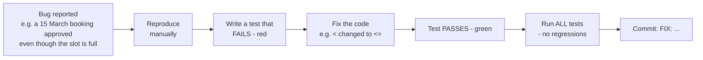

# 10 · PHPUnit Testing in CodeIgniter 4

> Topical notes (cross-day reference) · Canon: [`SPEC-KURSUS.md`](../SPEC-KURSUS.md) · Index: [`README.md`](./README.md)

## Note objectives

- **Distinguish** unit tests from feature tests and choose the right type for each business rule (BR-*).
- **Configure** a separate MySQL test database and **explain** why SQLite is not suitable for BR-TLK-05.
- **Write** tests using `DatabaseTestTrait`, `FeatureTestTrait` and `actingAs()` (Shield) for booking overlaps, status transitions and access control.
- **Practise** the *reproduce → failing test → fix → passing test* cycle when fixing bugs.

---

## 1. Why write tests?

Manual testing (clicking around in the browser) easily misses edge cases and has to be repeated every time the code changes. Automated tests:

- **Prove** that business rules (BR-TLK-01 no overlap, BR-PAS-04 ownership) are still correct after a refactor.
- **Act as living documentation** — the test name describes the expected behaviour.
- Are a **Definition of Done** requirement: "Related PHPUnit tests pass (`vendor/bin/phpunit`)" ([`KOLABORASI.md`](../KOLABORASI.md) §2).

---

## 2. Unit vs Feature — when to use which?

| | **Unit** test | **Feature** test |
|---|---|---|
| Tests | One class/method in isolation | The whole HTTP flow: route → filter → controller → view/redirect |
| DB | Usually none | Yes (`DatabaseTestTrait`) |
| Speed | Very fast (ms) | Slower |
| Course example | `PassStatus::canTransitionTo()`, calculating the 90-day period | An applicant cannot open `/pas/semakan`; an overlapping booking POST is rejected |
| Base class | `CIUnitTestCase` | `CIUnitTestCase` + `FeatureTestTrait` + `DatabaseTestTrait` |

**Rule of thumb:** pure logic (enums, date calculations) → unit. Anything involving filters, sessions, roles or the DB → feature/DB test.

Recommended folder structure:

```text
tests/
├── unit/
│   └── Enums/PassStatusTest.php
├── database/
│   └── Services/SlotAvailabilityServiceTest.php
└── feature/
    ├── Pas/ReviewAccessTest.php
    └── Pas/ApplicationOwnershipTest.php
```

---

## 3. Test database — don't use the development DB!

`DatabaseTestTrait` with `$refresh = true` **drops and recreates all tables** before the tests. If it is connected to the development DB, your training data is **lost**. So use a separate DB, `kkm_latihan_test`.

### Why not SQLite (the appstarter default)?

`app/Config/Database.php` in appstarter sets the `tests` group to **SQLite3 `:memory:`**. The problems:
- SQLite **does not support `SELECT … FOR UPDATE`** — the BR-TLK-05 code will error or behave differently.
- MySQL functions such as `DATEDIFF` and `DATE_FORMAT` (in reports/statistics) do not exist in SQLite.

Tests must run on the **same** engine as production.

```sql
-- Once only (MySQL):
CREATE DATABASE kkm_latihan_test CHARACTER SET utf8mb4 COLLATE utf8mb4_unicode_ci;
```

```ini
# .env  (DO NOT commit)
database.tests.hostname = localhost
database.tests.database = kkm_latihan_test
database.tests.username = root
database.tests.password =
database.tests.DBDriver = MySQLi
database.tests.DBPrefix =
database.tests.port = 3306
```

> **Empty `DBPrefix`:** appstarter sets the prefix `db_` for the `tests` group. Query Builder adds the prefix automatically, but raw SQL (e.g. `SELECT id FROM parking_slots … FOR UPDATE`) does not — empty the prefix so it is consistent with development.

Alternative: set it in `phpunit.xml.dist` (copy it to `phpunit.xml` if you want to change it locally):

```xml
<php>
    <env name="CI_ENVIRONMENT" value="testing"/>
    <env name="database.tests.hostname" value="localhost"/>
    <env name="database.tests.database" value="kkm_latihan_test"/>
    <env name="database.tests.username" value="root"/>
    <env name="database.tests.password" value=""/>
    <env name="database.tests.DBDriver" value="MySQLi"/>
    <env name="database.tests.DBPrefix" value=""/>
</php>
```

---

## 4. `DatabaseTestTrait` — important properties

```php
use CodeIgniter\Test\CIUnitTestCase;
use CodeIgniter\Test\DatabaseTestTrait;

abstract class KkmDatabaseTestCase extends CIUnitTestCase
{
    use DatabaseTestTrait;

    protected $migrate   = true;   // run migrations before the tests
    protected $refresh   = true;   // drop & recreate tables (clean state)
    protected $namespace = null;   // null = ALL namespaces → Shield migrations (users, auth_*) also run
    protected $seed      = 'App\Database\Seeds\DatabaseSeeder'; // basic synthetic data (zones, slots, users)
}
```

**Why `$namespace = null`?** By default only the `App` migrations run. The `users`, `auth_identities` and `auth_groups_users` tables come from the `CodeIgniter\Shield` namespace — without them `actingAs()` fails because the user tables do not exist.

Available DB assertions:

```php
$this->seeInDatabase('slot_bookings', ['ref_no' => 'TLK-2026-0001', 'status' => 'pending']);
$this->dontSeeInDatabase('slot_bookings', ['slot_id' => 1, 'status' => 'approved']);
$this->seeNumRecords(1, 'status_logs', ['module' => 'PAS', 'record_id' => 5]);
```

---

## 5. Unit test — `PassStatus::canTransitionTo()` (BR-PAS-01)

Pure logic, no DB. Use a *data provider* (PHPUnit 10+ attribute) so one test covers every transition.

```php
<?php
// tests/unit/Enums/PassStatusTest.php
namespace Tests\Unit\Enums;

use App\Enums\PassStatus;
use CodeIgniter\Test\CIUnitTestCase;
use PHPUnit\Framework\Attributes\DataProvider;

final class PassStatusTest extends CIUnitTestCase
{
    /** Each row: [from, to, expected] — straight from the SPEC §2.2 table */
    public static function transitions(): array
    {
        return [
            'dihantar → dalam semakan'   => [PassStatus::Submitted,   PassStatus::UnderReview, true],
            'dalam semakan → diluluskan' => [PassStatus::UnderReview, PassStatus::Approved,    true],
            'dalam semakan → ditolak'    => [PassStatus::UnderReview, PassStatus::Rejected,    true],
            'diluluskan → tamat tempoh'  => [PassStatus::Approved,    PassStatus::Expired,     true],
            // Forbidden paths — just as important to test!
            'dihantar → diluluskan (langkau semakan)' => [PassStatus::Submitted, PassStatus::Approved,    false],
            'ditolak → diluluskan'                    => [PassStatus::Rejected,  PassStatus::Approved,    false],
            'diluluskan → dalam semakan'              => [PassStatus::Approved,  PassStatus::UnderReview, false],
        ];
    }

    #[DataProvider('transitions')]
    public function testCanTransitionTo(PassStatus $from, PassStatus $to, bool $expected): void
    {
        $this->assertSame($expected, $from->canTransitionTo($to));
    }
}
```

> The array key names (`'dihantar → diluluskan …'`) are shown when a test fails — easy to identify.

---

## 6. DB test — date overlap (BR-TLK-01)

Overlap condition: `start_date <= :end AND end_date >= :start`. Test the **edge cases**: same day, adjacent, enclosing, and statuses that are not counted (`rejected`).

```php
<?php
// tests/database/Services/SlotAvailabilityServiceTest.php
namespace Tests\Database\Services;

use App\Services\SlotAvailabilityService;
use CodeIgniter\Test\CIUnitTestCase;
use CodeIgniter\Test\DatabaseTestTrait;

final class SlotAvailabilityServiceTest extends CIUnitTestCase
{
    use DatabaseTestTrait;

    protected $migrate   = true;
    protected $refresh   = true;
    protected $namespace = null;
    protected $seed      = 'App\Database\Seeds\DatabaseSeeder';

    private SlotAvailabilityService $service;

    protected function setUp(): void
    {
        parent::setUp();
        $this->service = new SlotAvailabilityService($this->db); // test DB connection injected

        // Existing booking: slot 1, 10–15 March 2026, approved
        $this->db->table('slot_bookings')->insert([
            'ref_no' => 'TLK-2026-0901', 'user_id' => 1, 'vehicle_id' => 1, 'slot_id' => 1,
            'start_date' => '2026-03-10', 'end_date' => '2026-03-15',
            'reason' => 'Data ujian sintetik', 'status' => 'approved',
        ]);
    }

    public function testOverlapInsideRangeIsNotAvailable(): void
    {
        $this->assertTrue($this->service->hasOverlap(1, '2026-03-12', '2026-03-13'));
    }

    public function testSameLastDayCountsAsOverlap(): void
    {
        // 15 March = last day of the existing booking → overlaps (<=, >= inclusive)
        $this->assertTrue($this->service->hasOverlap(1, '2026-03-15', '2026-03-20'));
    }

    public function testAdjacentRangeIsAvailable(): void
    {
        $this->assertFalse($this->service->hasOverlap(1, '2026-03-16', '2026-03-20'));
    }

    public function testRejectedBookingDoesNotBlock(): void
    {
        $this->db->table('slot_bookings')->where('ref_no', 'TLK-2026-0901')->update(['status' => 'rejected']);
        $this->assertFalse($this->service->hasOverlap(1, '2026-03-12', '2026-03-13'));
    }
}
```

> `hasOverlap(int $slotId, string $start, string $end, ?int $excludeBookingId = null): bool` is the same method as in [note 02](./02-migration-seeder-dan-query-builder.md) and [note 05](./05-service-layer-dan-transaksi.md) — `true` means **overlapping** (slot not available).

---

## 7. Feature tests with Shield — `actingAs()`

### 7.1 Helper to create test users

```php
<?php
// tests/_support/CreatesUsers.php
namespace Tests\Support;

use CodeIgniter\Shield\Entities\User;

trait CreatesUsers
{
    protected function createUser(string $group, string $email): User
    {
        $users = auth()->getProvider();            // the UserModel configured by Shield

        $user = new User([
            'username' => strstr($email, '@', true),
            'email'    => $email,                  // synthetic: @latihan.test
            'password' => 'Latihan@2026',
        ]);
        $users->save($user);

        $user = $users->findById($users->getInsertID()); // fetch again with the id
        $user->addGroup($group);                          // applicant / reviewer / approver / admin

        return $user;
    }
}
```

### 7.2 CSRF in feature tests — IMPORTANT

`FeatureTestTrait` does **not** bypass the CSRF filter (confirmed from the CI4 source code). A `post()` request without a token throws a `SecurityException`. To test POST logic, disable CSRF **in tests only**, and keep **one** dedicated test that proves CSRF still works.

```php
protected function disableCsrfForThisTest(): void
{
    $filters = config('Filters');   // shared instance — FeatureTestTrait builds a new Filters from it
    $before  = $filters->globals['before'];

    unset($before['csrf']);                                   // form 'csrf' => ['except' => …]
    $before = array_filter($before, static fn ($v) => $v !== 'csrf'); // value form 'csrf'

    $filters->globals['before'] = $before;
}
```

### 7.3 Access test — an applicant cannot open `/pas/semakan`

```php
<?php
// tests/feature/Pas/ReviewAccessTest.php
namespace Tests\Feature\Pas;

use CodeIgniter\Security\Exceptions\SecurityException;
use CodeIgniter\Shield\Test\AuthenticationTesting;
use CodeIgniter\Test\CIUnitTestCase;
use CodeIgniter\Test\DatabaseTestTrait;
use CodeIgniter\Test\FeatureTestTrait;
use Tests\Support\CreatesUsers;

final class ReviewAccessTest extends CIUnitTestCase
{
    use DatabaseTestTrait;
    use FeatureTestTrait;
    use AuthenticationTesting;   // provides actingAs()
    use CreatesUsers;

    protected $migrate   = true;
    protected $refresh   = true;
    protected $namespace = null;

    public function testGuestIsRedirectedToLogin(): void
    {
        $this->get('/pas/semakan')->assertRedirectTo('/login');
    }

    public function testApplicantIsDenied(): void
    {
        $applicant = $this->createUser('applicant', 'pemohon1@latihan.test');

        $result = $this->actingAs($applicant)->get('/pas/semakan');

        // Group filter: Shield denies with a redirect (not 200)
        $result->assertRedirect();
        $result->assertDontSee('Senarai Semakan');
    }

    public function testReviewerCanOpen(): void
    {
        $reviewer = $this->createUser('reviewer', 'penyemak@latihan.test');

        $this->actingAs($reviewer)->get('/pas/semakan')->assertOK();
    }

    public function testPostWithoutCsrfTokenIsRejected(): void
    {
        // CSRF is NOT disabled here — proof that the protection is still alive
        $reviewer = $this->createUser('reviewer', 'penyemak@latihan.test');

        $this->expectException(SecurityException::class);
        $this->actingAs($reviewer)->post('/pas/semakan/1/review', ['remarks' => 'Semakan ujian']);
    }
}
```

> In the `testing`/`development` environments, `Config\Security::$redirect` is false, so an invalid token → exception. In `production` it becomes a redirect with an error message.

### 7.4 Ownership (BR-PAS-04) — applicant A cannot view applicant B's application

The `session` filter only ensures the user is logged in; the **ownership check** in the controller/service is what blocks access. The controller is expected to throw `PageNotFoundException` (404) — we don't want to reveal that the record exists.

```php
public function testApplicantCannotViewOthersApplication(): void
{
    $owner    = $this->createUser('applicant', 'pemohon1@latihan.test');
    $intruder = $this->createUser('applicant', 'pemohon2@latihan.test');

    $this->db->table('pass_applications')->insert([
        'ref_no' => 'PAS-2026-0001', 'user_id' => $owner->id, 'pass_type' => 'kakitangan',
        'purpose' => 'Akses bangunan (sintetik)', 'valid_from' => '2026-04-01',
        'valid_until' => '2026-06-30', 'status' => 'submitted',
    ]);
    $id = $this->db->insertID();

    $this->expectException(\CodeIgniter\Exceptions\PageNotFoundException::class);
    $this->actingAs($intruder)->get("/pas/permohonan/{$id}");
}
```

> **Why `expectException` and not `assertStatus(404)`?** Without `set404Override()` in `Routes.php`, CI4 rethrows `PageNotFoundException` from `run()` — so the test catches the exception. If your project sets a 404 override, change it to `->assertStatus(404)`. The POST route in the example (`/pas/semakan/1/review`) is also just an example — match it to your `Routes.php`.

Frequently used TestResponse methods: `assertStatus(403)`, `assertOK()`, `assertRedirect()`, `assertRedirectTo('/path')`, `assertSee('teks')`, `assertDontSee('teks')`, `assertSessionHas('message')`, `assertJSONFragment([...])`.

---

## 8. Running the tests

```bash
composer test                                       # all tests
composer test -- --testdox                          # readable output (test names as sentences)
composer test -- --filter PassStatusTest            # one class
composer test -- --filter testApplicantIsDenied     # one method
composer test -- tests/feature                      # one folder
```

`composer test` runs the `"test": "phpunit"` script in `composer.json` (the appstarter already provides it). It is the same as `vendor/bin/phpunit`, but it works unchanged in Git Bash, PowerShell, macOS and Linux. PHPUnit arguments must go after `--`; without `--`, Composer does not pass `--filter` to PHPUnit and the **whole** suite runs. Composer also stops scripts after 300 seconds by default — `composer config process-timeout 0` (Lab 4.2 step 1) removes that limit.

---

## 9. The bug-fix cycle: reproduce → fail → fix → pass



**Why write the test before fixing?** A failing test proves you have really caught that bug. If the test passes straight away before the fix, it is not testing the right thing.

---

## ⚠️ Common mistakes

| Mistake | Consequence | Fix |
|-----------|--------|----------|
| The `tests` group points to the development DB | All training data is deleted by `$refresh` | A separate DB, `kkm_latihan_test` |
| Staying on SQLite `:memory:` | `FOR UPDATE`/`DATEDIFF` errors; tests don't reflect MySQL | `database.tests.DBDriver = MySQLi` |
| Forgetting `$namespace = null` | Shield tables missing → `actingAs()` / `addGroup()` errors | Set `$namespace = null` |
| POST in a test fails with `SecurityException` | Confusion — you think the controller is broken | Disable CSRF in logic tests; keep one CSRF test |
| Testing only the "happy" path | Access bugs (an applicant opening `/pas/semakan`) are missed | For every feature: one positive test + one negative test |
| A test depends on the order/data of other tests | Passes alone, fails when run together | `$refresh = true`, create data in each test |
| Dates typed relative to "today" without control | The test fails next month | Use fixed dates; if the code uses `Time::now()`, set `Time::setTestNow('2026-03-01')` |
| Using real data/real emails | Data breach | `@latihan.test` and made-up plates only |

---

## Official references

- CodeIgniter 4 — Testing overview: <https://codeigniter.com/user_guide/testing/overview.html>
- CodeIgniter 4 — Database testing: <https://codeigniter.com/user_guide/testing/database.html>
- CodeIgniter 4 — HTTP Feature Testing: <https://codeigniter.com/user_guide/testing/feature.html>
- CodeIgniter 4 — Testing Responses (assertions): <https://codeigniter.com/user_guide/testing/response.html>
- CodeIgniter Shield — Testing: <https://shield.codeigniter.com/latest/references/testing/>
- PHPUnit — Data providers: <https://docs.phpunit.de/en/10.5/writing-tests-for-phpunit.html#data-providers>

## Book reading — *CodeIgniter 4 Foundations*

Lonnie Ezell, [Leanpub](https://leanpub.com/codeigniter4foundations), 2021 edition (CodeIgniter 4.1). `p.` = the page number printed at the foot of the book page.

- Test setup — p. 51–52
- Model unit tests — p. 52–56
- Controller tests — p. 56–66
- API endpoint tests — p. 82–93

The book uses `CIDatabaseTestCase` (p. 53), which is now deprecated; use `CIUnitTestCase` + `DatabaseTestTrait` as in this note.

---
**Used on Day 6** (S3 — TLK (Special Vehicle Parking) overlap & status transition tests), **Day 8** (S3 — positive/negative access tests & Pass ownership) and **Day 10** (S3 — final system tests & the bug-fix cycle). Related notes: [05 · Service Layer & Transactions](./05-service-layer-dan-transaksi.md) · [06 · Shield Auth & RBAC](./06-shield-auth-dan-rbac.md) · [03 · Model, Entity & Enum](./03-model-entity-dan-enum.md)
