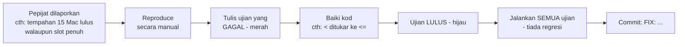

# 10 · Ujian PHPUnit dalam CodeIgniter 4

> Nota topikal (rujukan merentas hari) · Kanun: [`SPEC-KURSUS.md`](../SPEC-KURSUS.md) · Indeks: [`README.md`](./README.md)

## Objektif nota

- **Membezakan** ujian unit dan ujian ciri (feature) serta memilih jenis yang sesuai untuk setiap peraturan perniagaan (BR-*).
- **Mengkonfigur** pangkalan data ujian MySQL yang berasingan dan **menerangkan** kenapa SQLite tidak sesuai untuk BR-TLK-05.
- **Menulis** ujian menggunakan `DatabaseTestTrait`, `FeatureTestTrait` dan `actingAs()` (Shield) untuk pertindihan tempahan, peralihan status dan kawalan akses.
- **Mengamalkan** kitaran *reproduce → ujian gagal → baiki → ujian lulus* apabila membetulkan pepijat.

---

## 1. Kenapa menulis ujian?

Ujian manual (klik-klik dalam pelayar) mudah terlepas kes sempadan dan perlu diulang setiap kali kod berubah. Ujian automatik:

- **Membuktikan** peraturan perniagaan (BR-TLK-01 tiada pertindihan, BR-PAS-04 pemilikan) masih betul selepas refactor.
- **Menjadi dokumentasi hidup** — nama ujian menerangkan kelakuan yang dijangka.
- Menjadi syarat **Definition of Done**: "Ujian PHPUnit berkaitan lulus (`vendor/bin/phpunit`)" ([`KOLABORASI.md`](../KOLABORASI.md) §2).

---

## 2. Unit vs Feature — bila guna yang mana?

| | Ujian **unit** | Ujian **feature** (ciri) |
|---|---|---|
| Menguji | Satu kelas/method secara terasing | Seluruh aliran HTTP: route → filter → controller → view/redirect |
| DB | Biasanya tiada | Ya (`DatabaseTestTrait`) |
| Kelajuan | Sangat pantas (ms) | Lebih perlahan |
| Contoh kursus | `PassStatus::canTransitionTo()`, kiraan tempoh 90 hari | Pemohon tidak boleh buka `/pas/semakan`; POST tempahan bertindih ditolak |
| Kelas asas | `CIUnitTestCase` | `CIUnitTestCase` + `FeatureTestTrait` + `DatabaseTestTrait` |

**Peraturan ibu jari:** logik tulen (enum, pengiraan tarikh) → unit. Apa-apa yang melibatkan filter, sesi, peranan atau DB → feature/DB test.

Struktur folder yang disyorkan:

```text
tests/
├── unit/
│   └── Enums/PassStatusTest.php
├── database/
│   └── Services/SlotAvailabilityServiceTest.php
└── feature/
    ├── Pas/ReviewAccessTest.php
    └── Pas/ApplicationOwnershipTest.php
```

---

## 3. Pangkalan data ujian — jangan guna DB pembangunan!

`DatabaseTestTrait` dengan `$refresh = true` akan **membuang dan mencipta semula semua jadual** sebelum ujian. Jika disambung ke DB pembangunan, data latihan anda **hilang**. Maka guna DB berasingan `kkm_latihan_test`.

### Kenapa bukan SQLite (lalai appstarter)?

`app/Config/Database.php` dalam appstarter menetapkan kumpulan `tests` kepada **SQLite3 `:memory:`**. Masalahnya:
- SQLite **tidak menyokong `SELECT … FOR UPDATE`** — kod BR-TLK-05 akan ralat atau berkelakuan lain.
- Fungsi MySQL seperti `DATEDIFF`, `DATE_FORMAT` (dalam laporan/statistik) tiada dalam SQLite.

Ujian mesti berjalan pada enjin yang **sama** dengan pengeluaran.

```sql
-- Sekali sahaja (MySQL):
CREATE DATABASE kkm_latihan_test CHARACTER SET utf8mb4 COLLATE utf8mb4_unicode_ci;
```

```ini
# .env  (JANGAN commit)
database.tests.hostname = localhost
database.tests.database = kkm_latihan_test
database.tests.username = root
database.tests.password =
database.tests.DBDriver = MySQLi
database.tests.DBPrefix =
database.tests.port = 3306
```

> **`DBPrefix` kosong:** appstarter menetapkan prefix `db_` untuk kumpulan `tests`. Query Builder menambah prefix secara automatik, tetapi SQL mentah (cth `SELECT id FROM parking_slots … FOR UPDATE`) tidak — kosongkan prefix supaya konsisten dengan pembangunan.

Alternatif: tetapkan dalam `phpunit.xml.dist` (disalin ke `phpunit.xml` jika mahu ubah setempat):

```xml
<php>
    <env name="CI_ENVIRONMENT" value="testing"/>
    <env name="database.tests.hostname" value="localhost"/>
    <env name="database.tests.database" value="kkm_latihan_test"/>
    <env name="database.tests.username" value="root"/>
    <env name="database.tests.password" value=""/>
    <env name="database.tests.DBDriver" value="MySQLi"/>
    <env name="database.tests.DBPrefix" value=""/>
</php>
```

---

## 4. `DatabaseTestTrait` — sifat penting

```php
use CodeIgniter\Test\CIUnitTestCase;
use CodeIgniter\Test\DatabaseTestTrait;

abstract class KkmDatabaseTestCase extends CIUnitTestCase
{
    use DatabaseTestTrait;

    protected $migrate   = true;   // jalankan migration sebelum ujian
    protected $refresh   = true;   // buang & cipta semula jadual (keadaan bersih)
    protected $namespace = null;   // null = SEMUA namespace → migration Shield (users, auth_*) turut dijalankan
    protected $seed      = 'App\Database\Seeds\DatabaseSeeder'; // data sintetik asas (zon, slot, pengguna)
}
```

**Kenapa `$namespace = null`?** Lalainya hanya migration `App`. Jadual `users`, `auth_identities`, `auth_groups_users` datang dari namespace `CodeIgniter\Shield` — tanpanya `actingAs()` gagal kerana jadual pengguna tiada.

Penegasan DB yang tersedia:

```php
$this->seeInDatabase('slot_bookings', ['ref_no' => 'TLK-2026-0001', 'status' => 'pending']);
$this->dontSeeInDatabase('slot_bookings', ['slot_id' => 1, 'status' => 'approved']);
$this->seeNumRecords(1, 'status_logs', ['module' => 'PAS', 'record_id' => 5]);
```

---

## 5. Ujian unit — `PassStatus::canTransitionTo()` (BR-PAS-01)

Logik tulen, tiada DB. Guna *data provider* (atribut PHPUnit 10+) supaya satu ujian meliputi semua peralihan.

```php
<?php
// tests/unit/Enums/PassStatusTest.php
namespace Tests\Unit\Enums;

use App\Enums\PassStatus;
use CodeIgniter\Test\CIUnitTestCase;
use PHPUnit\Framework\Attributes\DataProvider;

final class PassStatusTest extends CIUnitTestCase
{
    /** Setiap baris: [dari, ke, dijangka] — terus dari jadual SPEC §2.2 */
    public static function transitions(): array
    {
        return [
            'dihantar → dalam semakan'   => [PassStatus::Submitted,   PassStatus::UnderReview, true],
            'dalam semakan → diluluskan' => [PassStatus::UnderReview, PassStatus::Approved,    true],
            'dalam semakan → ditolak'    => [PassStatus::UnderReview, PassStatus::Rejected,    true],
            'diluluskan → tamat tempoh'  => [PassStatus::Approved,    PassStatus::Expired,     true],
            // Laluan terlarang — sama penting untuk diuji!
            'dihantar → diluluskan (langkau semakan)' => [PassStatus::Submitted, PassStatus::Approved,    false],
            'ditolak → diluluskan'                    => [PassStatus::Rejected,  PassStatus::Approved,    false],
            'diluluskan → dalam semakan'              => [PassStatus::Approved,  PassStatus::UnderReview, false],
        ];
    }

    #[DataProvider('transitions')]
    public function testCanTransitionTo(PassStatus $from, PassStatus $to, bool $expected): void
    {
        $this->assertSame($expected, $from->canTransitionTo($to));
    }
}
```

> Nama kunci array (`'dihantar → diluluskan …'`) dipaparkan apabila ujian gagal — mudah dikenal pasti.

---

## 6. Ujian DB — pertindihan tarikh (BR-TLK-01)

Syarat bertindih: `start_date <= :end AND end_date >= :start`. Uji **kes sempadan**: hari yang sama, bersebelahan, merangkumi, dan status yang tidak dikira (`rejected`).

```php
<?php
// tests/database/Services/SlotAvailabilityServiceTest.php
namespace Tests\Database\Services;

use App\Services\SlotAvailabilityService;
use CodeIgniter\Test\CIUnitTestCase;
use CodeIgniter\Test\DatabaseTestTrait;

final class SlotAvailabilityServiceTest extends CIUnitTestCase
{
    use DatabaseTestTrait;

    protected $migrate   = true;
    protected $refresh   = true;
    protected $namespace = null;
    protected $seed      = 'App\Database\Seeds\DatabaseSeeder';

    private SlotAvailabilityService $service;

    protected function setUp(): void
    {
        parent::setUp();
        $this->service = new SlotAvailabilityService($this->db); // sambungan DB ujian disuntik

        // Tempahan sedia ada: slot 1, 10–15 Mac 2026, diluluskan
        $this->db->table('slot_bookings')->insert([
            'ref_no' => 'TLK-2026-0901', 'user_id' => 1, 'vehicle_id' => 1, 'slot_id' => 1,
            'start_date' => '2026-03-10', 'end_date' => '2026-03-15',
            'reason' => 'Data ujian sintetik', 'status' => 'approved',
        ]);
    }

    public function testOverlapInsideRangeIsNotAvailable(): void
    {
        $this->assertTrue($this->service->hasOverlap(1, '2026-03-12', '2026-03-13'));
    }

    public function testSameLastDayCountsAsOverlap(): void
    {
        // 15 Mac = hari terakhir tempahan sedia ada → bertindih (<=, >= inklusif)
        $this->assertTrue($this->service->hasOverlap(1, '2026-03-15', '2026-03-20'));
    }

    public function testAdjacentRangeIsAvailable(): void
    {
        $this->assertFalse($this->service->hasOverlap(1, '2026-03-16', '2026-03-20'));
    }

    public function testRejectedBookingDoesNotBlock(): void
    {
        $this->db->table('slot_bookings')->where('ref_no', 'TLK-2026-0901')->update(['status' => 'rejected']);
        $this->assertFalse($this->service->hasOverlap(1, '2026-03-12', '2026-03-13'));
    }
}
```

> `hasOverlap(int $slotId, string $start, string $end, ?int $excludeBookingId = null): bool` ialah method yang sama seperti dalam [nota 02](./02-migration-seeder-dan-query-builder.md) dan [nota 05](./05-service-layer-dan-transaksi.md) — `true` bermaksud **bertindih** (slot tidak tersedia).

---

## 7. Ujian feature dengan Shield — `actingAs()`

### 7.1 Pembantu cipta pengguna ujian

```php
<?php
// tests/_support/CreatesUsers.php
namespace Tests\Support;

use CodeIgniter\Shield\Entities\User;

trait CreatesUsers
{
    protected function createUser(string $group, string $email): User
    {
        $users = auth()->getProvider();            // UserModel yang dikonfigur Shield

        $user = new User([
            'username' => strstr($email, '@', true),
            'email'    => $email,                  // sintetik: @latihan.test
            'password' => 'Latihan@2026',
        ]);
        $users->save($user);

        $user = $users->findById($users->getInsertID()); // dapatkan semula dengan id
        $user->addGroup($group);                          // applicant / reviewer / approver / admin

        return $user;
    }
}
```

### 7.2 CSRF dalam ujian feature — PENTING

`FeatureTestTrait` **tidak** memintas filter CSRF (disahkan dari kod sumber CI4). Permintaan `post()` tanpa token akan membaling `SecurityException`. Untuk ujian logik POST, nyahaktifkan CSRF **dalam ujian sahaja**, dan kekalkan **satu** ujian khusus yang membuktikan CSRF masih berfungsi.

```php
protected function disableCsrfForThisTest(): void
{
    $filters = config('Filters');   // instance kongsi — FeatureTestTrait membina Filters baharu daripadanya
    $before  = $filters->globals['before'];

    unset($before['csrf']);                                   // bentuk 'csrf' => ['except' => …]
    $before = array_filter($before, static fn ($v) => $v !== 'csrf'); // bentuk nilai 'csrf'

    $filters->globals['before'] = $before;
}
```

### 7.3 Ujian akses — pemohon tidak boleh buka `/pas/semakan`

```php
<?php
// tests/feature/Pas/ReviewAccessTest.php
namespace Tests\Feature\Pas;

use CodeIgniter\Security\Exceptions\SecurityException;
use CodeIgniter\Shield\Test\AuthenticationTesting;
use CodeIgniter\Test\CIUnitTestCase;
use CodeIgniter\Test\DatabaseTestTrait;
use CodeIgniter\Test\FeatureTestTrait;
use Tests\Support\CreatesUsers;

final class ReviewAccessTest extends CIUnitTestCase
{
    use DatabaseTestTrait;
    use FeatureTestTrait;
    use AuthenticationTesting;   // menyediakan actingAs()
    use CreatesUsers;

    protected $migrate   = true;
    protected $refresh   = true;
    protected $namespace = null;

    public function testGuestIsRedirectedToLogin(): void
    {
        $this->get('/pas/semakan')->assertRedirectTo('/login');
    }

    public function testApplicantIsDenied(): void
    {
        $applicant = $this->createUser('applicant', 'pemohon1@latihan.test');

        $result = $this->actingAs($applicant)->get('/pas/semakan');

        // Filter group: Shield menolak dengan redirect (bukan 200)
        $result->assertRedirect();
        $result->assertDontSee('Senarai Semakan');
    }

    public function testReviewerCanOpen(): void
    {
        $reviewer = $this->createUser('reviewer', 'penyemak@latihan.test');

        $this->actingAs($reviewer)->get('/pas/semakan')->assertOK();
    }

    public function testPostWithoutCsrfTokenIsRejected(): void
    {
        // CSRF TIDAK dinyahaktif di sini — bukti perlindungan masih hidup
        $reviewer = $this->createUser('reviewer', 'penyemak@latihan.test');

        $this->expectException(SecurityException::class);
        $this->actingAs($reviewer)->post('/pas/semakan/1/review', ['remarks' => 'Semakan ujian']);
    }
}
```

> Dalam persekitaran `testing`/`development`, `Config\Security::$redirect` palsu, jadi token tidak sah → exception. Di `production` ia menjadi redirect dengan mesej ralat.

### 7.4 Pemilikan (BR-PAS-04) — pemohon A tidak boleh lihat permohonan pemohon B

Filter `session` hanya memastikan pengguna log masuk; **semakan pemilikan** dalam controller/service yang menghalang. Controller dijangka membaling `PageNotFoundException` (404) — kita tidak mahu mendedahkan bahawa rekod itu wujud.

```php
public function testApplicantCannotViewOthersApplication(): void
{
    $owner    = $this->createUser('applicant', 'pemohon1@latihan.test');
    $intruder = $this->createUser('applicant', 'pemohon2@latihan.test');

    $this->db->table('pass_applications')->insert([
        'ref_no' => 'PAS-2026-0001', 'user_id' => $owner->id, 'pass_type' => 'kakitangan',
        'purpose' => 'Akses bangunan (sintetik)', 'valid_from' => '2026-04-01',
        'valid_until' => '2026-06-30', 'status' => 'submitted',
    ]);
    $id = $this->db->insertID();

    $this->expectException(\CodeIgniter\Exceptions\PageNotFoundException::class);
    $this->actingAs($intruder)->get("/pas/permohonan/{$id}");
}
```

> **Kenapa `expectException` dan bukan `assertStatus(404)`?** Tanpa `set404Override()` dalam `Routes.php`, CI4 membaling semula `PageNotFoundException` dari `run()` — jadi ujian menangkap exception. Jika projek anda menetapkan 404 override, tukar kepada `->assertStatus(404)`. Laluan POST dalam contoh (`/pas/semakan/1/review`) juga contoh — padankan dengan `Routes.php` anda.

Kaedah TestResponse yang kerap digunakan: `assertStatus(403)`, `assertOK()`, `assertRedirect()`, `assertRedirectTo('/path')`, `assertSee('teks')`, `assertDontSee('teks')`, `assertSessionHas('message')`, `assertJSONFragment([...])`.

---

## 8. Menjalankan ujian

```bash
composer test                                       # semua ujian
composer test -- --testdox                          # output mudah dibaca (nama ujian sebagai ayat)
composer test -- --filter PassStatusTest            # satu kelas
composer test -- --filter testApplicantIsDenied     # satu method
composer test -- tests/feature                      # satu folder
```

`composer test` menjalankan skrip `"test": "phpunit"` dalam `composer.json` (appstarter sudah menyediakannya). Ia sama dengan `vendor/bin/phpunit`, tetapi berfungsi tanpa ubah suai di Git Bash, PowerShell, macOS dan Linux. Argumen PHPUnit mesti diletak selepas `--`; tanpa `--`, Composer tidak menghantar `--filter` kepada PHPUnit dan **seluruh** suite dijalankan. Composer juga menghentikan skrip selepas 300 saat secara lalai — `composer config process-timeout 0` (Lab 4.2 langkah 1) membuang had itu.

---

## 9. Kitaran membaiki pepijat: reproduce → gagal → baiki → lulus



**Kenapa tulis ujian dahulu sebelum baiki?** Ujian yang gagal membuktikan anda benar-benar menangkap pepijat itu. Jika ujian terus lulus sebelum dibaiki, ujian itu tidak menguji perkara yang betul.

---

## ⚠️ Kesilapan lazim

| Kesilapan | Akibat | Betulkan |
|-----------|--------|----------|
| Kumpulan `tests` menunjuk ke DB pembangunan | Semua data latihan dipadam oleh `$refresh` | DB berasingan `kkm_latihan_test` |
| Kekal SQLite `:memory:` | `FOR UPDATE`/`DATEDIFF` ralat; ujian tidak mencerminkan MySQL | `database.tests.DBDriver = MySQLi` |
| Lupa `$namespace = null` | Jadual Shield tiada → `actingAs()` / `addGroup()` ralat | Tetapkan `$namespace = null` |
| POST dalam ujian gagal dengan `SecurityException` | Keliru — sangka controller rosak | Nyahaktif CSRF dalam ujian logik; kekalkan satu ujian CSRF |
| Hanya uji laluan "gembira" | Pepijat akses (pemohon buka `/pas/semakan`) terlepas | Setiap ciri: satu ujian positif + satu negatif |
| Ujian bergantung pada susunan/data ujian lain | Lulus seorang diri, gagal bila dijalan bersama | `$refresh = true`, cipta data dalam setiap ujian |
| Tarikh ditaip relatif kepada "hari ini" tanpa kawalan | Ujian gagal bulan depan | Guna tarikh tetap; jika kod guna `Time::now()`, tetapkan `Time::setTestNow('2026-03-01')` |
| Guna data sebenar/emel sebenar | Pelanggaran data | `@latihan.test`, plat rekaan sahaja |

---

## Rujukan rasmi

- CodeIgniter 4 — Testing overview: <https://codeigniter.com/user_guide/testing/overview.html>
- CodeIgniter 4 — Database testing: <https://codeigniter.com/user_guide/testing/database.html>
- CodeIgniter 4 — HTTP Feature Testing: <https://codeigniter.com/user_guide/testing/feature.html>
- CodeIgniter 4 — Testing Responses (assertions): <https://codeigniter.com/user_guide/testing/response.html>
- CodeIgniter Shield — Testing: <https://shield.codeigniter.com/latest/references/testing/>
- PHPUnit — Data providers: <https://docs.phpunit.de/en/10.5/writing-tests-for-phpunit.html#data-providers>

## Bacaan buku — *CodeIgniter 4 Foundations*

Lonnie Ezell, [Leanpub](https://leanpub.com/codeigniter4foundations), edisi 2021 (CodeIgniter 4.1). `hlm.` = nombor halaman yang tercetak di kaki halaman buku.

- Persediaan ujian — hlm. 51–52
- Ujian unit model — hlm. 52–56
- Ujian controller — hlm. 56–66
- Ujian endpoint API — hlm. 82–93

Buku guna `CIDatabaseTestCase` (hlm. 53), yang kini *deprecated*; guna `CIUnitTestCase` + `DatabaseTestTrait` seperti nota ini.

---
**Digunakan pada Hari 6** (S3 — ujian pertindihan & peralihan status TLK), **Hari 8** (S3 — ujian akses positif/negatif & pemilikan Pas) dan **Hari 10** (S3 — ujian akhir sistem & kitaran pembetulan pepijat). Nota berkaitan: [05 · Service Layer & Transaksi](./05-service-layer-dan-transaksi.md) · [06 · Shield Auth & RBAC](./06-shield-auth-dan-rbac.md) · [03 · Model, Entity & Enum](./03-model-entity-dan-enum.md)
